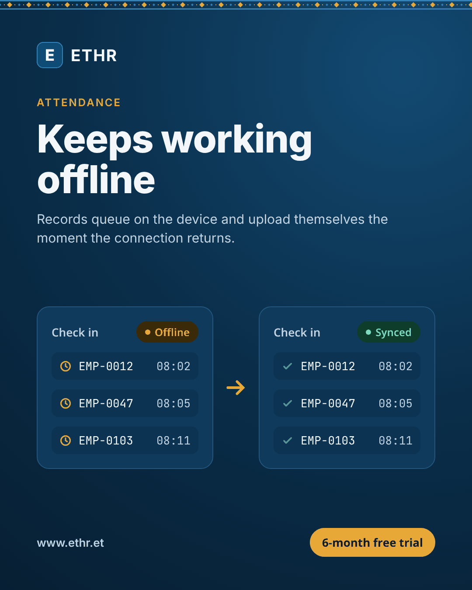
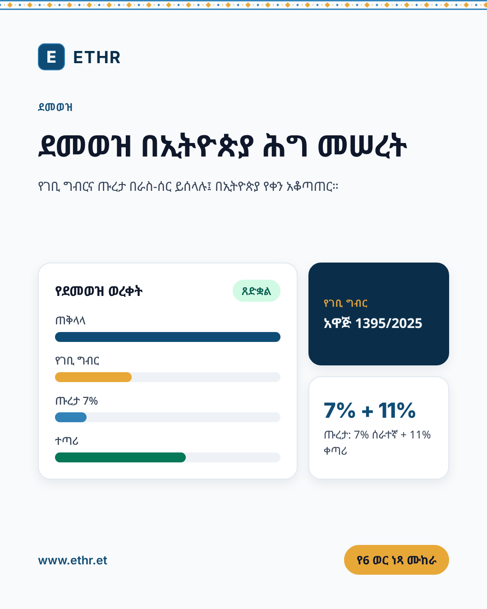
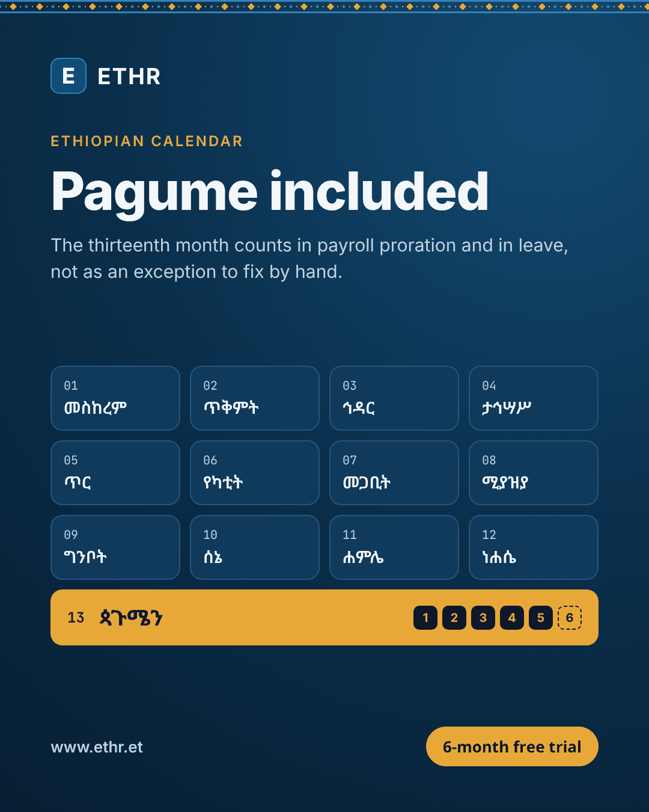
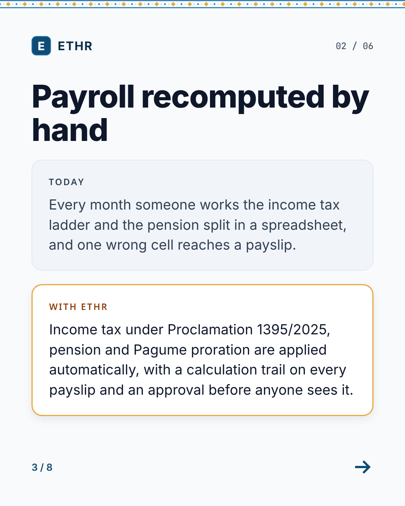

# Social media kit

Everything needed to run ETHR's social channels: profile images and bios, 72 ready-to-post images in English and Amharic (ten of them built on real ETHR screens), captions for each platform, a four-week launch calendar and short video scripts. It sits beside the [sales deck](../marketing-deck/README.md) and makes the same claims, from the same sources.

| File | What it is |
|---|---|
| [`brand.md`](brand.md) | How ETHR looks and sounds on social: colours, type, the tibeb band, voice, the claims it may and may not make |
| [`profiles.md`](profiles.md) | Handles, bios and links for LinkedIn, Facebook, Telegram, Instagram, TikTok, X and YouTube, in both languages |
| [`copy-bank.md`](copy-bank.md) | A caption per platform for each of the eight pillars, the carousel and the stories |
| [`calendar.md`](calendar.md) | A four-week launch plan, the monthly rhythm after it, and the dates in the Ethiopian year worth planning around |
| [`video-scripts.md`](video-scripts.md) | Six short scripts for Reels, TikTok and YouTube Shorts, recorded from the demo organisation |
| [`assets/`](assets/) | The rendered images (below) |
| [`source/`](source/) | The copy (`content.mjs`), the renderer (`render.mjs`) and the claims check (`check.mjs`) |

## The images

Every image exists in English (`-en`) and Amharic (`-am`). The Amharic is the product's own: each line is copied from `src/src/lib/i18n/locales/am.json` or the landing page snapshot, never translated afresh.

| Folder | Size | Use it for | Count |
|---|---|---|---|
| [`assets/posts/`](assets/posts/) | 1080 × 1350 (4:5) | Feed posts on Instagram, Facebook and LinkedIn | 16 |
| [`assets/carousel-en/`](assets/carousel-en/), [`assets/carousel-am/`](assets/carousel-am/) | 1080 × 1350 | One eight-slide carousel: the six problems an HR office has today, each beside what ETHR does | 16 |
| [`assets/stories/`](assets/stories/) | 1080 × 1920 (9:16) | Instagram and Facebook Stories, WhatsApp and Telegram Status, Reels covers | 8 |
| [`assets/links/`](assets/links/) | 1200 × 675 (16:9) | Link posts on X and LinkedIn, Telegram channel posts | 16 |
| [`assets/profile/`](assets/profile/) | Per platform | Avatars (dark and light, 800 × 800) and banners for LinkedIn, Facebook, X and YouTube | 6 |
| [`assets/screens/`](assets/screens/) | 1080 × 1350 | Feed posts built on real screens from the demo organisation: phone check-in, payslips, leave, the same phone in English and Amharic, and the employee list in both languages | 10 |
| [`assets/screenshots/`](assets/screenshots/) | 1440 × 900 or 390 × 844, at 2x and 3x | The raw screens those posts are built from, for anyone making their own | 10 |

The eight pillars, each one post, one link card and (for four of them) one story:

| Pillar | Says | Links to |
|---|---|---|
| `offline` | Keeps working offline: check-ins queue on the device and upload when the connection returns | `/attendance-system` |
| `payroll` | Income tax under Proclamation 1395/2025, pension 7% + 11%, a calculation trail on every payslip | `/payroll-software` |
| `calendar` | The 13-month Ethiopian calendar, Pagume counted in payroll and leave | `/ethiopian-calendar-hr` |
| `language` | Every screen, payslip and notification in Amharic and English | `/ethiopian-calendar-hr` |
| `trust` | Data stored on servers in Ethiopia (Proclamation 1321/2024, Art. 22), AES-256 at rest, tenant isolation, audit trail | `/faq` |
| `leave` | Request from a phone, decide from one approvals inbox | `/leave-management` |
| `kiosk` | Phone, QR code, kiosk and web; the kiosk serves staff without a smartphone | `/attendance-system` |
| `trial` | 6-month free trial, no credit card | `/` |

<p>




</p>

## Rules for changing it

- **Say only what the product does today.** Every sentence in this kit is checked against the list the marketing console refuses (`api/app/Support/MarketingClaims.php`). [`brand.md`](brand.md) explains each category. Run the check after any edit:

  ```bash
  node docs/operations/social-kit/source/check.mjs
  ```

  It reads the patterns from the PHP file itself, so the two cannot drift, and it also fails on an em dash, an exclamation mark or an emoji, which the house style rules out.
- **No figures about the business.** No customer counts, employee counts, service-level figures or time-to-set-up claims, and no testimonial until a real customer agrees to be quoted by name. The landing page was stripped of all of these in October 2026 ([`LANDING_PAGE_PRODUCTION_PLAN.md`](../../LANDING_PAGE_PRODUCTION_PLAN.md) F3).
- **Check prices before quoting them.** Prices are edited at `/admin/plans` and can change without this kit changing, so the images name none, and captions send people to `www.ethr.et/en/pricing`.
- **Never show a real organisation.** Screenshots and recordings come from the demo organisation (`DemoTenantSeeder`), never from a customer's.
- **Amharic comes from the product's dictionary.** A new Amharic sentence needs a native speaker's review before it is posted.

## Rebuilding the images

Copy lives in [`source/content.mjs`](source/content.mjs); layout in [`source/render.mjs`](source/render.mjs). After changing either:

```bash
cd docs/operations/social-kit/source
node check.mjs          # the claims and style check
node render.mjs         # all 72 images; `node render.mjs posts` for a subset
node render.mjs --html  # also keeps each image's HTML beside it, for a designer
```

### Recapturing the real screens

The screen posts are built on screenshots of a local install, never of a real organisation. To recapture them after the product changes:

1. Set up a local install from [`LOCAL_SETUP.md`](../../LOCAL_SETUP.md) and seed it with `DemoTenantSeeder`.
2. Run `php docs/operations/social-kit/source/screens/ethiopian-names.php`. The seeder names its staff with US-style Faker names; this gives them Ethiopian given and father's names, in English and Amharic, and matching addresses. It changes only the `demo` organisation in whatever database `api/.env` points at.
3. Start the API on `:8000` and `npm run dev` on `:3000`, then run `node source/screens/capture.mjs`. It signs in as the demo admin and employee and photographs each screen in both languages, with the phone placed in Addis Ababa so check-in is live.
4. Look at every screenshot before rendering. The script blurs every money amount automatically (a demo salary on a public post reads as someone's real pay) and hides the development server's badge; the rest is judgement. Screens left out, and why, are listed in `capture.mjs`.

The renderer needs Playwright's Chromium, `curl` and, for the final size reduction, Python with Pillow. The first run downloads Inter, JetBrains Mono and Noto Sans Ethiopic (all SIL Open Font Licence) into `source/.fonts`, which is not committed. It refuses to write an image whose fonts did not load or whose content runs off the canvas, so Amharic can never ship as empty boxes.
