# ይህ መመሪያ ለማን ነው

ይህ መመሪያ ድርጅቱን በETHR ላይ ለሚያስተዳድሩ ነው፦ ለ**የድርጅት አስተዳዳሪ** እና ለ**የሰው ሃብት አስተዳዳሪ**። ስለ ሠራተኛ እና ስለ ኃላፊ ሥራዎች (መግባት፣ መገኘት፣ ፈቃድ፣ ማጽደቅ) **የሠራተኛ መመሪያ** እና **የኃላፊ መመሪያ** ይመልከቱ።

## ሚናዎች

እያንዳንዱ ተጠቃሚ አንድ ሚና አለው። ሚናው በምናሌው ውስጥ የሚታየውን እና ሊሠራ የሚችለውን ይወስናል።

| ሚና | የሚችለው |
|---|---|
| **የድርጅት አስተዳዳሪ** | ሁሉንም። ደመወዝን ማጽደቅ፣ መሰረዝ እና እንደገና ማስኬድ፣ የደመወዝ ደንቦችን፣ የድርጅት ቅንብሮችን፣ ሚናዎችን፣ የAPI ቁልፎችን እና መሣሪያዎችን መቀየር የሚችለው ይህ ሚና ብቻ ነው |
| **የሰው ሃብት አስተዳዳሪ** | የሰው ሀብት ጎኑን፦ ሠራተኞችን ማስገባት እና ማዘመን፣ የባንክ እና የደመወዝ መረጃ፣ የድርጅት አወቃቀር፣ ፈረቃዎች፣ በዓላት፣ የሁሉም መገኘት እና ፈቃድ፣ ማጽደቅ፣ ሪፖርቶች እና ማስታወቂያዎች። ደመወዝ አያስኬድም |
| **የፋይናንስ አስተዳዳሪ** | የደመወዝ ጎኑን፦ ደመወዝ ማስኬድ፣ ብድሮች፣ የወጪ መጋራት፣ ሪፖርቶች። የሠራተኛ መረጃን ማንበብ ይችላል፤ ሠራተኛ ወይም የባንክ መረጃ መቀየር አይችልም |
| **የክፍል አስተዳዳሪ** | እንደ ተቆጣጣሪ፣ ለራሱ ክፍል ሰዎች ሁሉ |
| **ተቆጣጣሪ** | ቀጥታ ሪፖርት የሚያደርጉለትን፦ ማጽደቅ፣ የቡድን መገኘት እና ፈቃድ |
| **ሠራተኛ** | የራሱን መገኘት፣ ፈቃድ፣ የደመወዝ ወረቀት እና መገለጫ |

> [!why] የሥራ ክፍፍል
> ደመወዝ የሚያስኬደው (የፋይናንስ አስተዳዳሪ) ገንዘቡ የሚገባበትን የባንክ ሒሳብ መቀየር አይችልም (የሰው ሃብት አስተዳዳሪ ይቀይራል)። ደመወዝን የሚያጸድቀው ደግሞ የድርጅት አስተዳዳሪ ብቻ ነው። ሌላ ክፍፍል ከፈለጉ (ለምሳሌ ለአንድ ቅርንጫፍ ብቻ የሰው ሀብት ባለሙያ) በክፍል 9.3 እንዳለው ብጁ ሚና ይፍጠሩ።

# የመጀመሪያ ዝግጅት

ድርጅትዎን በ`ethr.et` ላይ ሲመዘግቡ መለያዎ **የድርጅት አስተዳዳሪ** ይሆናል፣ እና ETHR በቀጥታ ወደ ተመራው ዝግጅት ይወስድዎታል። ዝግጅቱ እስኪያልቅ ድረስ በጎን ምናሌው አናት ላይ **መጀመሪያ** የሚል የሂደት ሳጥን (ለምሳሌ «0/4») ይታያል፤ ይጫኑት እና ይመለሱ።

> [!note] ከመጀመሪያው ቀን ጀምሮ የሚሠራው
> አዲስ ድርጅት ከመጀመሪያው ምዝገባ ጀምሮ መገኘት መቀበል ይችላል። ETHR ለሥራ ዘርፍዎ መሠረታዊውን ያዘጋጃል፦ የመገኘት ቅንብሮች፣ ነባሪ ፈረቃ፣ የሥራ ሳምንት እና የዘንድሮ እና የሚቀጥለው ዓመት ይፋዊ በዓላት። የጎደለውን ብቻ ይፈጥራል፤ እርስዎ ያስቀመጡትን አይቀይርም።

ዝግጅቱ አራት ደረጃዎች አሉት፦

1. **ድርጅት።** የድርጅትዎን አይነት ይምረጡ (ለምሳሌ ሆስፒታል፣ ባንክ፣ ፋብሪካ፣ የክልል ቢሮ)። ETHR እንዲገመግሙት የሥራ ክፍሎችን፣ የሥራ መደቦችን፣ ደረጃዎችን፣ ፈረቃዎችን፣ የፈቃድ አይነቶችን እና በዓላትን ያቀርባል። እስኪተገብሩት ድረስ ምንም አይፈጠርም።
2. **ሠራተኞች።** ሰዎችዎን ያስገቡ፦ ከመገኘት መሣሪያ የተመዘገቡ ሰዎችን በማምጣት፣ ወይም ከኤክሴል የተቀዳ ዝርዝር በመለጠፍ። እያንዳንዱን ግጥሚያ ገምግመው ያረጋግጡ።
3. **መግቢያ።** ሠራተኞች እንዴት እንደሚገቡ ይምረጡ፦ በኢሜይል፣ በስልክ፣ በሠራተኛ ኮድ ወይም በተጠቃሚ ስም።
4. **አስጀምር።** የዝግጁነት ውጤት፣ የቀሩ ክፍተቶች እና እነሱን ለማስተካከል አገናኞች። ዝግጁ ሲሆኑ ያስጀምሩ።

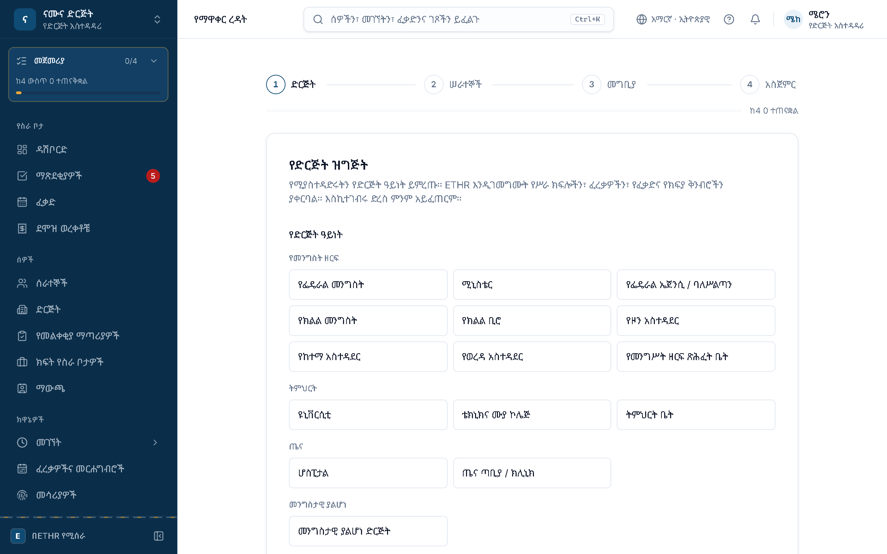

ደረጃዎችን ዘልለው በኋላ መመለስ ይችላሉ። በዝግጅቱ የተደረገው ሁሉ ከዚያ በኋላ በቅንብሮች ውስጥ ሊቀየር ይችላል።

# የድርጅት አወቃቀር

**ሰዎች → ድርጅት** የድርጅትዎን ቅርጽ ይይዛል።

1. **አወቃቀር** የክፍሎችን ዛፍ እና በእያንዳንዱ ያሉትን የሠራተኞች ብዛት ያሳያል።
2. **ቅርንጫፎች፦** ስም፣ አድራሻ እና በካርታ ላይ ያለ ቦታ (ክፍል 5.2)።
3. **ክፍሎች፦** በደረጃ ሊደራጁ (ዋና ክፍል እና ንዑስ ክፍል) እና ለቅርንጫፍ ሊመደቡ ይችላሉ።
4. **የስራ መደቦች፦** የሥራ መጠሪያዎች።
5. **ደረጃዎች፦** የደመወዝ ደረጃዎች፤ እያንዳንዱ ዝቅተኛ እና ከፍተኛ ደመወዝ ሊኖረው ይችላል።

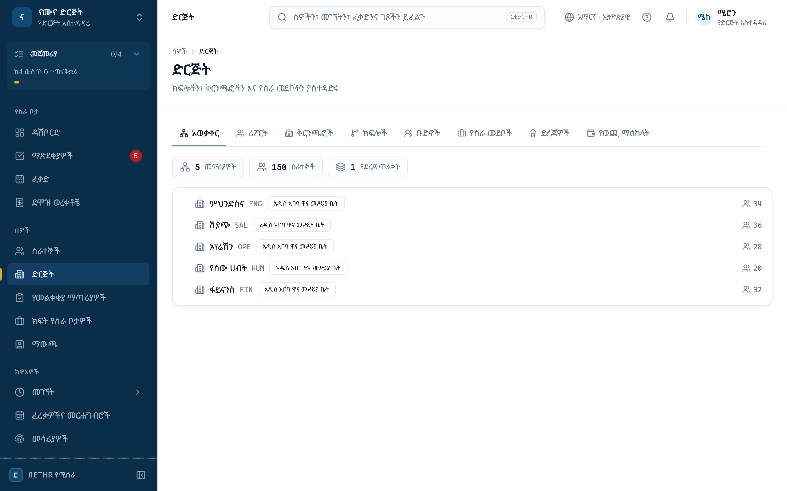

**ሪፖርት** ትር ማን ለማን ሪፖርት እንደሚያደርግ ያሳያል፤ **ቡድኖች** እና **የወጪ ማዕከላት** ትሮችም አሉ።

# ሠራተኞች

## የሠራተኞች ዝርዝር

**ሰዎች → ሰራተኞች** ሁሉንም ሠራተኞች ይዘረዝራል።

1. **ሰራተኛ ጨምር** አንድ ሠራተኛ ያስገባል (ክፍል 4.2)። ከጎኑ ያሉት ምልክቶች ፋይል ያስገባሉ፣ ዝርዝሩን ያወርዳሉ እና ከመሣሪያ ያመጣሉ።
2. ማጣሪያዎቹ በሁኔታ፣ በክፍል እና በቅርንጫፍ ይለያሉ፤ ከጎናቸው በስም፣ በኢሜይል ወይም በኮድ መፈለግ ይቻላል።
3. ረድፉን ይጫኑ፤ የሠራተኛው መዝገብ ይከፈታል (ክፍል 4.4)።

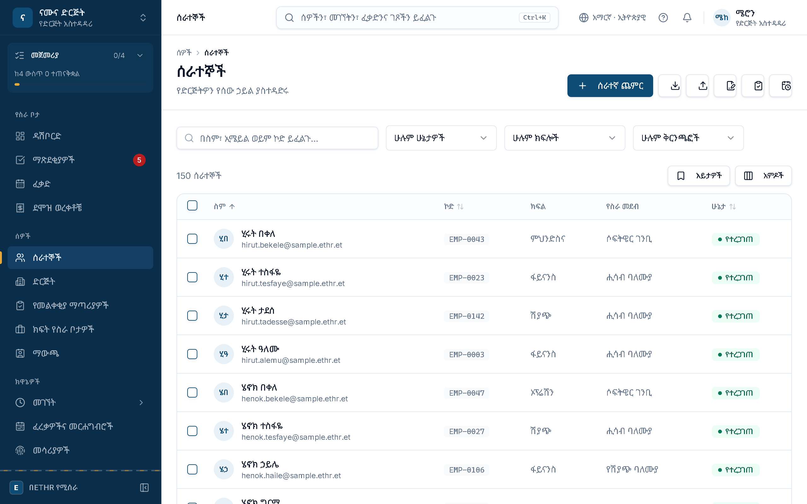

## አንድ ሠራተኛ ማስገባት

**ሰራተኛ ጨምር** ቅጹን በአራት ክፍሎች ይከፍታል። ግዴታ የሆኑት ስም እና የሥራ ክፍሉ መረጃ ብቻ ናቸው፤ ሌላውን በኋላ መሙላት ይችላሉ።

1. **ግለሰብ፦** ሙሉ ስም (በእንግሊዝኛ እና በአማርኛ)፣ ጾታ፣ የልደት ቀን በኢትዮጵያ ቀን መቁጠሪያ፣ የጋብቻ ሁኔታ እና ዜግነት።
2. **አድራሻና መግቢያ፦** ኢሜይል እና ስልክ። ኢሜይል ካለ ግብዣ ይላክለታል።
3. **ሥራ፦** የቅጥር ቀን፣ ክፍል፣ ቅርንጫፍ፣ የሥራ መደብ እና ኃላፊ። የሠራተኛ ኮዱ በራሱ ይሰጣል።
4. **ክፍያና መታወቂያ፦** ደመወዝ፣ TIN እና የባንክ መረጃ።

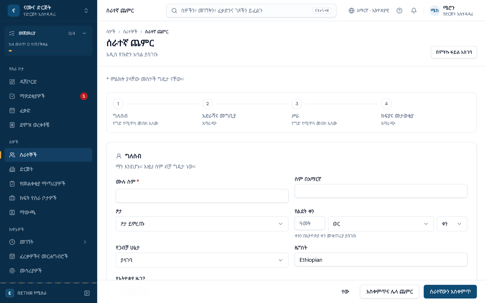

## ብዙ ሠራተኞችን በፋይል ማስገባት

1. የCSV ፋይልዎን ወደ ሳጥኑ ይጎትቱ ወይም **ፋይሎችን አስስ** ይጫኑ (ቢበዛ 5 ሜባ)።
2. መጀመሪያ **CSV አብነት አውርድ**፤ ሁሉንም አምዶች ይዟል። ግዴታ የሆኑት `name` እና `hire_date` ብቻ ናቸው።

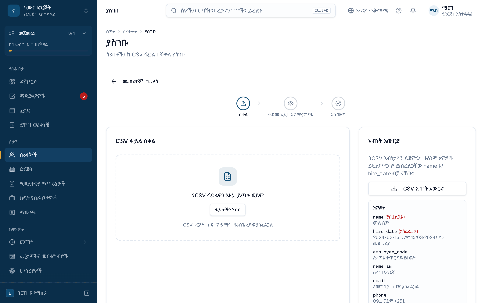

ከተሰቀለ በኋላ **ቅድመ እይታ እና ማረጋገጫ** ደረጃ እያንዳንዱን ረድፍ ያሳያል፤ ስሕተት ያለባቸው ረድፎች ምክንያታቸውን ይዘው ይታያሉ። ከዚያ **አስመጣ** ይጫኑ። ክፍል፣ ቅርንጫፍ እና የሥራ መደብ በETHR ውስጥ ባለው ስማቸው ወይም ኮዳቸው ይገባሉ።

> [!tip]
> ቀኖች `2024-03-15` ወይም `15/03/2024` (ቀን መጀመሪያ) ሊሆኑ ይችላሉ። ደመወዝ ወርሃዊ፣ በብር፣ ለምሳሌ `12,500.00`። ስልክ `09...` ወይም `+251...`።

## የሠራተኛ መዝገብ

1. **ወደ ETHR ጋብዝ** ለሠራተኛው የመግቢያ ግብዣ ይልካል። ኢሜይል ወይም ስልክ ለሌለው ሠራተኛ **በአካል አግብር** ይጠቀሙ፤ የአንድ ጊዜ ኮድ በእጁ ይሰጡታል።
2. **አርም** መረጃውን ያዘምናል።
3. **የሕይወት ዑደት** ትር የቅጥር ሁኔታን ይቀይራል (ክፍል 4.5)።
4. **ታሪክ** ትር የዝውውር፣ የዕድገት እና ሌሎች የሰው ሀብት እርምጃዎችን ታሪክ ይይዛል።

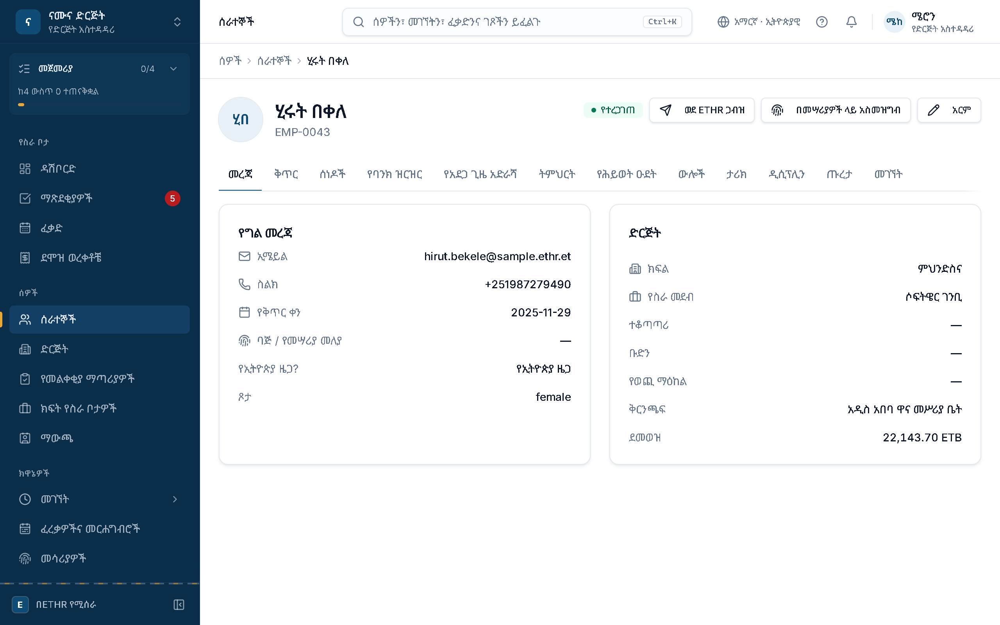

ሌሎቹ ትሮች፦ **ቅጥር**፣ **ሰነዶች**፣ **የባንክ ዝርዝር**፣ **የአደጋ ጊዜ አድራሻ**፣ **ትምህርት**፣ **ውሎች**፣ **ዲሲፕሊን**፣ **ጡረታ** እና **መገኘት**። **በመሣሪያዎች ላይ አስመዝግብ** ሠራተኛውን በጣት አሻራ መሣሪያዎች ላይ ያስመዘግባል።

## የቅጥር ሁኔታ

እያንዳንዱ የሁኔታ ለውጥ ይመዘገባል፦

| ከ | ወደ |
|---|---|
| ተቀጠረ | በሙከራ ላይ፣ ወይም በቀጥታ የተረጋገጠ |
| በሙከራ ላይ | የተረጋገጠ፣ ወይም የተሰናበተ |
| የተረጋገጠ | የታገደ፣ የለቀቀ፣ የተሰናበተ ወይም ጡረታ የወጣ |
| የታገደ | የተረጋገጠ፣ ወይም የተሰናበተ |

**የለቀቀ**፣ **የተሰናበተ** እና **ጡረታ የወጣ** የመጨረሻ ናቸው። ዝውውር እና ዕድገት ሁኔታ አይደሉም፤ በ**ታሪክ** ትር ውስጥ እንደ የሰው ሀብት እርምጃ ይመዘገባሉ። ሠራተኛ ሲለቅ የተመዘገበ ስልኩ ይሰረዛል፣ እና **የመልቀቂያ ማጣሪያ** ዝርዝር ይከፈታል።

## ሠራተኞች የሚጠይቋቸው ለውጦች

ሠራተኛ ስሙን፣ የትውልድ ቀኑን፣ TINን ወይም የባንክ መረጃውን ሲቀይር ለውጡ ወዲያውኑ አይገባም። ከፈቃድ እና ከማስተካከያ ጋር በ**ማጽደቂያዎች** ዝርዝር ውስጥ የሠራተኛ መዝገብ ማዘመን ለሚችሉ ሰዎች ይታያል።

# መገኘት

## የመገኘት ዝግጅት እና ዘዴዎች

**ቅንብሮች → የመገኘት ደንቦች** በ**የመገኘት ዝግጅት** ሳጥን ይጀምራል።

1. **የመገኘት ዝግጅት** ገና የሚያስፈልግዎትን ይዘረዝራል፣ ከከባዱ ጀምሮ፣ እያንዳንዱን ከማስተካከያ አገናኙ ጋር። ለምሳሌ «በካርታ ላይ ምንም ቅርንጫፍ ወይም ቦታ የለም»።
2. **የነቁ የመገኘት ዘዴዎች፦** ድርጅትዎ የሚጠቀምባቸውን ያብሩ። ያጠፉት ዘዴ ከሠራተኞች ምናሌ ይጠፋል፣ አገልጋዩም አይቀበለውም።
3. **ለውጦችን አስቀምጥ** ይጫኑ።

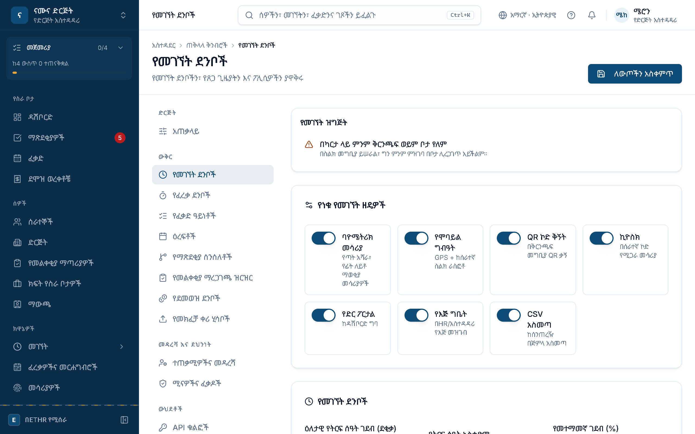

| ዘዴ | የሚስማማው |
|---|---|
| **ባዮሜትሪክ መሳሪያ** | ፋብሪካዎች፣ ባንኮች |
| **የሞባይል ግብዓት** (GPS እና የራስ ፎቶ) | የመስክ ሠራተኞች |
| **QR ኮድ ቅኝት** | የጋራ መግቢያዎች |
| **ኪዮስክ** | መቀበያ ዴስኮች |
| **የድር ፖርታል** | የቢሮ ሠራተኞች |
| **የእጅ ግቤት** | የሰው ሀብት የሚያስገባው |
| **CSV አስመጣ** | ከሰንጠረዥ በጅምላ |

## ቅርንጫፎች፣ የሥራ ቦታዎች እና ካርታው

እያንዳንዱ ቅርንጫፍ ቦታ እና ራዲየስ አለው። በ**ድርጅት → ቅርንጫፎች** ቅጽ ውስጥ በካርታው ላይ ያስቀምጡት፦ ምልክቱን ይጎትቱ፣ አድራሻ ይፈልጉ፣ እዚያ ቆመው **አሁን ያለሁበትን ቦታ ተጠቀም** ይጫኑ፣ ወይም የGoogle Maps አገናኝ ወይም `9.0108, 38.7613` የመሰለ ጥንድ ይለጥፉ።

**የሥራ ቦታዎች** ሰዎች ሊመዘገቡባቸው የሚችሉ ተጨማሪ ቦታዎች ናቸው፦ የፕሮጀክት ቦታ፣ የደንበኛ ግቢ፣ መጋዘን። ለሠራተኞች ወይም ለአንድ ክፍል ሙሉ ይመድቧቸው።

> [!note] ቦታው እንዴት እንደሚረጋገጥ
> የስልክ GPS ሁልጊዜ ትክክል ስለማይሆን፣ ስልኩ የሚገልጸው ትክክለኛነት (እስከ 50 ሜትር) ታሳቢ ይደረጋል። ቦታ እንዲረጋገጥ ሲያበሩ ከተፈቀዱት ቦታዎች ውጭ ያለ ምዝገባ ውድቅ ይደረጋል፤ ሲጠፋ ይመዘገባል እና ምልክት ይደረግበታል። ቦታ ያልተቀመጠለት ቅርንጫፍ ማንንም አይከለክልም።

በሠራተኛው መዝገብ ላይ ያለው **የሚመዘገቡበት ቦታ** ከሦስቱ አንዱ ነው፦ **በቅርንጫፋቸው** (ነባሪው፤ ቅርንጫፉ እና የተመደቡለት ቦታዎች)፣ **መስክ** (ከተመደቡባቸው ቦታዎች በማንኛውም፤ ከሌላ ቦታ የተደረገ ምዝገባ ለግምገማ ይላካል እንጂ አይከለከልም) ወይም **ከርቀት** (ከየትኛውም ቦታ፤ ቦታው ግን ይመዘገባል)።

## ፈረቃዎች

**ክዋኔዎች → ፈረቃዎችና መርሐግብሮች**፦

1. **አዲስ ፈረቃ** መጀመሪያ እና መጨረሻ ሰዓት፣ የእፎይታ ደቂቃ (ዘግይቷል ከመባሉ በፊት)፣ እረፍት እና የሥራ ቀናት ያለው ፈረቃ ይፈጥራል። መጨረሻው ከመጀመሪያው በፊት ከሆነ ፈረቃው ከእኩለ ሌሊት ያልፋል።
2. **ምደባዎች** ፈረቃን ለሠራተኞች፣ ለክፍሎች ወይም ለቅርንጫፎች ይመድባል።
3. **ዙር ፈረቃዎች** ለ24 ሰዓት ወይም ለሦስት ፈረቃ ሥራ የሚዞሩ መርሐ ግብሮችን ይፈጥራል።
4. **ነባሪ** የተባለው ፈረቃ ምደባ የሌለውን ሰው ሁሉ ይመለከታል።

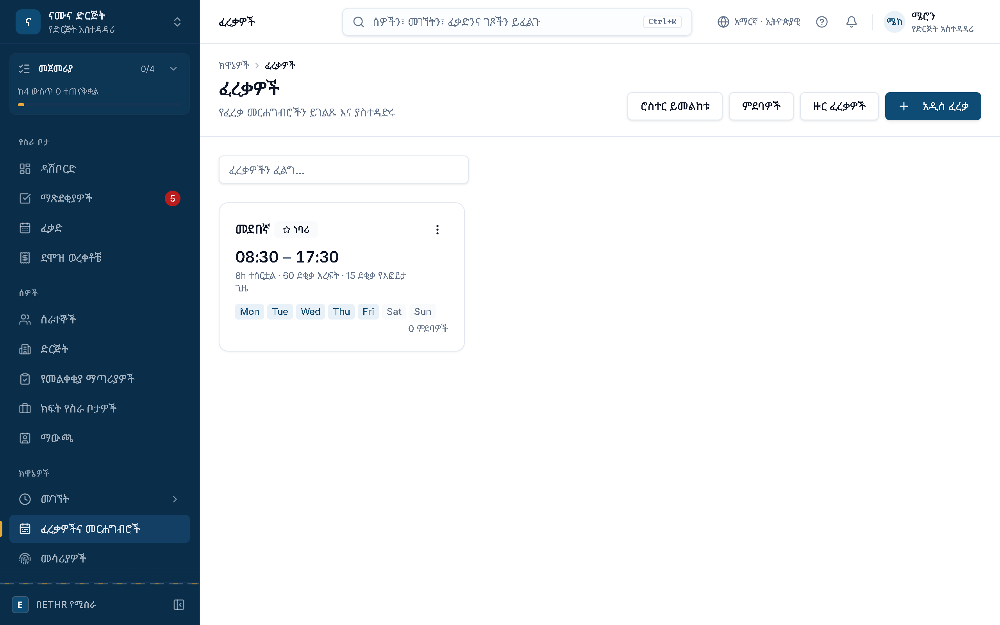

ሁልጊዜ አንድ ንቁ ነባሪ ፈረቃ አለ። ሌላ ፈረቃ ቦታውን እስኪወስድ ድረስ ሊሰረዝ ወይም ሊጠፋ አይችልም። **ሮስተር ይመልከቱ** የሳምንቱን የሥራ ሰሌዳ ያሳያል።

## የተመዘገቡ ስልኮች

**ቅንብሮች → የመገኘት ደንቦች → ማጭበርበርን መከላከል** ውስጥ ያለው **የተመዘገበ ስልክ** አንድ ሰው በሌላው ስም ከሌላ ስልክ እንዳይመዘገብ ይከላከላል። እያንዳንዱ ሰው በአንድ ስልክ ይመዘገባል፤ ስልኩ ሊገለበጥ የማይችል የይለፍ ቁልፍ (passkey) ይይዛል።

| ቅንብር | ከተመዘገበው ስልክ ውጭ የሚመጣ ምዝገባ |
|---|---|
| ጠፍቷል | ምንም አይረጋገጥም |
| አረጋግጥና ገምግም | ይመዘገባል፣ ለግምገማ ምልክት ይደረግበታል |
| የተመዘገበው ስልክ ብቻ | ውድቅ ይደረጋል፣ ሰውዬውም ምክንያቱ ይነገረዋል |

**ክዋኔዎች → መገኘት → ስልኮች** የሚጠብቁ፣ ያላስመዘገቡ፣ የተመዘገቡ እና የተሰረዙ ስልኮችን ያሳያል። ከሥራ ቦታ ውጭ የተመዘገበ ወይም የሚተካ ስልክ እዚህ ማጽደቅ ይጠብቃል።

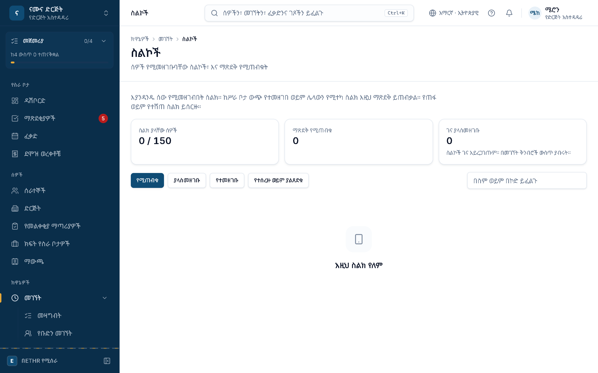

> [!tip] በደረጃ ማስጀመር
> መጀመሪያ **አረጋግጥና ገምግም** ይምረጡ። ሠራተኞች በሥራ ቦታ ሲመዘገቡ ስልካቸውን ያስመዘግባሉ። **ገና ያላስመዘገቡ** ቁጥር ዜሮ ሲሆን **የተመዘገበው ስልክ ብቻ** ይምረጡ።

## ማጭበርበርን መከላከል

እያንዳንዱ ምዝገባ ከ0 እስከ 100 የሆነ **የአደጋ ነጥብ** ያገኛል፣ ከምክንያቶቹ ጋር። ምክንያቶቹ ለምሳሌ፦ ከተፈቀደው ቦታ ውጭ መሆን፣ የተጭበረበረ የሚመስል ቦታ፣ በሁለት ምዝገባዎች መካከል የማይቻል ጉዞ፣ አንድ ስልክ በሁለት ሰዎች መጠቀም፣ እና እንደገና የቀረበ ፎቶ።

- ነጥቡ ከግምገማ ገደቡ (ነባሪ 40፣ በቅርንጫፍ ሊቀየር ይችላል) በላይ ሲሆን በ**ክዋኔዎች → መገኘት → ታማኝነት** ውስጥ የግምገማ ንጥል ይከፈታል። **ምዝገባው ግን ይመዘገባል**፤ በነጥብ ምክንያት ማንም አይከለከልም።
- የደመወዝ ሂደት ከመጽደቁ በፊት ያልተዘጉ ከፍተኛ የአደጋ ንጥሎችን ይዘረዝራል።
- ገምጋሚው ነጥቡን በዝርዝር፣ የራስ ፎቶውን እና ምዝገባውን በካርታ ላይ ያያል።

# ፈቃድ እና በዓላት

## የፈቃድ አይነቶች እና የሥራ ሳምንት

**ቅንብሮች → የፈቃድ ዓይነቶች**፦

1. **የሥራ ሳምንት** የድርጅትዎ የሥራ ቀናትን ይወስናል። የፈቃድ ጥያቄ የሚቆጥረው እነዚህን ቀናት ብቻ ነው፤ በዓላት አይቆጠሩም። መቀየር የሚችለው የድርጅት አስተዳዳሪ ብቻ ነው።
2. **የፈቃድ አይነት ጨምር** አዲስ አይነት ይፈጥራል፤ ስም፣ ኮድ፣ ነባሪ ቀናት እና የክምችት አይነት (**ወርሃዊ**፣ **ዓመታዊ** ወይም አንድ ጊዜ)።

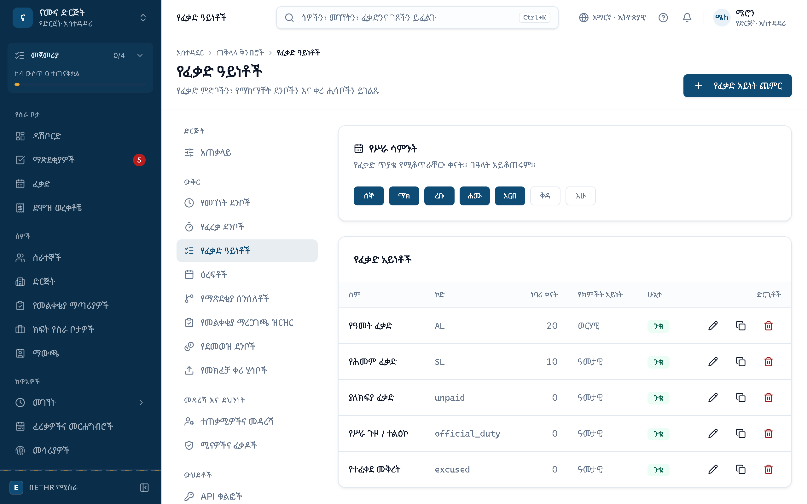

በዝግጅቱ ወቅት የኢትዮጵያ ነባሪዎች ይፈጠራሉ፦

| አይነት | ቀናት | ክምችት |
|---|---|---|
| የዓመት ፈቃድ | 16 | ወርሃዊ |
| የሕመም ፈቃድ | 30 | ዓመታዊ |
| የወሊድ ፈቃድ | 120 | አንድ ጊዜ |
| የአባትነት ፈቃድ | 3 | አንድ ጊዜ |
| የሐዘን ፈቃድ | 3 | ዓመታዊ |

ሁሉም ሊቀየሩ ይችላሉ። ጋብቻ፣ ትምህርት፣ ያለክፍያ ፈቃድ እና ሌሎችም እንደ ሥራ ዘርፍዎ ይጨመራሉ።

## በዓላት

**ቅንብሮች → ዕረፍቶች**፦

1. **የኢትዮጵያ በዓላትን በራስ-ሰር ለይ** እንቁጣጣሽን፣ መስቀልን፣ ገናን፣ ጥምቀትን እና ሌሎችንም ያስገባል።
2. **በዓል ጨምር** የድርጅትዎን የራሱን በዓል ያስገባል።

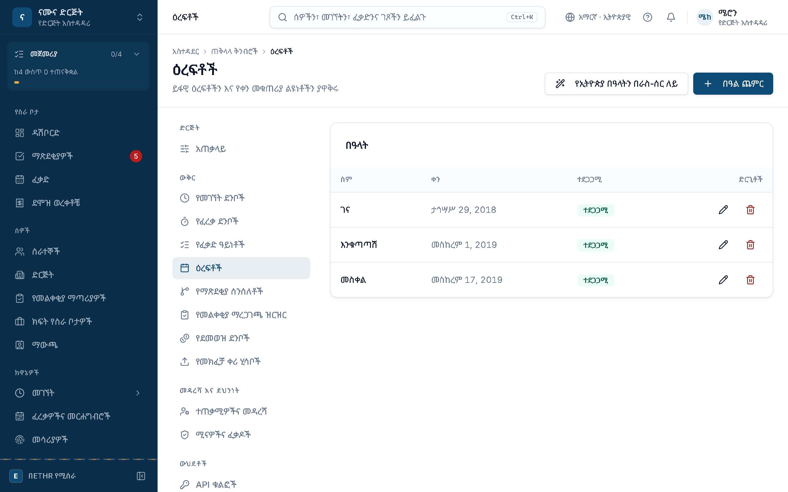

በዓላት የፈቃድ ቀናት ሲቆጠሩ አይቆጠሩም።

## የማጽደቂያ ሰንሰለቶች

ሰንሰለት ከሌለ እያንዳንዱ የፈቃድ፣ የማስተካከያ ወይም የመገለጫ ለውጥ ጥያቄ ማጽደቅ በሚችል ማንኛውም ሰው በአንድ ደረጃ ይወሰናል። ከአንድ በላይ አጽዳቂ ከፈለጉ (ለምሳሌ መጀመሪያ ተቆጣጣሪ፣ ከዚያ የሰው ሀብት)፦

1. **ቅንብሮች → የማጽደቂያ ሰንሰለቶች** ላይ **አዲስ ሰንሰለት** ይጫኑ፣ የጥያቄውን አይነት እና ደረጃዎቹን ይምረጡ።

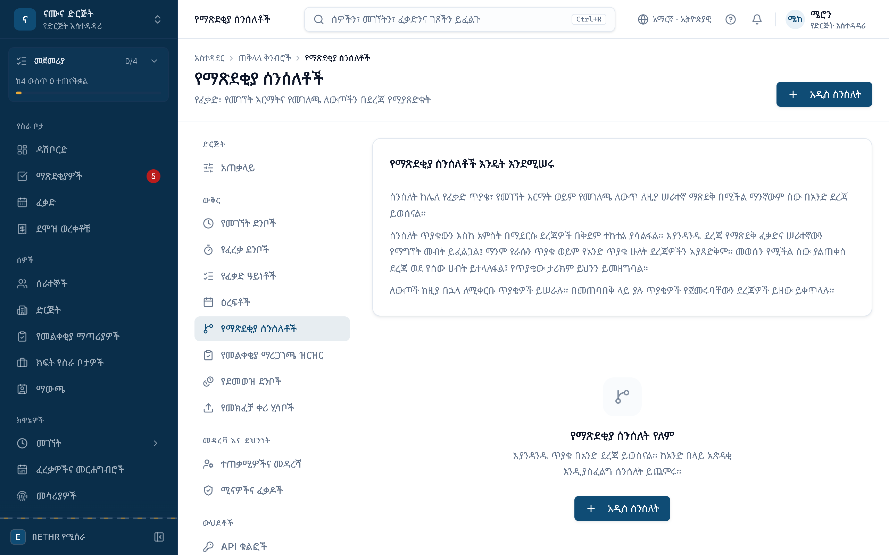

ለውጡ ከዚያ በኋላ ለሚቀርቡ ጥያቄዎች ይሠራል። በመጠባበቅ ላይ ያሉ ጥያቄዎች በጀመሩባቸው ደረጃዎች ይቀጥላሉ።

## የቀን መቁጠሪያ

**ቅንብሮች → አጠቃላይ** ውስጥ የድርጅቱን ነባሪ ቋንቋ እና የቀን መቁጠሪያ (ኢትዮጵያዊ ወይም ግሪጎሪያን) ይመርጣሉ። እያንዳንዱ ተጠቃሚ የራሱን መምረጥ ይችላል፤ ነባሪው የሚሠራው እስኪመርጡ ድረስ ነው። የቀን ሳጥኖች የሌላውን የቀን መቁጠሪያ ቀን ከሥራቸው ያሳያሉ።

# ደመወዝ

## የደመወዝ ቅንብሮች

**ቅንብሮች → የደመወዝ ደንቦች** (የድርጅት አስተዳዳሪ ብቻ)፦

- **የደመወዝ መርሐ ግብር፦** ደመወዝ የሚሠራበት የወር ቀን፣ የበጀት ዓመቱ የሚጀምርበት ወር (ለአብዛኞቹ የግል ድርጅቶች መስከረም፣ ለመንግሥት ሐምሌ)፣ የጳጉሜ ክፍያ (ሙሉ ወር፣ ወይም ቀኖቹ በቀን ተመን) እና የጡረታ ዕድሜ።
- **የገቢ ግብር ደረጃዎች፦** የኢትዮጵያ ተመኖች አስቀድመው ገብተዋል፤ መንግሥት ሲቀይራቸው ያዘምኑ።
- **የትርፍ ሰዓት ተመኖች፦** ነባሪዎቹ የሕግ ዝቅተኛዎቹ ናቸው፦ ቀን 1.5፣ ሌሊት 1.75፣ የሳምንት ዕረፍት ቀን 2.0፣ ይፋዊ በዓል 2.5።
- **አበሎች**

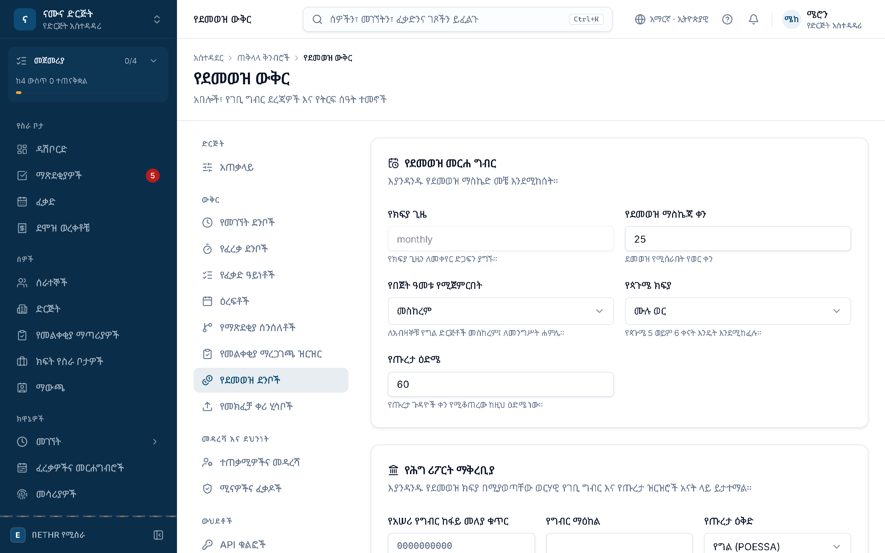

> [!note]
> ጡረታ በሕግ የተወሰነ ነው፦ ሠራተኛው 7 በመቶ፣ አሠሪው 11 በመቶ። ሊቀየር አይችልም።

## ደመወዝ ማስኬድ

**ፋይናንስ → ደመወዝ → ሂደቶች**፦

1. **ደመወዝ አስሂድ** ይጫኑ፣ የክፍያ ጊዜውን ይምረጡ እና ያረጋግጡ።
2. አዲሱ ሂደት **ማጽደቅ በመጠበቅ ላይ** ተብሎ በዝርዝሩ ውስጥ ይታያል። ይጫኑት።

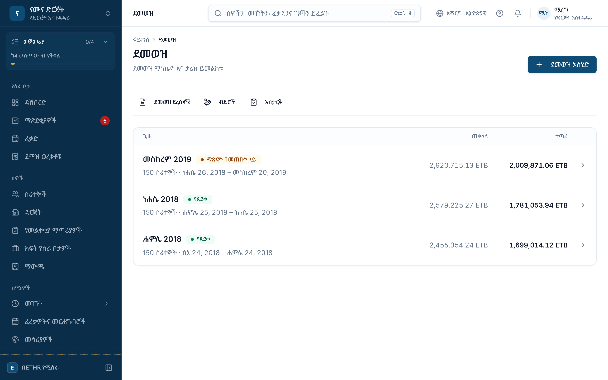

ሂደቱ ለእያንዳንዱ ሠራተኛ፦ የተረጋገጠውን መገኘት ይወስዳል፣ የፈቃድ ቀናትን ያሰላል፣ መሠረታዊ ደመወዝን (ለአዲስ ተቀጣሪ እና ለለቀቀ በቀን ተከፋፍሎ) ያሰላል፣ የትርፍ ሰዓት እና አበል ይጨምራል፣ የገቢ ግብር፣ ጡረታ እና ብድር ይቀንሳል፣ የደመወዝ ወረቀቶችን እና የባንክ ማስተላለፊያ ፋይል ያዘጋጃል።

## ደመወዝ መገምገም እና ማጽደቅ

የሂደቱ ገጽ አራት ደረጃዎችን ያሳያል፦ **ማስላት**፣ **መገምገም**፣ **ማጽደቅ** እና **ተከፍሏል**።

1. **መገምገም** ደረጃ ላይ ድምሮቹን እና መዝገቡን ይፈትሹ። ከደረጃዎቹ ሥር **ጠቅላላ ድምር**፣ **ተጣራ ድምር**፣ **ጠቅላላ ግብር** እና የሠራተኞች ብዛት፣ ከሥራቸውም እያንዳንዱ ሠራተኛ ይታያሉ።
2. ሁሉም ትክክል ሲሆን **ደመወዝ አጽድቅ** ይጫኑ። የሚችለው የድርጅት አስተዳዳሪ ብቻ ነው።
3. **ወጪ ያውጡ** የባንክ ፋይሉን እና ሪፖርቶቹን ያወርዳል።

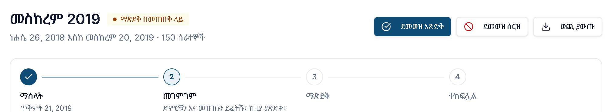

ሲጸድቅ ሠራተኞች የደመወዝ ወረቀታቸውን ወዲያውኑ በ**ደሞዝ ወረቀቶቼ** ያያሉ። **ደመወዝ ሰርዝ** የተሳሳተ ሂደትን ከምክንያት ጋር ይሰርዛል፤ የብድር እና የወጪ መጋራት ቀሪዎችም ወደ ቀድሞው ይመለሳሉ። መሰረዙ አይቀለበስም፤ የተስተካከለ ሂደት እንደገና ማስኬድ ይችላሉ።

> [!warning] ከማጽደቅዎ በፊት
> ገጹ ያለ ፈቃድ የቀሩ ቀናት ያሏቸውን ሠራተኞች እና ያልተዘጉ ከፍተኛ የአደጋ መገኘት ንጥሎችን ከዘረዘረ መጀመሪያ ይመልከቷቸው። ዝርዝሩ ምልክት ብቻ ነው፤ ደመወዙን በራሱ አይቀንስም። የጸደቀ ደመወዝ ከተሠራ በኋላ የመገኘት ማስተካከያ ቢጸድቅ ደመወዙ በራሱ አይታደስም።

# ሪፖርቶች

ሪፖርቶች ለሰው ሀብት፣ ለፋይናንስ እና ለድርጅት አስተዳዳሪዎች ናቸው።

1. **ገንቢ** ትር የራስዎን ሪፖርት ያዘጋጃል።
2. **የውሂብ ምንጭ** ይምረጡ፦ ሠራተኞች፣ መገኘት፣ ፈቃድ ወይም ደመወዝ።
3. **አምዶች** ውስጥ የሚፈልጉትን ምልክት ያድርጉ።
4. **ማጣሪያዎች** (ለሠራተኞች ሁኔታ፣ ለመገኘት የቀን ክልል፣ ለፈቃድ ዓመት)፣ እንዲሁም ከሥሩ በቡድን መደርደር እና ቅደም ተከተል ያክሉ።

በመጨረሻ ከታች ያለውን **ቅድመ እይታ አሂድ** ይጫኑ። ውጤቱ በቀኝ በኩል ይታያል፤ ከዚያ **CSV አውርድ** ወይም እንደ አብነት ያስቀምጡ።

> [!tip]
> የወር የግብር እና የጡረታ ድምሮችን ለማግኘት የደመወዝ ሪፖርት ይገንቡ እና በክፍል ወይም በወር ይደርድሩት፤ የተደረደሩ ሪፖርቶች የእያንዳንዱን ቡድን ድምር ያሳያሉ።

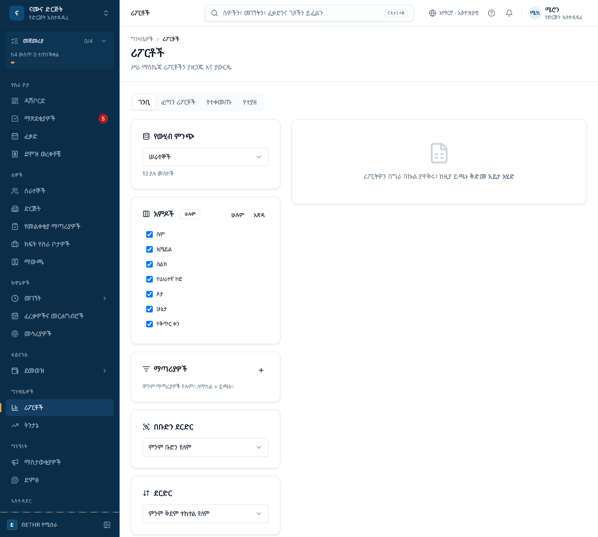

**ፈጣን ሪፖርቶች** ለእያንዳንዱ የውሂብ ምንጭ አንድ ዝግጁ ሪፖርት አላቸው፣ ለምሳሌ ወርሃዊ የሰዓት ሰሌዳ። **የተቀመጡ** ትር የተቀመጡ ሪፖርቶችን እንደገና ያስኬዳል ወይም በየቀኑ፣ በየሳምንቱ ወይም በየወሩ በኢሜይል እንዲላኩ ያቅዳል (**ያቅዱ**)። የተቀመጠ ሪፖርት ሊሰረዝ እንጂ ሊታረም አይችልም።

# ተጠቃሚዎች እና ሚናዎች

## ተጠቃሚዎችን መጋበዝ

**ቅንብሮች → ተጠቃሚዎችና መዳረሻ**፦

1. **ተጠቃሚ ጋብዝ** ይጫኑ።
2. **ሚና** አምዱ የእያንዳንዱን ሰው ሚና ያሳያል፤ በረድፉ ላይ ያለው የእርሳስ ምልክት ይቀይረዋል።

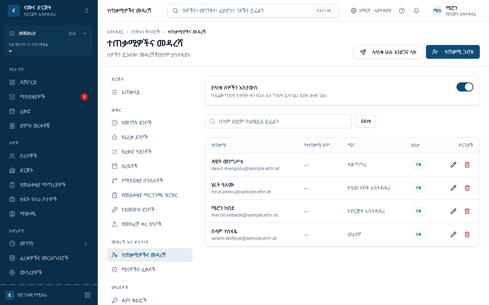

በግብዣው ቅጽ ውስጥ ኢሜይል፣ ከተፈለገ የተጠቃሚ ስም እና ሚና ያስገቡ፣ ከዚያ **ግብዣ ላክ** ይጫኑ። ተጠቃሚው ኢሜይል ደርሶት የራሱን የይለፍ ቃል ይመርጣል። ግብዣውን ያልተቀበሉ ሰዎች ከሦስት ቀን በኋላ እንደገና ይጋበዛሉ፣ ቢበዛ ሁለት ጊዜ፤ **ላላነቁ ሁሉ እንደገና ላክ** ወዲያውኑ ይልካል።

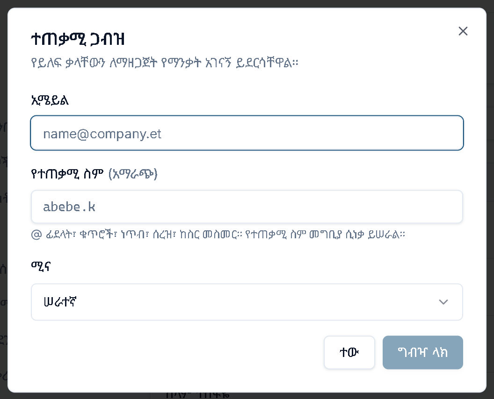{half}

## ባለሁለት ደረጃ ማረጋገጫን ማስጀመር

ተጠቃሚ የማረጋገጫ መተግበሪያውን ያለበትን ስልክ ካጣ፣ በ**ተጠቃሚዎችና መዳረሻ** ዝርዝር ውስጥ በስሙ ረድፍ ላይ ያለውን የጋሻ ምልክት ይጫኑ። ተጠቃሚው በይለፍ ቃሉ ገብቶ እንደገና ያዘጋጀዋል፣ ኢሜይልም ይደርሰዋል። በራስዎ መለያ ወይም ከእርስዎ በላይ በሆነ ሚና ላይ አይሠራም።

## ብጁ ሚናዎች

**ቅንብሮች → ሚናዎችና ፈቃዶች → ሚና ፍጠር** የራስዎን ሚና ይፈጥራል። ብጁ ሚና የተጠቃሚውን አብሮ የተሰራ ሚና ፈቃዶች ይተካል፣ እና ባለቤቶቹ የማንን መዝገብ እንደሚደርሱ ይወስናል፦ የራሳቸውን፣ ቀጥታ ሪፖርቶቻቸውን፣ ቡድናቸውን፣ ክፍላቸውን፣ ቅርንጫፋቸውን ወይም ሁሉንም። ሚናውን ለተጠቃሚ መስጠት የሚችለው ሚናው የሚሰጠውን ሁሉ የያዘ ሰው ብቻ ነው። ተጠቃሚ የያዘው ሚና አይሰረዝም።

# ማስታወቂያዎች እና ቅንብሮች

## ማስታወቂያዎች

**ግንኙነት → ማስታወቂያዎች → አዲስ ማስታወቂያ** ለድርጅቱ መልእክት ያወጣል። ወዲያውኑ ማተም ወይም ለሌላ ጊዜ **ቀጠሮ ያዝ** ማድረግ ይችላሉ። ማስታወቂያው በሠራተኞች ዳሽቦርድ እና በማሳወቂያዎቻቸው ውስጥ ይታያል።

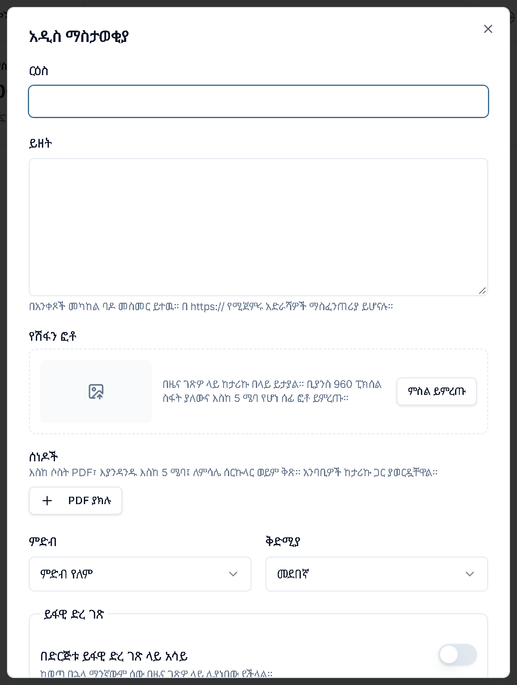{half}

## የቅንብሮች ማጣቀሻ

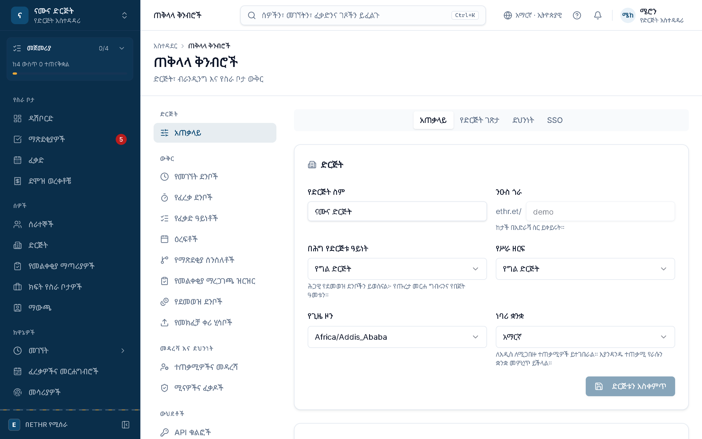

| ክፍል | የሚቆጣጠረው |
|---|---|
| **አጠቃላይ** | የድርጅት ስም፣ አድራሻ (`ethr.et/...`)፣ በሕግ የድርጅቱ ዓይነት፣ የጊዜ ዞን፣ ነባሪ ቋንቋ እና የቀን መቁጠሪያ |
| **የድርጅት ገጽታ** | አርማ እና ቀለሞች |
| **ደህንነት** | የባለሁለት ደረጃ ማረጋገጫ ፖሊሲ እና የክፍለ ጊዜ ማብቂያ (ከ5 እስከ 480 ደቂቃ) |
| **SSO** | SAML ነጠላ መግቢያ |
| **የመገኘት ደንቦች** | ዘዴዎች፣ ቦታ፣ የራስ ፎቶ፣ ፒን፣ የቅርንጫፍ ደንቦች፣ የማጭበርበር መከላከያ |
| **የፈረቃ ደንቦች** | ፈረቃዎች፣ የሥራ ቀናት፣ የእፎይታ እና የእረፍት ደቂቃዎች |
| **የፈቃድ ዓይነቶች** | የፈቃድ አይነቶች እና የሥራ ሳምንት |
| **ዕረፍቶች** | ይፋዊ በዓላት |
| **የማጽደቂያ ሰንሰለቶች** | በደረጃ የሚጸድቁ ጥያቄዎች |
| **የመልቀቂያ ማረጋገጫ ዝርዝር** | ሠራተኛ ሲለቅ የሚፈተሹ ነገሮች |
| **የደመወዝ ደንቦች** | መርሐ ግብር፣ የበጀት ዓመት፣ ጳጉሜ፣ ግብር፣ የትርፍ ሰዓት፣ አበሎች |
| **ተጠቃሚዎችና መዳረሻ** | የመግቢያ መለያዎች እና ሚናዎቻቸው |
| **ሚናዎችና ፈቃዶች** | ብጁ ሚናዎች |
| **API ቁልፎች**፣ **ዌብሁኮች**፣ **ሂሳብ** | ከሌሎች ሥርዓቶች ጋር ማገናኘት |
| **የማሳወቂያ ቅንብሮች** | የኢሜይል መልእክቶች በአማርኛ እና በእንግሊዝኛ |
| **ኦዲት ምዝገባ** | በድርጅቱ ውስጥ የተደረገ እያንዳንዱ ድርጊት |

## ከሠራተኞች የሚመጡ የእርዳታ ጥያቄዎች

ሠራተኞች **እርዳታ ያግኙ** ሲጫኑ ጥያቄያቸው መጀመሪያ ወደ ድርጅትዎ ይመጣል። የሰው ሀብት ቡድኑ ይመልሳል ወይም ወደ ETHR ድጋፍ ያስተላልፋል። መልሱ ለሠራተኛው በገጹ እና በኢሜይል ይደርሳል።
