# ይህ መመሪያ ለማን ነው

ይህ መመሪያ ድርጅቱን በETHR ላይ ለሚያስተዳድሩ ነው፦ ለ**የድርጅት አስተዳዳሪ** እና ለ**የሰው ሃብት አስተዳዳሪ**። ስለ ሠራተኛ እና ስለ ኃላፊ ሥራዎች (መግባት፣ መገኘት፣ ፈቃድ፣ ማጽደቅ) **የሠራተኛ መመሪያ** እና **የኃላፊ መመሪያ** ይመልከቱ።

## ሚናዎች

እያንዳንዱ ተጠቃሚ አንድ ሚና አለው። ሚናው በምናሌው ውስጥ የሚታየውን እና ሊሠራ የሚችለውን ይወስናል።

| ሚና | የሚችለው |
|---|---|
| **የድርጅት አስተዳዳሪ** | ሁሉንም። ደመወዝን ማጽደቅ፣ መሰረዝ እና እንደገና ማስኬድ፣ የደመወዝ ደንቦችን፣ የድርጅት ቅንብሮችን፣ ሚናዎችን፣ የAPI ቁልፎችን እና መሣሪያዎችን መቀየር የሚችለው ይህ ሚና ብቻ ነው |
| **የሰው ሃብት አስተዳዳሪ** | የሰው ሀብት ጎኑን፦ ሠራተኞችን ማስገባት እና ማዘመን፣ የባንክ እና የደመወዝ መረጃ፣ የድርጅት አወቃቀር፣ ፈረቃዎች፣ በዓላት፣ የሁሉም መገኘት እና ፈቃድ፣ ማጽደቅ፣ ሪፖርቶች እና ማስታወቂያዎች። ደመወዝ አያስኬድም |
| **የፋይናንስ አስተዳዳሪ** | የደመወዝ ጎኑን፦ ደመወዝ ማስኬድ፣ ብድሮች፣ የወጪ መጋራት፣ ሪፖርቶች። የሠራተኛ መረጃን ማንበብ ይችላል፤ ሠራተኛ ወይም የባንክ መረጃ መቀየር አይችልም |
| **የክፍል አስተዳዳሪ** | እንደ ተቆጣጣሪ፣ ለራሱ ክፍል ሰዎች ሁሉ |
| **ተቆጣጣሪ** | ቀጥታ ሪፖርት የሚያደርጉለትን፦ ማጽደቅ፣ የቡድን መገኘት እና ፈቃድ |
| **ሠራተኛ** | የራሱን መገኘት፣ ፈቃድ፣ የደመወዝ ወረቀት እና መገለጫ |

> [!why] የሥራ ክፍፍል
> ደመወዝ የሚያስኬደው (የፋይናንስ አስተዳዳሪ) ገንዘቡ የሚገባበትን የባንክ ሒሳብ መቀየር አይችልም (የሰው ሃብት አስተዳዳሪ ይቀይራል)። ደመወዝን የሚያጸድቀው ደግሞ የድርጅት አስተዳዳሪ ብቻ ነው። ሌላ ክፍፍል ከፈለጉ (ለምሳሌ ለአንድ ቅርንጫፍ ብቻ የሰው ሀብት ባለሙያ) በክፍል 10.3 እንዳለው ብጁ ሚና ይፍጠሩ።

# የመጀመሪያ ዝግጅት

ድርጅትዎን በ`ethr.et` ላይ ሲመዘግቡ መለያዎ **የድርጅት አስተዳዳሪ** ይሆናል፣ እና ETHR በቀጥታ ወደ ተመራው ዝግጅት ይወስድዎታል። ዝግጅቱ እስኪያልቅ ድረስ በጎን ምናሌው አናት ላይ **መጀመሪያ** የሚል የሂደት ሳጥን (ለምሳሌ «0/4») ይታያል፤ ይጫኑት እና ይመለሱ።

> [!note] ከመጀመሪያው ቀን ጀምሮ የሚሠራው
> አዲስ ድርጅት ከመጀመሪያው ምዝገባ ጀምሮ መገኘት መቀበል ይችላል። ETHR ለሥራ ዘርፍዎ መሠረታዊውን ያዘጋጃል፦ የመገኘት ቅንብሮች፣ ነባሪ ፈረቃ፣ የሥራ ሳምንት እና የዘንድሮ እና የሚቀጥለው ዓመት ይፋዊ በዓላት። የጎደለውን ብቻ ይፈጥራል፤ እርስዎ ያስቀመጡትን አይቀይርም።

ዝግጅቱ አራት ደረጃዎች አሉት፦

1. **ድርጅት።** የድርጅትዎን አይነት ይምረጡ (ለምሳሌ ሆስፒታል፣ ባንክ፣ ፋብሪካ፣ የክልል ቢሮ)። ETHR እንዲገመግሙት የሥራ ክፍሎችን፣ የሥራ መደቦችን፣ ደረጃዎችን፣ ፈረቃዎችን፣ የፈቃድ አይነቶችን እና በዓላትን ያቀርባል። እስኪተገብሩት ድረስ ምንም አይፈጠርም።
2. **ሠራተኞች።** ሰዎችዎን ያስገቡ፦ ከመገኘት መሣሪያ የተመዘገቡ ሰዎችን በማምጣት፣ ወይም ከኤክሴል የተቀዳ ዝርዝር በመለጠፍ። እያንዳንዱን ግጥሚያ ገምግመው ያረጋግጡ።
3. **መግቢያ።** ሠራተኞች እንዴት እንደሚገቡ ይምረጡ፦ በኢሜይል፣ በስልክ፣ በሠራተኛ ኮድ ወይም በተጠቃሚ ስም።
4. **አስጀምር።** የዝግጁነት ውጤት፣ የቀሩ ክፍተቶች እና እነሱን ለማስተካከል አገናኞች። ዝግጁ ሲሆኑ ያስጀምሩ።

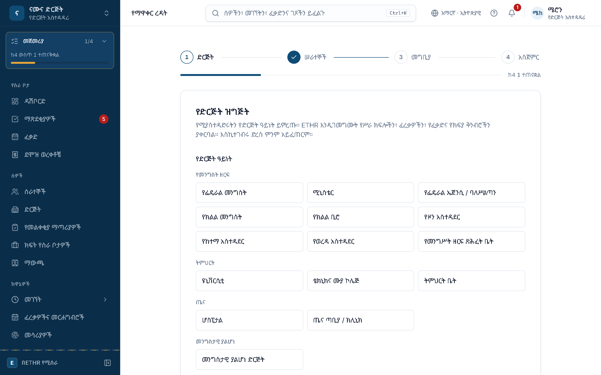

ደረጃዎችን ዘልለው በኋላ መመለስ ይችላሉ። በዝግጅቱ የተደረገው ሁሉ ከዚያ በኋላ በቅንብሮች ውስጥ ሊቀየር ይችላል።

# የድርጅት አወቃቀር

**ሰዎች → ድርጅት** የድርጅትዎን ቅርጽ ይይዛል።

1. **አወቃቀር** የክፍሎችን ዛፍ እና በእያንዳንዱ ያሉትን የሠራተኞች ብዛት ያሳያል።
2. **ቅርንጫፎች፦** ስም፣ አድራሻ እና በካርታ ላይ ያለ ቦታ (ክፍል 6.2)።
3. **ክፍሎች፦** በደረጃ ሊደራጁ (ዋና ክፍል እና ንዑስ ክፍል) እና ለቅርንጫፍ ሊመደቡ ይችላሉ።
4. **የስራ መደቦች፦** የሥራ መጠሪያዎች።
5. **ደረጃዎች፦** የደመወዝ ደረጃዎች፤ እያንዳንዱ ዝቅተኛ እና ከፍተኛ ደመወዝ ሊኖረው ይችላል።

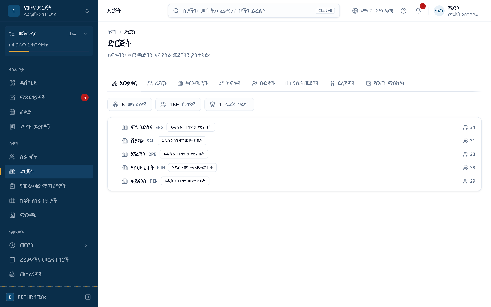

**ሪፖርት** ትር ማን ለማን ሪፖርት እንደሚያደርግ ያሳያል፤ **ቡድኖች** እና **የወጪ ማዕከላት** ትሮችም አሉ።

# ሠራተኞች

## የሠራተኞች ዝርዝር

**ሰዎች → ሰራተኞች** ሁሉንም ሠራተኞች ይዘረዝራል።

1. **ሰራተኛ ጨምር** አንድ ሠራተኛ ያስገባል (ክፍል 4.2)። ከጎኑ ያሉት ምልክቶች ፋይል ያስገባሉ፣ ዝርዝሩን ያወርዳሉ እና ከመሣሪያ ያመጣሉ።
2. ማጣሪያዎቹ በሁኔታ፣ በክፍል እና በቅርንጫፍ ይለያሉ፤ ከጎናቸው በስም፣ በኢሜይል ወይም በኮድ መፈለግ ይቻላል።
3. ረድፉን ይጫኑ፤ የሠራተኛው መዝገብ ይከፈታል (ክፍል 4.4)።

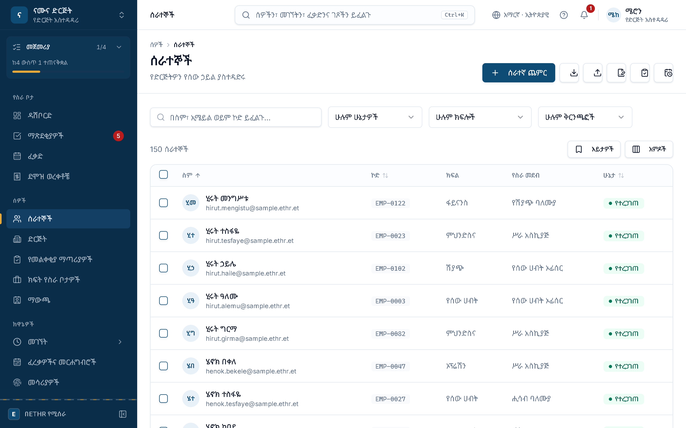

## አንድ ሠራተኛ ማስገባት

**ሰራተኛ ጨምር** ቅጹን በአራት ክፍሎች ይከፍታል። ግዴታ የሆኑት ስም እና የሥራ ክፍሉ መረጃ ብቻ ናቸው፤ ሌላውን በኋላ መሙላት ይችላሉ።

1. **ግለሰብ፦** ሙሉ ስም (በእንግሊዝኛ እና በአማርኛ)፣ ጾታ፣ የልደት ቀን በኢትዮጵያ ቀን መቁጠሪያ፣ የጋብቻ ሁኔታ እና ዜግነት።
2. **አድራሻና መግቢያ፦** ኢሜይል እና ስልክ። ኢሜይል ካለ ግብዣ ይላክለታል።
3. **ሥራ፦** የቅጥር ቀን፣ ክፍል፣ ቅርንጫፍ፣ የሥራ መደብ እና ኃላፊ። የሠራተኛ ኮዱ በራሱ ይሰጣል።
4. **ክፍያና መታወቂያ፦** ደመወዝ፣ TIN እና የባንክ መረጃ።

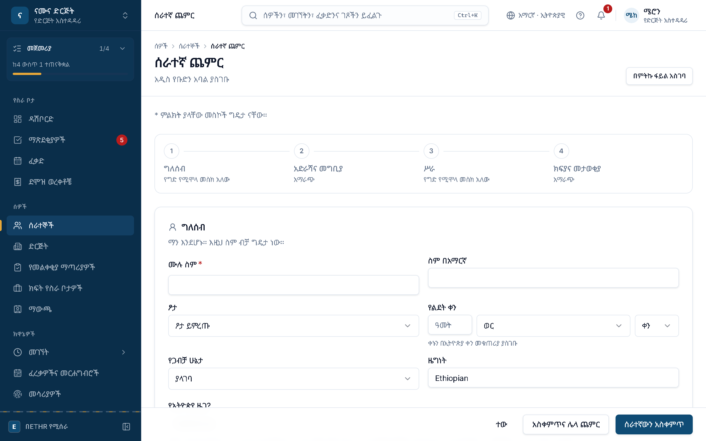

## ብዙ ሠራተኞችን በፋይል ማስገባት

1. የCSV ፋይልዎን ወደ ሳጥኑ ይጎትቱ ወይም **ፋይሎችን አስስ** ይጫኑ (ቢበዛ 5 ሜባ)።
2. መጀመሪያ **CSV አብነት አውርድ**፤ ሁሉንም አምዶች ይዟል። ግዴታ የሆኑት `name` እና `hire_date` ብቻ ናቸው።

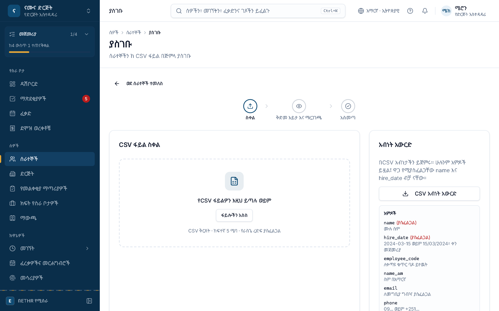

ከተሰቀለ በኋላ **ቅድመ እይታ እና ማረጋገጫ** ደረጃ እያንዳንዱን ረድፍ ያሳያል፤ ስሕተት ያለባቸው ረድፎች ምክንያታቸውን ይዘው ይታያሉ። ከዚያ **አስመጣ** ይጫኑ። ክፍል፣ ቅርንጫፍ እና የሥራ መደብ በETHR ውስጥ ባለው ስማቸው ወይም ኮዳቸው ይገባሉ።

> [!tip]
> ቀኖች `2024-03-15` ወይም `15/03/2024` (ቀን መጀመሪያ) ሊሆኑ ይችላሉ። ደመወዝ ወርሃዊ፣ በብር፣ ለምሳሌ `12,500.00`። ስልክ `09...` ወይም `+251...`።

## የሠራተኛ መዝገብ

1. **ወደ ETHR ጋብዝ** ለሠራተኛው የመግቢያ ግብዣ ይልካል። ኢሜይል ወይም ስልክ ለሌለው ሠራተኛ **በአካል አግብር** ይጠቀሙ፤ የአንድ ጊዜ ኮድ በእጁ ይሰጡታል።
2. **አርም** መረጃውን ያዘምናል።
3. **የሕይወት ዑደት** ትር የቅጥር ሁኔታን ይቀይራል (ክፍል 4.5)።
4. **ታሪክ** ትር የዝውውር፣ የዕድገት እና ሌሎች የሰው ሀብት እርምጃዎችን ታሪክ ይይዛል (ክፍል 4.7)።

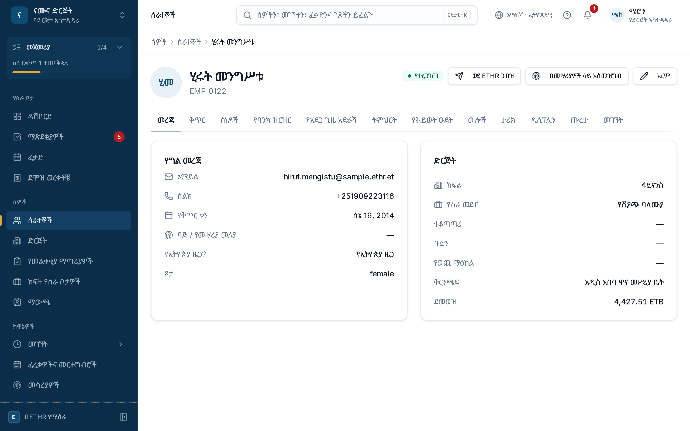

ሌሎቹ ትሮች፦ **ቅጥር**፣ **ሰነዶች**፣ **የባንክ ዝርዝር**፣ **የአደጋ ጊዜ አድራሻ**፣ **ትምህርት**፣ **ውሎች**፣ **ዲሲፕሊን**፣ **ጡረታ** እና **መገኘት**። **በመሣሪያዎች ላይ አስመዝግብ** ሠራተኛውን በጣት አሻራ መሣሪያዎች ላይ ያስመዘግባል።

## የቅጥር ሁኔታ

እያንዳንዱ የሁኔታ ለውጥ ይመዘገባል፦

| ከ | ወደ |
|---|---|
| ተቀጠረ | በሙከራ ላይ፣ ወይም በቀጥታ የተረጋገጠ |
| በሙከራ ላይ | የተረጋገጠ፣ ወይም የተሰናበተ |
| የተረጋገጠ | የታገደ፣ የለቀቀ፣ የተሰናበተ ወይም ጡረታ የወጣ |
| የታገደ | የተረጋገጠ፣ ወይም የተሰናበተ |

**የለቀቀ**፣ **የተሰናበተ** እና **ጡረታ የወጣ** የመጨረሻ ናቸው። ዝውውር እና ዕድገት ሁኔታ አይደሉም፤ በ**ታሪክ** ትር ውስጥ እንደ የሰው ሀብት እርምጃ ይመዘገባሉ። ሠራተኛ ሲለቅ የተመዘገበ ስልኩ ይሰረዛል፣ እና **የመልቀቂያ ማጣሪያ** ዝርዝር ይከፈታል (ክፍል 4.9)።

## ሠራተኞች የሚጠይቋቸው ለውጦች

ሠራተኛ ስሙን፣ የትውልድ ቀኑን፣ TINን ወይም የባንክ መረጃውን ሲቀይር ለውጡ ወዲያውኑ አይገባም። ከፈቃድ እና ከማስተካከያ ጋር በ**ማጽደቂያዎች** ዝርዝር ውስጥ የሠራተኛ መዝገብ ማዘመን ለሚችሉ ሰዎች ይታያል።

## የሰው ሀብት እርምጃዎች

ዕድገት፣ ዝውውር፣ የደመወዝ እርከን ጭማሪ እና ሌሎች የሥራ ለውጦች በ**አርም** አይቀየሩም፤ በሠራተኛው መዝገብ **ታሪክ** ትር ውስጥ እንደ እርምጃ ይመዘገባሉ። እያንዳንዱ እርምጃ የመዘገበውን ሰው እና ከለውጡ በፊት እና በኋላ የነበረውን ይይዛል።

1. **ታሪክ** ትር ላይ **እርምጃ መዝግብ** ይጫኑ።
2. **የእርምጃ አይነት** ይምረጡ፦ እድገት፣ ዝቅ ማድረግ፣ ዝውውር፣ እንደገና መመደብ፣ የደመወዝ እርከን ጭማሪ፣ የውክልና ምደባ፣ ውክልና፣ የውሰት ምደባ፣ እንደገና ማከፋፈል ወይም ሹመት።
3. **የሚጸናበት ቀን** ያስገቡ፣ ከዚያ የሚቀየረውን ብቻ ይሙሉ፦ **ደረጃ**፣ **የስራ መደብ**፣ **ክፍል**፣ **ቅርንጫፍ**፣ **አዲስ ደመወዝ (ብር)** ወይም **ደረጃ (እርከን)**።

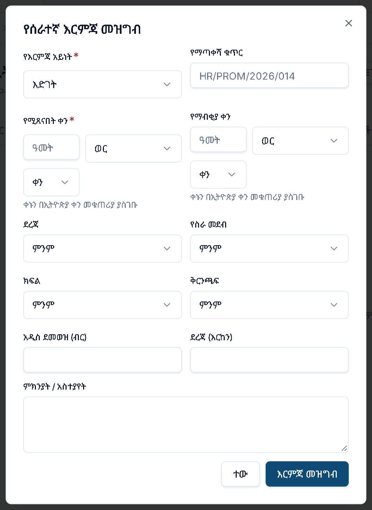{half}

**ደረጃ** የደመወዝ ደረጃው ነው (ምዕራፍ 3)፤ **ደረጃ (እርከን)** በዚያ ደረጃ ውስጥ ያለው እርከን ነው። ምንም የማይቀይር እርምጃ አይቀበልም። ደመወዝ የሚቀይር እርምጃ መመዝገብ የሚችለው የደመወዝ መረጃ መቀየር የሚችል ብቻ ነው።

> [!note] ወደፊት የሚጸና ለውጥ
> የሚጸናበት ቀን ከዛሬ በኋላ ከሆነ እርምጃው **የታቀደ** ተብሎ ይቀመጣል። እስከዚያ ቀን ድረስ የሠራተኛው መዝገብ አይለወጥም፤ በዕለቱ በራሱ ይተገበራል። አንድ ሠራተኛ በአንድ ጊዜ አንድ የታቀደ ለውጥ ብቻ ሊኖረው ይችላል፤ **ለውጡን ሰርዝ** ይሰርዘዋል።

የውክልና ምደባ፣ ውክልና እና የውሰት ምደባ ጊዜያዊ ናቸው፦ **የማብቂያ ቀን** ይጠይቃሉ፣ **ጊዜያዊ** ተብለው ይመዘገባሉ፣ የሠራተኛውን ቋሚ መደብ ግን አይቀይሩም።

## የሚያበቁ ውሎች

በሠራተኞች ዝርዝር አናት ላይ ያለው **የሚያበቁ ውሎች** ምልክት በሚቀጥሉት 30፣ 60 ወይም 90 ቀናት የሚያበቁ ውሎችን እና ሳይታደሱ ያበቁትን ይዘረዝራል። ቋሚ ውሎች የማብቂያ ቀን ስለሌላቸው እዚህ አይታዩም።

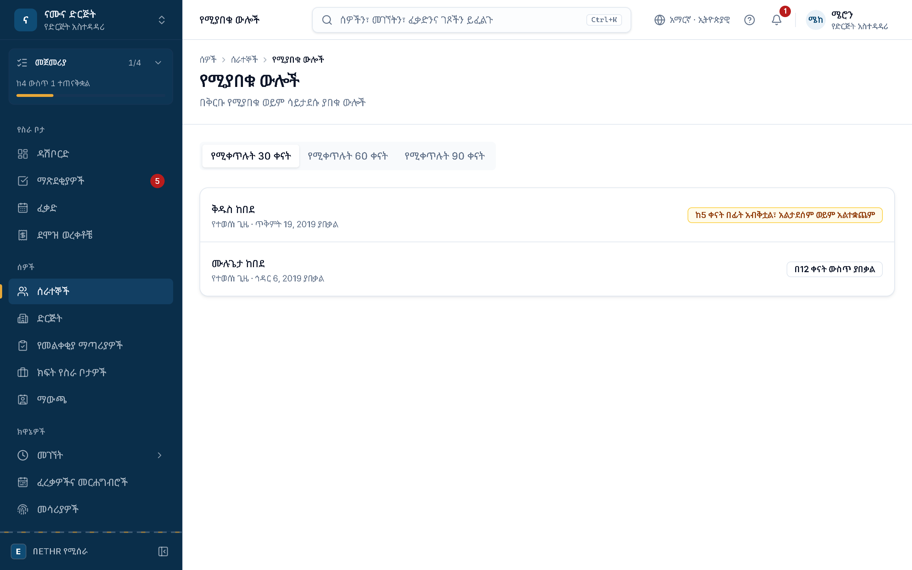

ስሙን ይጫኑ፤ የሠራተኛው **ውሎች** ትር ይከፈታል። እዚያ **አድስ**፣ **ቀደም ብሎ አቁም** ወይም **ውል ጨምር** ይምረጡ።

## የመልቀቂያ ማጣሪያ

ሠራተኛ **የለቀቀ**፣ **የተሰናበተ** ወይም **ጡረታ የወጣ** ሲባል ETHR በራሱ የመልቀቂያ ማጣሪያ ይጀምራል፦ ሰውዬው ከመልቀቁ በፊት መመለስ፣ ማስረከብ እና ማወራረድ ያለበት ዝርዝር።

1. **ሰዎች → የመልቀቂያ ማጣሪያዎች** **ክፍት** እና **ተጠናቋል** ትሮች አሉት፤ እያንዳንዱ ረድፍ ከመስመሮቹ ስንቱ እንደተጠናቀቀ ያሳያል።
2. ስሙን ይጫኑ፤ በሠራተኛው መዝገብ ውስጥ **የመልቀቂያ ማጣሪያ** ትር ይከፈታል።
3. የተፈጸመውን መስመር ምልክት ያድርጉበት። ሁሉም መስመሮች ሲጠናቀቁ ማጣሪያው ይጠናቀቃል።

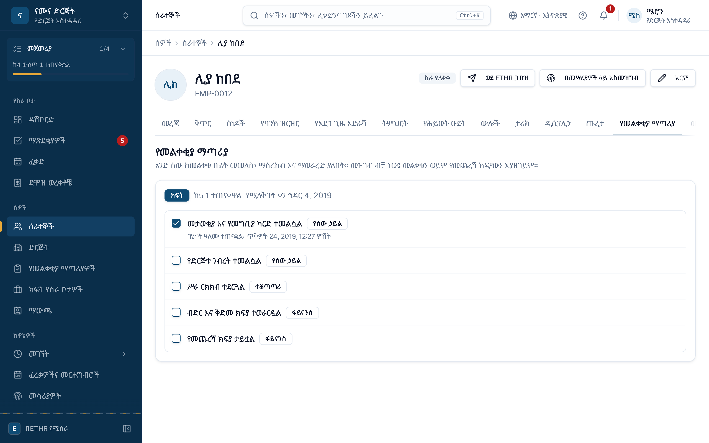

እያንዳንዱ መስመር ባለቤት አለው፦ **የሰው ኃይል**፣ **ፋይናንስ** ወይም **ተቆጣጣሪ**። የሰው ሀብት ማንኛውንም መስመር ምልክት ማድረግ ይችላል፤ ፋይናንስ እና የሚለቀው ሰው ተቆጣጣሪ የራሳቸውን ብቻ። ያልተከፈለ ብድር ወይም የወጪ መጋራት ካለ **ያልተከፈለ ቀሪ** ይታያል፤ ያንን መስመር ሲያጠናቅቁ ቀሪው እንዴት እንደተወራረደ ይጠየቃሉ (ለምሳሌ «ከመጨረሻ ክፍያ ተቀንሷል»)። ማጣሪያ የሌለው የሚለቅ ሠራተኛ ካለ በትሩ ላይ **የመልቀቂያ ማጣሪያ ጀምር** ይጫኑ።

> [!why] መዝገብ ብቻ ነው
> ማጣሪያው መልቀቁን፣ የመጨረሻ ክፍያውን ወይም መግቢያው መዘጋቱን አያዘገይም። ያልተጠናቀቀ መስመር የሚያሳየው ማን ምን እንደቀረበት ብቻ ነው።

**ቅንብሮች → የመልቀቂያ ማረጋገጫ ዝርዝር** (የድርጅት አስተዳዳሪ ብቻ) እያንዳንዱ ማጣሪያ የሚጀምርባቸውን መስመሮች ይይዛል። ነባሪዎቹ፦ መታወቂያ እና የመግቢያ ካርድ፣ የድርጅቱ ንብረት፣ የሥራ ርክክብ፣ ብድር እና ቅድመ ክፍያ፣ እና የመጨረሻ ክፍያ። **መስመር ጨምር** (እስከ 20)፣ ለእያንዳንዱ መስመር የሚያረጋግጠውን ይምረጡ፣ ከዚያ **ዝርዝሩን አስቀምጥ**። ለውጡ የሚሠራው ከዚያ በኋላ ለሚጀምሩ ማጣሪያዎች ብቻ ነው።

## የሥራ ማረጋገጫ ደብዳቤዎች

ሠራተኞች ሥራቸውን የሚያረጋግጥ ደብዳቤ (ለምሳሌ ለባንክ ብድር ማመልከቻ) በ**መገለጫዬ → ሰነዶች** ይጠይቃሉ። ጥያቄዎቹ በሠራተኞች ዝርዝር አናት ላይ ባለው **የደብዳቤ ጥያቄዎች** ምልክት ይደርሳሉ።

1. **በመጠባበቅ ላይ** ትር አዳዲስ ጥያቄዎችን ያሳያል፦ ለምን እንደሆነ፣ ለማን እንደሚላክ፣ ቋንቋውን፣ እና ደመወዝ እንዲጨመር ከተጠየቀ **ከደመወዝ ጋር**።
2. **ስጥ** ደብዳቤውን በማጣቀሻ ቁጥር ይሰጣል፤ ሠራተኛው ከ**ሰነዶች** ያወርደዋል።
3. **ውድቅ አድርግ** ጥያቄውን ከምክንያት ጋር ይመልሳል።

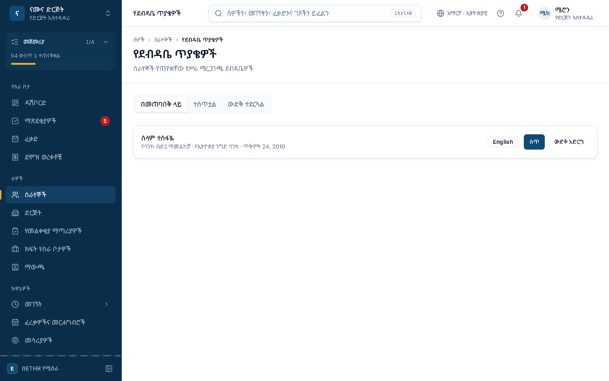

ደብዳቤው የሚገልጸው በመዝገቡ ላይ ያለውን ብቻ ነው፦ ስም፣ የሠራተኛ ኮድ፣ የቅጥር ቀን፣ የሥራ መደብ እና ክፍል፣ ሠራተኛው ከጠየቀ ደግሞ መሠረታዊ ወርሃዊ ደመወዝ። ፒዲኤፉ በሚወርድበት ጊዜ ከመዝገቡ ይዘጋጃል፤ የማጣቀሻ ቁጥሩ እና የተሰጠበት ቀን ግን አይቀየሩም።

# ቅጥር

**ሰዎች → ክፍት የስራ ቦታዎች** ክፍት ቦታ ከማውጣት እስከ ሠራተኛ መዝገብ መፍጠር ያለውን ይይዛል። ሁሉም ሠራተኞች ገጹን ያያሉ፣ የሚያዩት ግን የወጡ እና ማመልከቻቸው ያልተዘጋ ቦታዎችን ብቻ ነው። ቦታ ማውጣት እና አመልካቾችን መያዝ የሰው ሃብት አስተዳዳሪ እና የድርጅት አስተዳዳሪ ሥራ ነው።

## ክፍት የስራ ቦታ ማውጣት

1. **ክፍት የስራ ቦታ ለጥፍ** ቅጹን ይከፍታል።
2. **ክፍት**፣ **ረቂቅ** እና **የተዘጋ** ትሮች ቦታዎቹን በሁኔታቸው ይለያሉ።
3. በካርዱ ላይ ያለው **አመልካቾች** የቦታውን አመልካቾች ይከፍታል (ክፍል 5.2)።

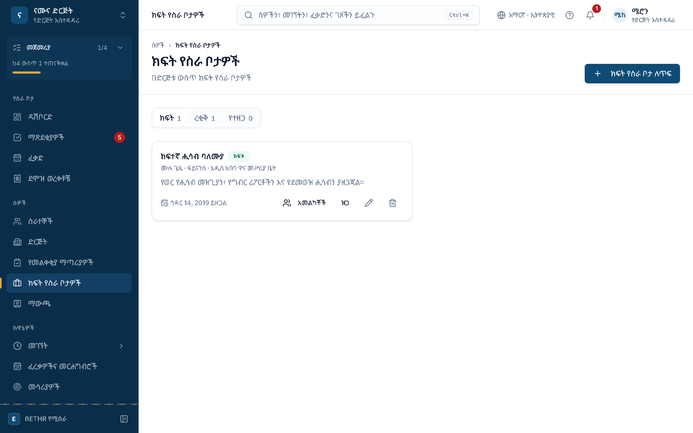

በቅጹ ውስጥ **ርዕስ**፣ **የቅጥር አይነት** (ሙሉ ጊዜ፣ የትርፍ ጊዜ፣ ኮንትራት፣ ጊዜያዊ ወይም የስራ ልምምድ)፣ **ክፍል**፣ **ቅርንጫፍ**፣ **ስለ ስራው**፣ **መስፈርቶች**፣ **የቦታዎች ብዛት** እና **ማመልከቻ የሚዘጋበት** ቀን ያስገቡ። አመልካቾች የሚያመለክቱበትን **ማመልከቻ የሚላክበት ኢሜይል** ወይም የመስመር ላይ አድራሻ ይጨምሩ። **ማን ሊያየው ይችላል** ውስጥ **ሰራተኞች ብቻ** ወይም **ሰራተኞችና የድርጅቱ ይፋዊ ድረ ገጽ** ይምረጡ፤ ይፋዊ የሆነ ቦታ ክፍት እስከሆነ ድረስ በይፋዊ ገጹ «ክፍት የስራ ቦታዎች» ክፍል ውስጥ ይታያል፣ በካርዱ ላይም **በድረ ገጹ ላይ** ምልክት ይኖረዋል (ምዕራፍ 11)። ከዚያ **ክፍት የስራ ቦታውን አስቀምጥ** ይጫኑ።

ረቂቅን **አትም** ያወጣዋል፤ **ዝጋ** ማመልከቻ መቀበልን ያቆማል፤ **እንደገና ክፈት** ይመልሰዋል። የመዝጊያ ቀን የሌለው ቦታ «እስኪሞላ ክፍት ነው» ይላል።

> [!tip]
> ቦታን ከመሰረዝ ይልቅ ይዝጉት፤ መዝገቡ እና አመልካቾቹ ይቆያሉ።

## አመልካቾች

**አመልካቾች** ከጎን የሚከፈት ሳጥን ነው። **አመልካች ያክሉ** ሙሉ ስም፣ ኢሜይል፣ ስልክ፣ **እንዴት አመለከቱ** (ኢሜይል፣ በአካል፣ ጥቆማ፣ የውስጥ፣ ኤጀንሲ፣ ድረ ገጽ ወይም ሌላ) እና የላኩትን ይመዘግባል።

> [!warning] የሚያስፈልገውን ብቻ
> ለምርጫው የሚያስፈልገውን ብቻ ይመዝግቡ። ጤናን፣ ሃይማኖትን፣ ብሔርን ወይም የፖለቲካ አመለካከትን አይመዝግቡ።

1. እያንዳንዱ አመልካች በደረጃዎቹ ያልፋል፦ **አመልክቷል**፣ **በማጣራት ላይ**፣ **ቃለ መጠይቅ**፣ **ቅናሽ**፣ **ተቀጥሯል**። የሚቀጥለውን ደረጃ የሚያስጀምረው አንድ ቁልፍ ብቻ ይታያል፦ **ማጣራት ጀምር**፣ **ለቃለ መጠይቅ ጋብዝ** ወይም **ቅናሽ አቅርብ**።
2. **ወደ ታሪኩ ያክሉ** ማስታወሻ ወይም ቃለ መጠይቅ ይመዘግባል፤ ለቃለ መጠይቅ **መቼ** እና **የቃለ መጠይቅ ቡድን ውጤት ከ100** ያስገቡ።
3. **ውድቅ አድርግ** እና **ማመልከቻውን እንደተወ መዝግብ** ምክንያት ይጠይቃሉ።

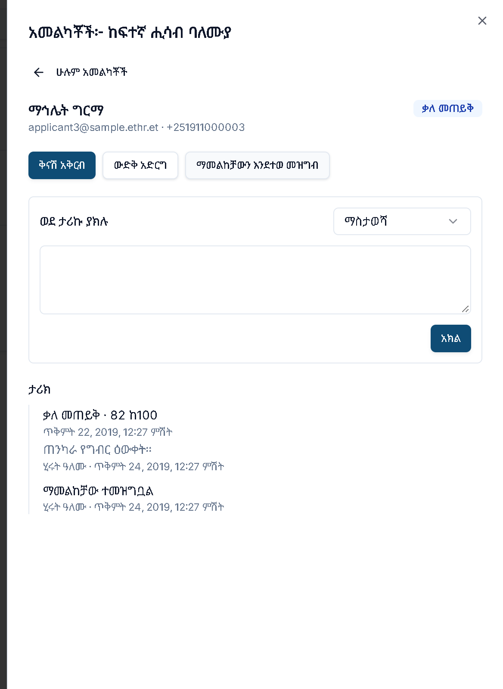

ያው ኢሜይል ወይም ስልክ ያለው ሌላ አመልካች ካለ «ተመሳሳይ ኢሜይል ወይም ስልክ ተገኝቷል» ይላል፤ ETHR ሁለቱን አያዋህድም። ውድቅ የተደረገን ወይም ራሱን ያገለለን አመልካች **የግል መረጃውን ሰርዝ** ያጠፋል፤ ደረጃዎቹ እና ቀኖቹ ይቀራሉ።

## ቅናሽ እና መቅጠር

1. **ቅናሽ አቅርብ** **የመጀመሪያ ቀን** (ግዴታ)፣ **ወርሃዊ ደመወዝ (ብር)** እና **ውሎች** ይጠይቃል።
2. ቅናሹን ያቀረበው ሰው ራሱ አያጸድቀውም፤ ሌላ የሰው ሃብት አስተዳዳሪ ወይም የድርጅት አስተዳዳሪ **ቅናሹን አጽድቅ** ይጫናል። ደመወዝን የሚወስን ቅናሽ በአንድ ሰው ብቻ እንዳይጸድቅ ነው።
3. ከጸደቀ በኋላ **ቅጠር** ይታያል። **የሰራተኛ መዝገቡን ይፍጠሩ** ቅጹ የመጀመሪያ ቀኑን፣ እና ሰውዬው **በሙከራ ጊዜ ይጀምራል** ከሆነ **የሙከራ ጊዜ ማብቂያ**ን ይጠይቃል።

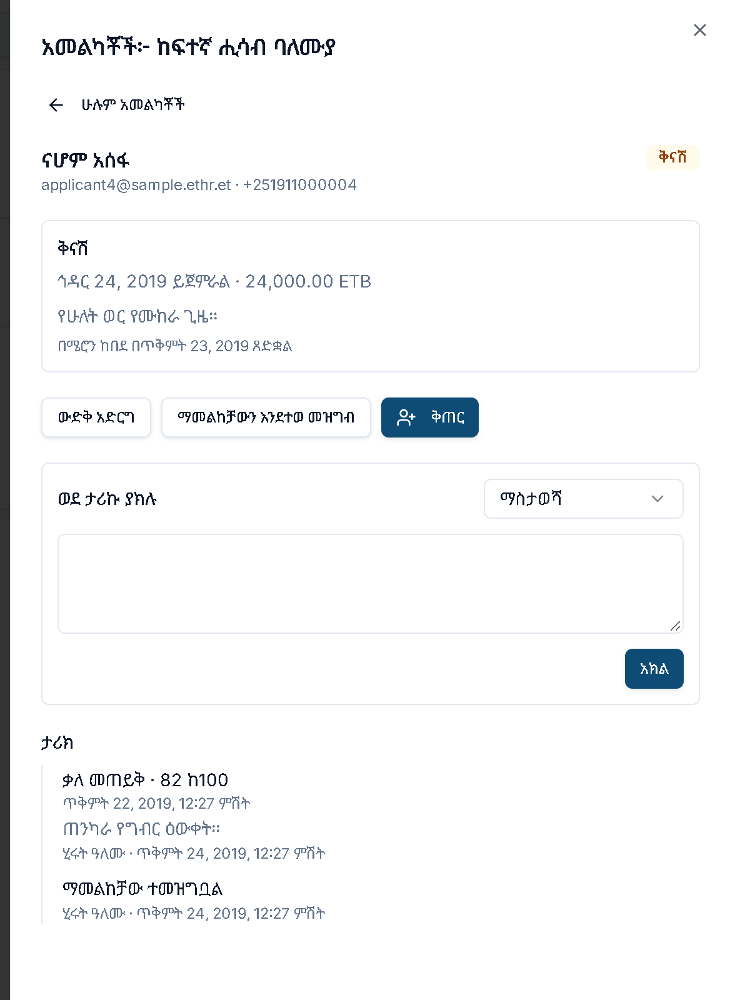

ETHR የሠራተኛ መዝገቡን አንድ ጊዜ ይፈጥራል፣ የሠራተኛ ኮዱንም በራሱ ይሰጣል። ስም፣ ኢሜይል እና ስልክ ከማመልከቻው፣ ክፍል እና ቅርንጫፍ ከክፍት ቦታው፣ ደመወዝ ከቅናሹ ይወሰዳሉ። ሁሉም ቦታዎች ከተሞሉ፣ የዕቅድዎ የሠራተኛ ገደብ ከደረሰ ወይም ሰውዬው አሁን ሠራተኛ ከሆነ አይቀጥርም። ከዚያ አዲሱን ሠራተኛ ከመዝገቡ **ወደ ETHR ጋብዝ** (ክፍል 4.4)።

# መገኘት

## የመገኘት ዝግጅት እና ዘዴዎች

**ቅንብሮች → የመገኘት ደንቦች** በ**የመገኘት ዝግጅት** ሳጥን ይጀምራል።

1. **የመገኘት ዝግጅት** ገና የሚያስፈልግዎትን ይዘረዝራል፣ ከከባዱ ጀምሮ፣ እያንዳንዱን ከማስተካከያ አገናኙ ጋር። ለምሳሌ «በካርታ ላይ ምንም ቅርንጫፍ ወይም ቦታ የለም»።
2. **የነቁ የመገኘት ዘዴዎች፦** ድርጅትዎ የሚጠቀምባቸውን ያብሩ። ያጠፉት ዘዴ ከሠራተኞች ምናሌ ይጠፋል፣ አገልጋዩም አይቀበለውም።
3. **ለውጦችን አስቀምጥ** ይጫኑ።

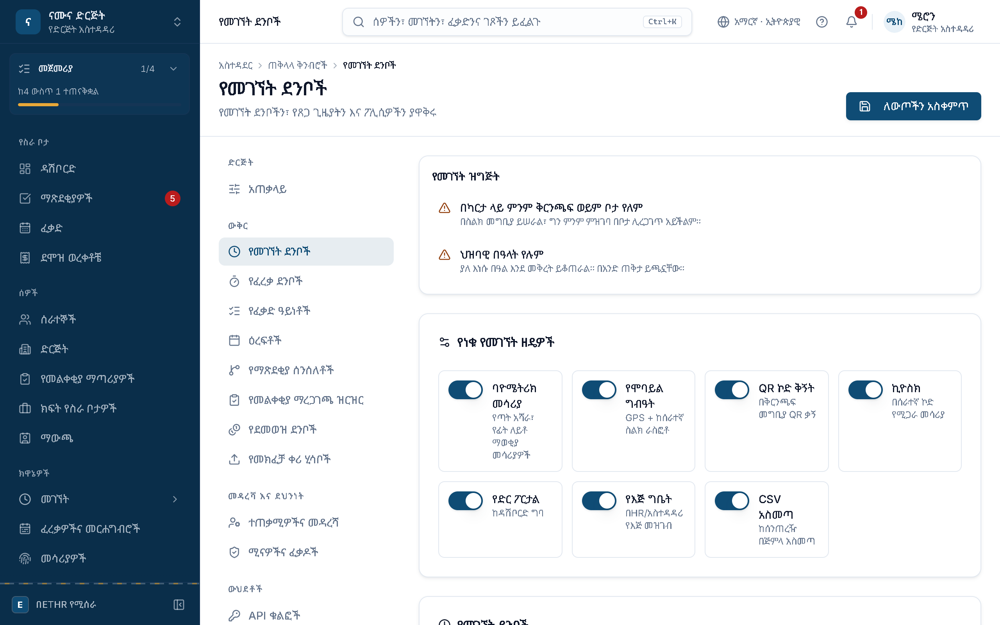

| ዘዴ | የሚስማማው |
|---|---|
| **ባዮሜትሪክ መሳሪያ** | ፋብሪካዎች፣ ባንኮች |
| **የሞባይል ግብዓት** (GPS እና የራስ ፎቶ) | የመስክ ሠራተኞች |
| **QR ኮድ ቅኝት** | የጋራ መግቢያዎች |
| **ኪዮስክ** | መቀበያ ዴስኮች |
| **የድር ፖርታል** | የቢሮ ሠራተኞች |
| **የእጅ ግቤት** | የሰው ሀብት የሚያስገባው |
| **CSV አስመጣ** | ከሰንጠረዥ በጅምላ |

## ቅርንጫፎች፣ የሥራ ቦታዎች እና ካርታው

እያንዳንዱ ቅርንጫፍ ቦታ እና ራዲየስ አለው። በ**ድርጅት → ቅርንጫፎች** ቅጽ ውስጥ በካርታው ላይ ያስቀምጡት፦ ምልክቱን ይጎትቱ፣ አድራሻ ይፈልጉ፣ እዚያ ቆመው **አሁን ያለሁበትን ቦታ ተጠቀም** ይጫኑ፣ ወይም የGoogle Maps አገናኝ ወይም `9.0108, 38.7613` የመሰለ ጥንድ ይለጥፉ።

**የሥራ ቦታዎች** ሰዎች ሊመዘገቡባቸው የሚችሉ ተጨማሪ ቦታዎች ናቸው፦ የፕሮጀክት ቦታ፣ የደንበኛ ግቢ፣ መጋዘን። ለሠራተኞች ወይም ለአንድ ክፍል ሙሉ ይመድቧቸው።

> [!note] ቦታው እንዴት እንደሚረጋገጥ
> የስልክ GPS ሁልጊዜ ትክክል ስለማይሆን፣ ስልኩ የሚገልጸው ትክክለኛነት (እስከ 50 ሜትር) ታሳቢ ይደረጋል። ቦታ እንዲረጋገጥ ሲያበሩ ከተፈቀዱት ቦታዎች ውጭ ያለ ምዝገባ ውድቅ ይደረጋል፤ ሲጠፋ ይመዘገባል እና ምልክት ይደረግበታል። ቦታ ያልተቀመጠለት ቅርንጫፍ ማንንም አይከለክልም።

በሠራተኛው መዝገብ ላይ ያለው **የሚመዘገቡበት ቦታ** ከሦስቱ አንዱ ነው፦ **በቅርንጫፋቸው** (ነባሪው፤ ቅርንጫፉ እና የተመደቡለት ቦታዎች)፣ **መስክ** (ከተመደቡባቸው ቦታዎች በማንኛውም፤ ከሌላ ቦታ የተደረገ ምዝገባ ለግምገማ ይላካል እንጂ አይከለከልም) ወይም **ከርቀት** (ከየትኛውም ቦታ፤ ቦታው ግን ይመዘገባል)።

## ፈረቃዎች

**ክዋኔዎች → ፈረቃዎችና መርሐግብሮች**፦

1. **አዲስ ፈረቃ** መጀመሪያ እና መጨረሻ ሰዓት፣ የእፎይታ ደቂቃ (ዘግይቷል ከመባሉ በፊት)፣ እረፍት እና የሥራ ቀናት ያለው ፈረቃ ይፈጥራል። መጨረሻው ከመጀመሪያው በፊት ከሆነ ፈረቃው ከእኩለ ሌሊት ያልፋል።
2. **ምደባዎች** ፈረቃን ለሠራተኞች፣ ለክፍሎች ወይም ለቅርንጫፎች ይመድባል።
3. **ዙር ፈረቃዎች** ለ24 ሰዓት ወይም ለሦስት ፈረቃ ሥራ የሚዞሩ መርሐ ግብሮችን ይፈጥራል።
4. **ነባሪ** የተባለው ፈረቃ ምደባ የሌለውን ሰው ሁሉ ይመለከታል።

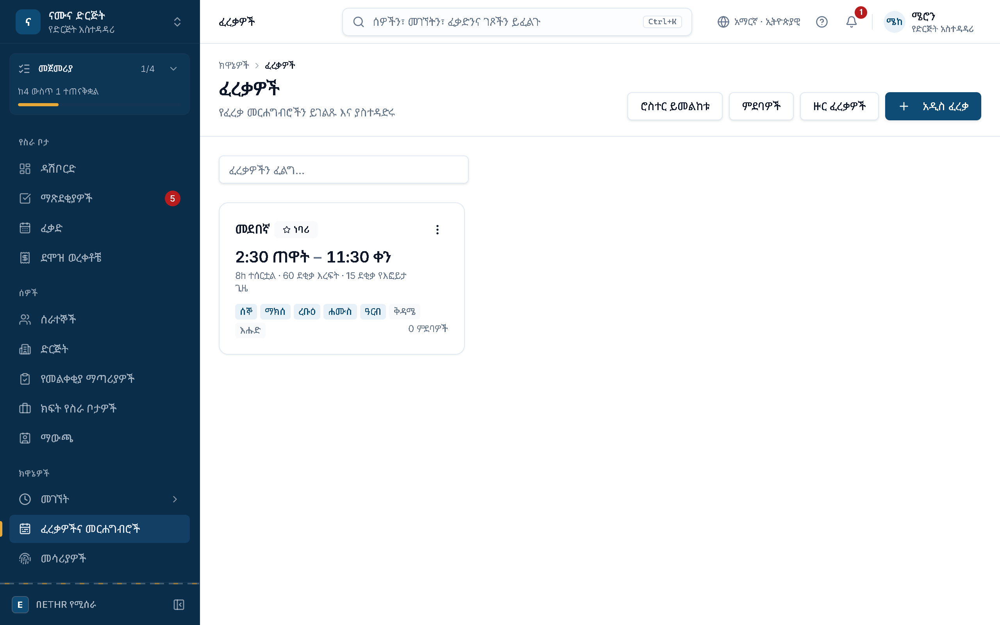

ሁልጊዜ አንድ ንቁ ነባሪ ፈረቃ አለ። ሌላ ፈረቃ ቦታውን እስኪወስድ ድረስ ሊሰረዝ ወይም ሊጠፋ አይችልም። **ሮስተር ይመልከቱ** የሳምንቱን የሥራ ሰሌዳ ያሳያል።

## የተመዘገቡ ስልኮች

**ቅንብሮች → የመገኘት ደንቦች → ማጭበርበርን መከላከል** ውስጥ ያለው **የተመዘገበ ስልክ** አንድ ሰው በሌላው ስም ከሌላ ስልክ እንዳይመዘገብ ይከላከላል። እያንዳንዱ ሰው በአንድ ስልክ ይመዘገባል፤ ስልኩ ሊገለበጥ የማይችል የይለፍ ቁልፍ (passkey) ይይዛል።

| ቅንብር | ከተመዘገበው ስልክ ውጭ የሚመጣ ምዝገባ |
|---|---|
| ጠፍቷል | ምንም አይረጋገጥም |
| አረጋግጥና ገምግም | ይመዘገባል፣ ለግምገማ ምልክት ይደረግበታል |
| የተመዘገበው ስልክ ብቻ | ውድቅ ይደረጋል፣ ሰውዬውም ምክንያቱ ይነገረዋል |

**ክዋኔዎች → መገኘት → ስልኮች** የሚጠብቁ፣ ያላስመዘገቡ፣ የተመዘገቡ እና የተሰረዙ ስልኮችን ያሳያል። ከሥራ ቦታ ውጭ የተመዘገበ ወይም የሚተካ ስልክ እዚህ ማጽደቅ ይጠብቃል።

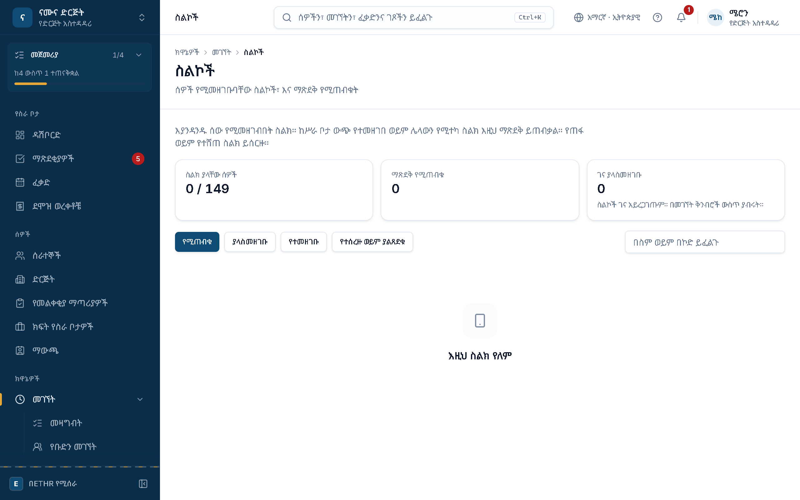

> [!tip] በደረጃ ማስጀመር
> መጀመሪያ **አረጋግጥና ገምግም** ይምረጡ። ሠራተኞች በሥራ ቦታ ሲመዘገቡ ስልካቸውን ያስመዘግባሉ። **ገና ያላስመዘገቡ** ቁጥር ዜሮ ሲሆን **የተመዘገበው ስልክ ብቻ** ይምረጡ።

## ማጭበርበርን መከላከል

እያንዳንዱ ምዝገባ ከ0 እስከ 100 የሆነ **የአደጋ ነጥብ** ያገኛል፣ ከምክንያቶቹ ጋር። ምክንያቶቹ ለምሳሌ፦ ከተፈቀደው ቦታ ውጭ መሆን፣ የተጭበረበረ የሚመስል ቦታ፣ በሁለት ምዝገባዎች መካከል የማይቻል ጉዞ፣ አንድ ስልክ በሁለት ሰዎች መጠቀም፣ እና እንደገና የቀረበ ፎቶ።

- ነጥቡ ከግምገማ ገደቡ (ነባሪ 40፣ በቅርንጫፍ ሊቀየር ይችላል) በላይ ሲሆን በ**ክዋኔዎች → መገኘት → ታማኝነት** ውስጥ የግምገማ ንጥል ይከፈታል። **ምዝገባው ግን ይመዘገባል**፤ በነጥብ ምክንያት ማንም አይከለከልም።
- የደመወዝ ሂደት ከመጽደቁ በፊት ያልተዘጉ ከፍተኛ የአደጋ ንጥሎችን ይዘረዝራል።
- ገምጋሚው ነጥቡን በዝርዝር፣ የራስ ፎቶውን እና ምዝገባውን በካርታ ላይ ያያል።

## የጣት አሻራ እና የፊት መሣሪያዎች

**ክዋኔዎች → መሳሪያዎች** ባዮሜትሪክ መሣሪያዎችን ያስተዳድራል። የሰው ሃብት አስተዳዳሪ ያያቸዋል፤ መሣሪያ ማከል፣ ማረም እና መሰረዝ የሚችለው የድርጅት አስተዳዳሪ ብቻ ነው።

1. **መሳሪያ ጨምር** **መሳሪያ መዝግብ** ቅጹን ይከፍታል፦ **የመሳሪያ ስም**፣ **ቅርንጫፍ** እና **የአስማሚ አይነት**።
2. **የጤንነት ዳሽቦርድ** የሁሉንም መሣሪያዎች ሁኔታ በአንድ ገጽ ያሳያል።
3. የሁኔታ ማጣሪያው **መስመር ላይ**፣ **መስመር ውጭ**፣ **ስህተት** እና **በመጠባበቅ ላይ** ያሉትን ይለያል።

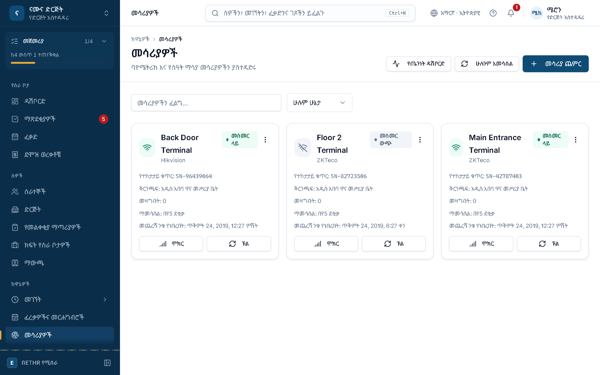

| የአስማሚ አይነት | እንዴት ይገናኛል |
|---|---|
| **ZKTeco (ADMS)** | መሣሪያው ራሱ ወደ ETHR ይልካል። **የተከታታይ ቁጥር** በመሣሪያው ላይ እንደሚታየው ያስገቡ። በመሣሪያው ላይ **COMM → Cloud Server Setting** ይክፈቱ፣ እና በመሣሪያው ገጽ **መሣሪያውን ያገናኙ** ሳጥን ውስጥ ያሉትን የሰርቨር አድራሻ እና ፖርት ያስገቡ። የቢሮው ይፋዊ IP አድራሻ በ**ለዌብሁክ የተፈቀዱ የIP አድራሻዎች** ውስጥ ከሌለ ETHR መሣሪያውን አይቀበልም |
| **Hikvision**፣ **ZKTeco**፣ **Suprema** | **የግንኙነት ቅንብሮች**፦ የIP አድራሻ፣ ወደብ፣ የተጠቃሚ ስም እና የይለፍ ቃል (ለSuprema የAPI ቁልፍ)። ወይም በመሣሪያው ገጽ ላይ ያለውን **የዌብሁክ URL ቅዳ** እና በመሣሪያው ውስጥ ያዋቅሩት |

በእያንዳንዱ ረድፍ ላይ፦ **ግንኙነት ሞክር**፣ **መዛግብት ፑል አድርግ**፣ እና **የመገኘት ታሪክ አስገባ** (ያለፉት 30 ወይም 90 ቀናት፣ ከተወሰነ ቀን ጀምሮ ወይም ሙሉ ታሪክ፤ የተደገሙ ምዝገባዎች ይዘለላሉ)። **የተመዘገቡ ተጠቃሚዎችን ያግኙ** በመሣሪያው ላይ ያሉትን ሰዎች ከሠራተኞች ጋር ያዛምዳል፤ ምንም አይፈጥርም። **እነዚህን ሰዎች ወደ ETHR ያስገቡ** ያልተገኙትን እንደ አዲስ ሠራተኛ ለማስገባት ይወስድዎታል።

**ያልታወቁ ባጆች** ከማንም ሠራተኛ ጋር ያልተዛመዱ ባጆችን ምዝገባዎች ይይዛል፦ **መድብ** ለተመረጠው ሠራተኛ ይመዘግባቸዋል፣ **አስወግድ** ይጥላቸዋል።

በመሣሪያው **አርም** ውስጥ **ወደዚህ መሣሪያ ትዕዛዝ ላክ** ሲበራ ETHR የመሣሪያውን ሰዓት ያስተካክላል፣ የቅርንጫፉን ሰዎችም ያክላል ወይም ያስወግዳል። **ትዕዛዞች** ትር ላይ **ሰዓቱን አሁን አስተካክል** እና **ሁሉንም ሠራተኞች ላክ** አሉ፤ የባጅ ቁጥር የሌላቸው ሰዎች አይላኩም። አንድ ሠራተኛን ብቻ ለማስመዝገብ በመዝገቡ ላይ **በመሣሪያዎች ላይ አስመዝግብ** ይጫኑ (ክፍል 4.4)።

> [!warning] ከመሣሪያ ማስወገድ
> ሰው ከመሣሪያ ሲወገድ የጣት አሻራው እና ፊቱ ከመሣሪያው ይሰረዛሉ። መሣሪያን ከETHR መሰረዝ ግን የመገኘት መዝገቦቹን አያጠፋም።

## ኪዮስክ

ኪዮስክ በመግቢያ ላይ የሚቀመጥ የጋራ ታብሌት ነው፤ ሠራተኞች በእሱ ይመዘገባሉ።

1. **ክዋኔዎች → መገኘት** ገጽ ላይ **ኪዮስኮች**ን ይክፈቱ፣ **ኪዮስክ መዝግብ** ይጫኑ፦ **የኪዮስክ ስም**፣ **ቅርንጫፍ** እና **የአስተዳዳሪ ፒን** (ከ4 እስከ 8 አሃዝ፤ ከኪዮስክ ለመውጣት ያስፈልጋል)።
2. **የኪዮስክ ቶከን** አንድ ጊዜ ብቻ ይታያል፤ **ገልብጥ** ይጫኑ።
3. በታብሌቱ ላይ የድርጅትዎን ETHR አድራሻ ከፍተው `/kiosk` ይጨምሩበት፣ ቶከኑን ይለጥፉ እና **ኪዮስኩን አንቃ** ይጫኑ። ቶከኑ በታብሌቱ ላይ ይቀመጣል።

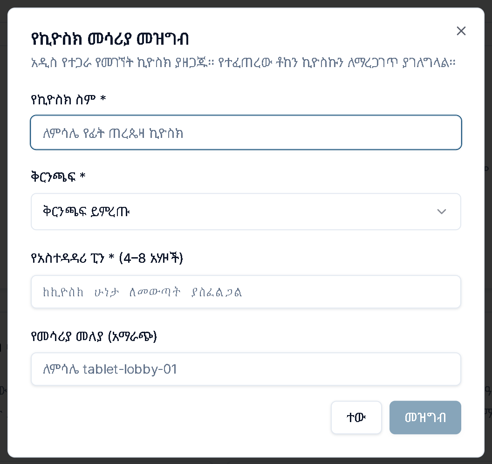{half}

**ከኪዮስክ ውጣ** የአስተዳዳሪ ፒኑን ይጠይቃል። በ**የመገኘት ደንቦች** ውስጥ **የሰራተኛ ፒን ይጠይቁ** ሲበራ እያንዳንዱ ሠራተኛ በመዝገቡ ላይ የሚቀመጥ **የኪዮስክ ፒን** (ከ4 እስከ 6 አሃዝ) ይጠቀማል። አምስት ጊዜ የተሳሳተ ፒን ያስገባ ሰው በዚያ ኪዮስክ ላይ ለ15 ደቂቃ ይቆለፋል። የጠፋ ታብሌት ካለ በ**ኪዮስኮች** ገጽ ላይ **አቦዝን** ወይም **ቶከን ዳግም ፍጠር** ይጫኑ።

## የመገኘት ፎቶዎች

የራስ ፎቶ ያለው ምዝገባ ፎቶው ለተወሰነ ጊዜ ብቻ ይቀመጣል፦

- ፎቶው ከቀኑ የመጨረሻ ምዝገባ በኋላ በ**የመገኘት ደንቦች** ውስጥ ባለው **የመገኘት ፎቶዎችን የሚቆዩበት ጊዜ (ቀናት)** (ከ1 እስከ 90፣ ነባሪ 7) ይቆያል።
- ከዚያ የ48 ሰዓት የግምገማ ጊዜ ይከፈታል፤ የሰው ሀብት እና የክፍሉ ኃላፊ ማሳወቂያ ይደርሳቸዋል።
- ግምገማው ሲያልቅ ያልተያዙ ፎቶዎች ይሰረዛሉ። የመገኘት መዝገቡ ራሱ አይሰረዝም።

**ክዋኔዎች → መገኘት → ፎቶዎች** ላይ **አሳይ** ማጣሪያ **ሁሉም**፣ **ለመሰረዝ የደረሱ** ወይም **የተያዙ** ፎቶዎችን ያሳያል። **የመግቢያ ፎቶ** እና **የመውጫ ፎቶ** ፎቶውን ይከፍታሉ፤ እያንዳንዱ እይታ በኦዲት ምዝገባው ውስጥ ይመዘገባል። ፎቶ ለቅሬታ ወይም ለምርመራ ከተፈለገ **ለቅሬታ አቆይ** ከምክንያት ጋር ከመሰረዝ ያቆየዋል፤ **ማቆያውን ልቀቅ** ይለቀዋል።

# ፈቃድ እና በዓላት

## የፈቃድ አይነቶች እና የሥራ ሳምንት

**ቅንብሮች → የፈቃድ ዓይነቶች**፦

1. **የሥራ ሳምንት** የድርጅትዎ የሥራ ቀናትን ይወስናል። የፈቃድ ጥያቄ የሚቆጥረው እነዚህን ቀናት ብቻ ነው፤ በዓላት አይቆጠሩም። መቀየር የሚችለው የድርጅት አስተዳዳሪ ብቻ ነው።
2. **የፈቃድ አይነት ጨምር** አዲስ አይነት ይፈጥራል፤ ስም፣ ኮድ፣ ነባሪ ቀናት እና የክምችት አይነት (**ወርሃዊ**፣ **ዓመታዊ** ወይም አንድ ጊዜ)።

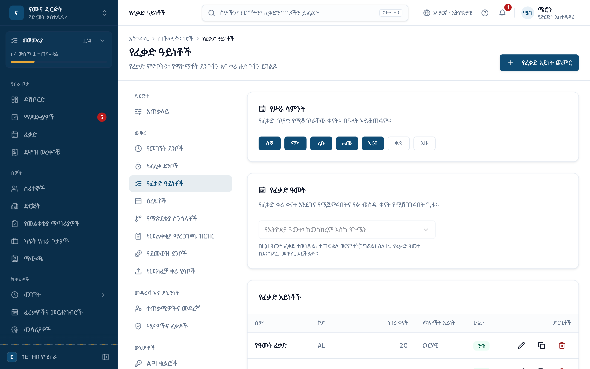

በዝግጅቱ ወቅት የኢትዮጵያ ነባሪዎች ይፈጠራሉ፦

| አይነት | ቀናት | ክምችት |
|---|---|---|
| የዓመት ፈቃድ | 16 | ወርሃዊ |
| የሕመም ፈቃድ | 30 | ዓመታዊ |
| የወሊድ ፈቃድ | 120 | አንድ ጊዜ |
| የአባትነት ፈቃድ | 3 | አንድ ጊዜ |
| የሐዘን ፈቃድ | 3 | ዓመታዊ |

ሁሉም ሊቀየሩ ይችላሉ። ጋብቻ፣ ትምህርት፣ ያለክፍያ ፈቃድ እና ሌሎችም እንደ ሥራ ዘርፍዎ ይጨመራሉ።

## በዓላት

**ቅንብሮች → ዕረፍቶች**፦

1. **የኢትዮጵያ በዓላትን በራስ-ሰር ለይ** እንቁጣጣሽን፣ መስቀልን፣ ገናን፣ ጥምቀትን እና ሌሎችንም ያስገባል።
2. **በዓል ጨምር** የድርጅትዎን የራሱን በዓል ያስገባል።

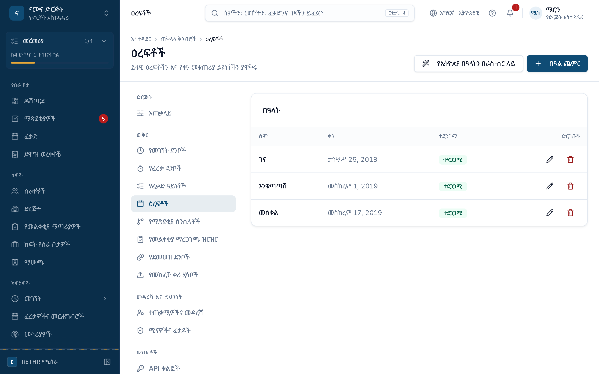

በዓላት የፈቃድ ቀናት ሲቆጠሩ አይቆጠሩም።

## የማጽደቂያ ሰንሰለቶች

ሰንሰለት ከሌለ እያንዳንዱ የፈቃድ፣ የማስተካከያ ወይም የመገለጫ ለውጥ ጥያቄ ማጽደቅ በሚችል ማንኛውም ሰው በአንድ ደረጃ ይወሰናል። ከአንድ በላይ አጽዳቂ ከፈለጉ (ለምሳሌ መጀመሪያ ተቆጣጣሪ፣ ከዚያ የሰው ሀብት)፦

1. **ቅንብሮች → የማጽደቂያ ሰንሰለቶች** ላይ **አዲስ ሰንሰለት** ይጫኑ፣ የጥያቄውን አይነት እና ደረጃዎቹን ይምረጡ።

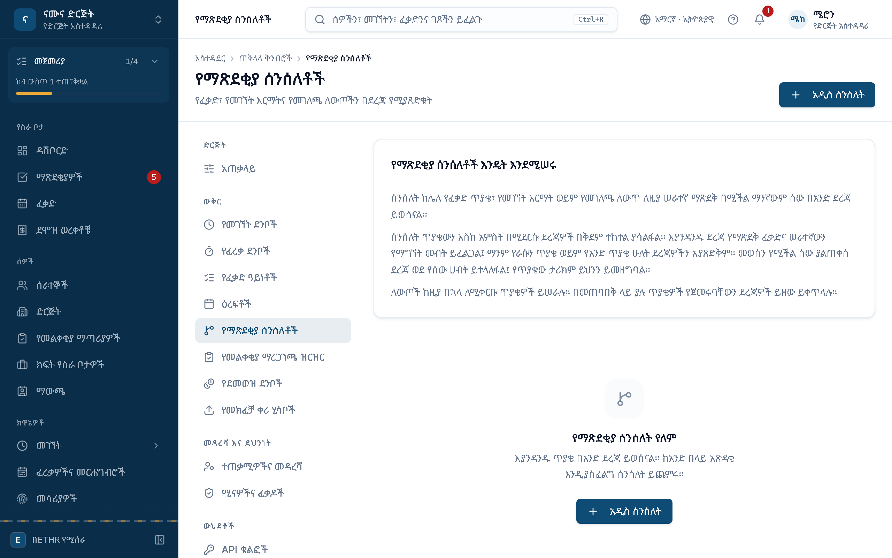

ለውጡ ከዚያ በኋላ ለሚቀርቡ ጥያቄዎች ይሠራል። በመጠባበቅ ላይ ያሉ ጥያቄዎች በጀመሩባቸው ደረጃዎች ይቀጥላሉ።

## የቀን መቁጠሪያ

**ቅንብሮች → አጠቃላይ** ውስጥ የድርጅቱን ነባሪ ቋንቋ እና የቀን መቁጠሪያ (ኢትዮጵያዊ ወይም ግሪጎሪያን) ይመርጣሉ። እያንዳንዱ ተጠቃሚ የራሱን መምረጥ ይችላል፤ ነባሪው የሚሠራው እስኪመርጡ ድረስ ነው። የቀን ሳጥኖች የሌላውን የቀን መቁጠሪያ ቀን ከሥራቸው ያሳያሉ።

# ደመወዝ

## የደመወዝ ቅንብሮች

**ቅንብሮች → የደመወዝ ደንቦች** (የድርጅት አስተዳዳሪ ብቻ)፦

- **የደመወዝ መርሐ ግብር፦** ደመወዝ የሚሠራበት የወር ቀን፣ የበጀት ዓመቱ የሚጀምርበት ወር (ለአብዛኞቹ የግል ድርጅቶች መስከረም፣ ለመንግሥት ሐምሌ)፣ የጳጉሜ ክፍያ (ሙሉ ወር፣ ወይም ቀኖቹ በቀን ተመን) እና የጡረታ ዕድሜ።
- **የገቢ ግብር ደረጃዎች፦** የኢትዮጵያ ተመኖች አስቀድመው ገብተዋል፤ መንግሥት ሲቀይራቸው ያዘምኑ።
- **የትርፍ ሰዓት ተመኖች፦** ነባሪዎቹ የሕግ ዝቅተኛዎቹ ናቸው፦ ቀን 1.5፣ ሌሊት 1.75፣ የሳምንት ዕረፍት ቀን 2.0፣ ይፋዊ በዓል 2.5።
- **አበሎች**

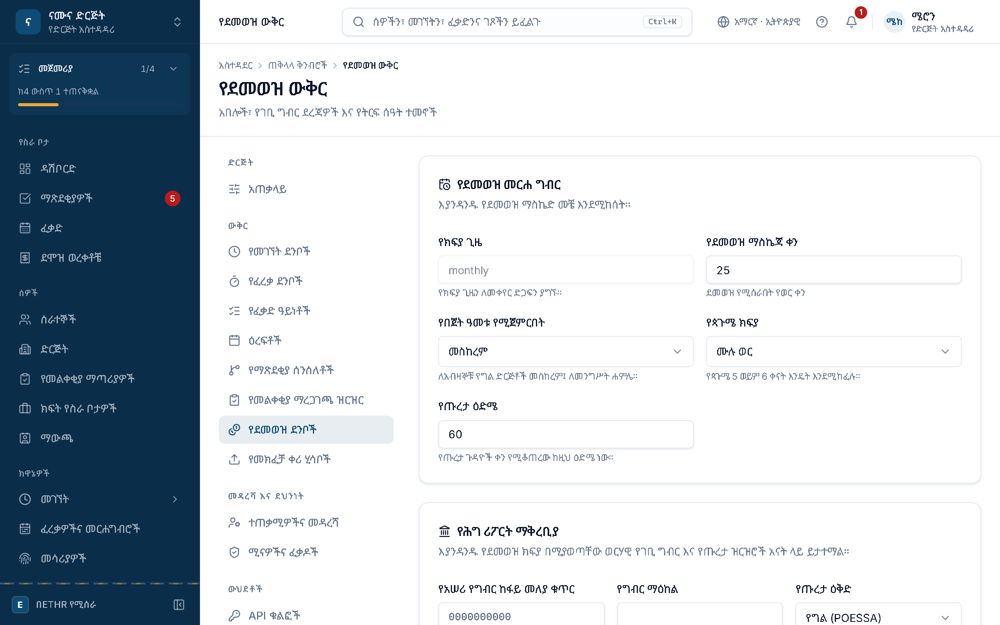

> [!note]
> ጡረታ በሕግ የተወሰነ ነው፦ ሠራተኛው 7 በመቶ፣ አሠሪው 11 በመቶ። ሊቀየር አይችልም።

## ደመወዝ ማስኬድ

**ፋይናንስ → ደመወዝ → ሂደቶች**፦

1. **ደመወዝ አስሂድ** ይጫኑ፣ የክፍያ ጊዜውን ይምረጡ እና ያረጋግጡ።
2. አዲሱ ሂደት **ማጽደቅ በመጠበቅ ላይ** ተብሎ በዝርዝሩ ውስጥ ይታያል። ይጫኑት።

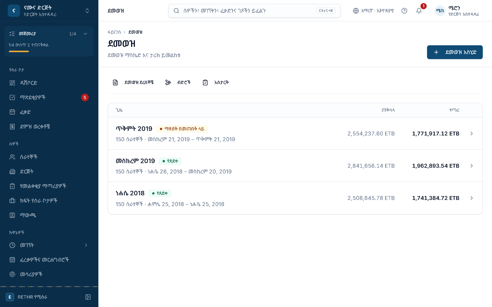

ሂደቱ ለእያንዳንዱ ሠራተኛ፦ የተረጋገጠውን መገኘት ይወስዳል፣ የፈቃድ ቀናትን ያሰላል፣ መሠረታዊ ደመወዝን (ለአዲስ ተቀጣሪ እና ለለቀቀ በቀን ተከፋፍሎ) ያሰላል፣ የትርፍ ሰዓት እና አበል ይጨምራል፣ የገቢ ግብር፣ ጡረታ እና ብድር ይቀንሳል፣ የደመወዝ ወረቀቶችን እና የባንክ ማስተላለፊያ ፋይል ያዘጋጃል።

## ደመወዝ መገምገም እና ማጽደቅ

የሂደቱ ገጽ አራት ደረጃዎችን ያሳያል፦ **ማስላት**፣ **መገምገም**፣ **ማጽደቅ** እና **ተከፍሏል**።

1. **መገምገም** ደረጃ ላይ ድምሮቹን እና መዝገቡን ይፈትሹ። ከደረጃዎቹ ሥር **ጠቅላላ ድምር**፣ **ተጣራ ድምር**፣ **ጠቅላላ ግብር** እና የሠራተኞች ብዛት፣ ከሥራቸውም እያንዳንዱ ሠራተኛ ይታያሉ።
2. ሁሉም ትክክል ሲሆን **ደመወዝ አጽድቅ** ይጫኑ። የሚችለው የድርጅት አስተዳዳሪ ብቻ ነው።
3. **ወጪ ያውጡ** የባንክ ፋይሉን እና ሪፖርቶቹን ያወርዳል።

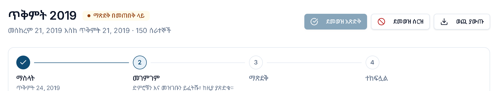

ሲጸድቅ ሠራተኞች የደመወዝ ወረቀታቸውን ወዲያውኑ በ**ደሞዝ ወረቀቶቼ** ያያሉ። **ደመወዝ ሰርዝ** የተሳሳተ ሂደትን ከምክንያት ጋር ይሰርዛል፤ የብድር እና የወጪ መጋራት ቀሪዎችም ወደ ቀድሞው ይመለሳሉ። መሰረዙ አይቀለበስም፤ የተስተካከለ ሂደት እንደገና ማስኬድ ይችላሉ።

> [!warning] ከማጽደቅዎ በፊት
> ገጹ ያለ ፈቃድ የቀሩ ቀናት ያሏቸውን ሠራተኞች እና ያልተዘጉ ከፍተኛ የአደጋ መገኘት ንጥሎችን ከዘረዘረ መጀመሪያ ይመልከቷቸው። ዝርዝሩ ምልክት ብቻ ነው፤ ደመወዙን በራሱ አይቀንስም። የጸደቀ ደመወዝ ከተሠራ በኋላ የመገኘት ማስተካከያ ቢጸድቅ ደመወዙ በራሱ አይታደስም።

## መገኘትን ከደመወዝ በፊት ማስታረቅ

**ፋይናንስ → ደመወዝ → ሂደቶች** ላይ ያለው **አስታርቅ** ከደመወዝ በፊት መስተካከል ያለባቸውን የመገኘት ጉዳዮች ይዘረዝራል፦ ምንም መዝገብ የሌለው ቀሪ፣ ማርፈድ፣ ቀድሞ መውጣት፣ መውጫ የሌለው ቀን፣ በራስ-ሰር የተዘጋ መውጫ፣ ከፀደቀው በላይ ትርፍ ሰዓት፣ ለግምገማ የተጠቆመ ምዝገባ እና የተደጋገሙ ምዝገባዎች።

1. **ከ** እና **እስከ** ጊዜውን ይምረጡ (ነባሪው ከወሩ መጀመሪያ እስከ ዛሬ)፣ **አሳይ** ይጫኑ።
2. ቀሪ ቀንን እዚሁ **አስተካክል**፦ የፈቃድ ዓይነት ይምረጡ፣ ምክንያት ይጻፉ እና **ለማፅደቅ አቅርብ**። የማርፈድ ቅናሽ ሲበራ ማርፈድም እዚሁ ይስተካከላል፤ ያመለጡትን ደቂቃዎች መቀነስ ወይም መተው ይችላሉ።
3. ሌላው ሁሉ **ክፈት** አለው፤ ጉዳዩ የሚስተካከልበትን ገጽ ይከፍታል፦ ማስተካከያዎች፣ የትርፍ ሰዓት ጥያቄዎች፣ ታማኝነት ወይም ማጽደቂያዎች።

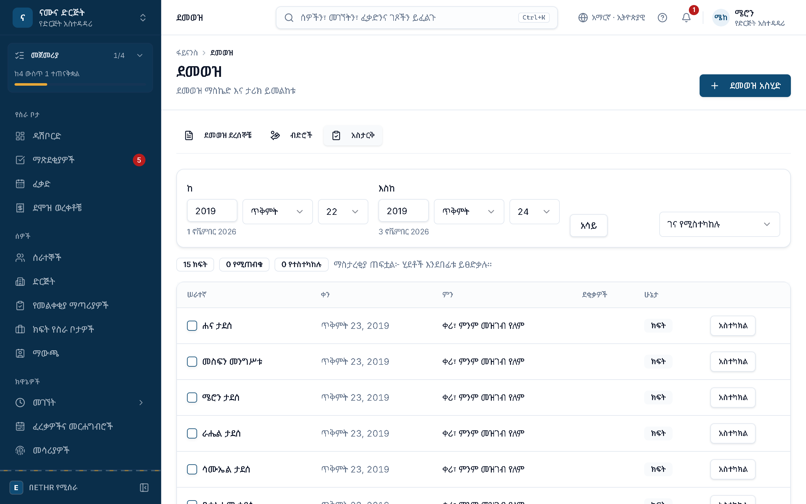

እዚህ የቀረበው እንደ ማንኛውም ጥያቄ በማጽደቂያ ያልፋል፤ ደመወዝን ወዲያውኑ አይቀይርም። በ**የመገኘት ደንቦች** ውስጥ ያለው **ከደመወዝ በፊት መገኘትን አስታርቅ** ደንቡን ይወስናል፦ **ጠፍቷል**፣ **ምክረ ሀሳብ** ወይም **ግዴታ**። **ግዴታ** ሲሆን ሁሉም ጉዳዮች እስኪስተካከሉ ድረስ ደመወዙ አይጸድቅም።

## ብድሮች እና የወጪ መጋራት

**ፋይናንስ → ደመወዝ → ብድሮች**፦ **አዲስ ብድር** ሠራተኛ፣ **የብድር መጠን (ETB)**፣ **ወርሃዊ ቅናሽ (ETB)** እና ምክንያት ይጠይቃል፣ ከዚያ **ብድር ፍጠር**። ወርሃዊ ቅናሹ ቀሪው ዜሮ እስኪሆን ድረስ በየወሩ ከደመወዝ ይቀነሳል፤ ከዚያ ብድሩ **የተጠናቀቀ** ይሆናል።

**ፋይናንስ → ደመወዝ → የወጪ መጋራት** ለምሳሌ የከፍተኛ ትምህርት የወጪ መጋራት ክፍያን ይይዛል። **አዲስ ግዴታ** **ጠቅላላ ግዴታ (ብር)**፣ **የተቀናሽ ምጣኔ (%)** እና **የተጀመረበት ቀን** ይጠይቃል፣ ከዚያ **ግዴታ መዝግብ**። ምጣኔው ሆን ተብሎ ባዶ ነው፤ ከሠራተኛው ስምምነት ያስገቡት። በየወሩ የሚቀነሰው ከጠቅላላ ደመወዙ ምጣኔው ነው፣ ከቀሪው ግን አይበልጥም። **አግድ** ቅናሹን ያቆማል፣ **ቀጥል** ይመልሰዋል።

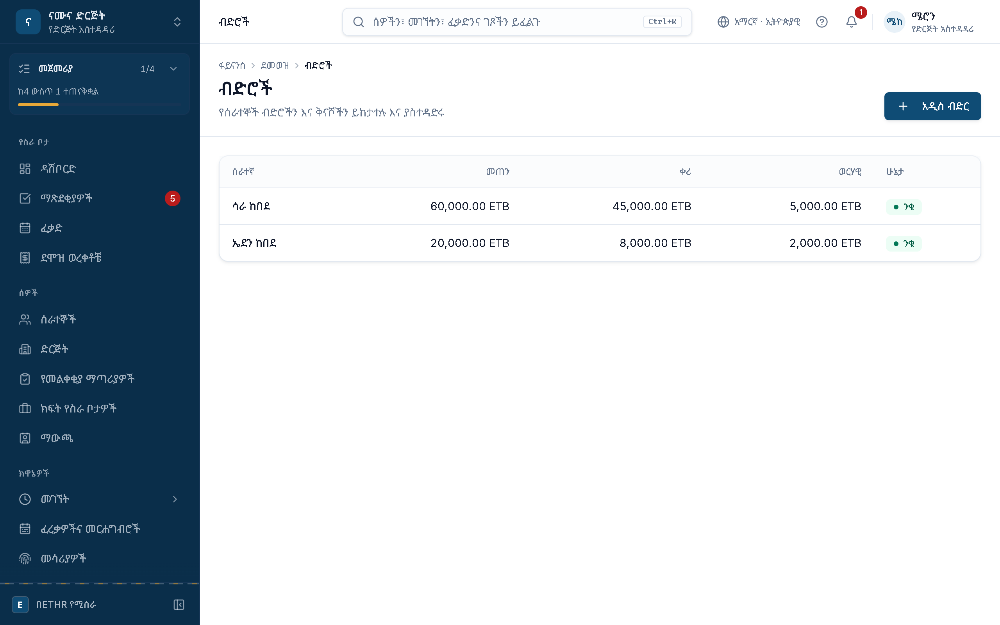

> [!note] ቀሪዎቹ መቼ ይቀየራሉ
> ሂደት ሲሰላ ምንም ቀሪ አይቀየርም። ቀሪዎቹ የሚቀነሱት ሂደቱ ሲጸድቅ ነው፣ የደመወዝ ወረቀቶቹ የሚያሳዩትን ያህል። ሂደት ሲሰረዝ የተቀነሰው ይመለሳል። ሂደቱ ከተሰላ በኋላ ብድር ከተከፈለ ወይም ግዴታ ከታገደ ማጽደቅ አይቻልም፤ ሂደቱን ሰርዘው ጊዜውን እንደገና ያስሉ።

# ሪፖርቶች

ሪፖርቶች ለሰው ሀብት፣ ለፋይናንስ እና ለድርጅት አስተዳዳሪዎች ናቸው።

1. **ገንቢ** ትር የራስዎን ሪፖርት ያዘጋጃል።
2. **የውሂብ ምንጭ** ይምረጡ፦ ሠራተኞች፣ መገኘት፣ ፈቃድ ወይም ደመወዝ።
3. **አምዶች** ውስጥ የሚፈልጉትን ምልክት ያድርጉ።
4. **ማጣሪያዎች** (ለሠራተኞች ሁኔታ፣ ለመገኘት የቀን ክልል፣ ለፈቃድ ዓመት)፣ እንዲሁም ከሥሩ በቡድን መደርደር እና ቅደም ተከተል ያክሉ።

በመጨረሻ ከታች ያለውን **ቅድመ እይታ አሂድ** ይጫኑ። ውጤቱ በቀኝ በኩል ይታያል፤ ከዚያ **CSV አውርድ** ወይም እንደ አብነት ያስቀምጡ።

> [!tip]
> የወር የግብር እና የጡረታ ድምሮችን ለማግኘት የደመወዝ ሪፖርት ይገንቡ እና በክፍል ወይም በወር ይደርድሩት፤ የተደረደሩ ሪፖርቶች የእያንዳንዱን ቡድን ድምር ያሳያሉ።

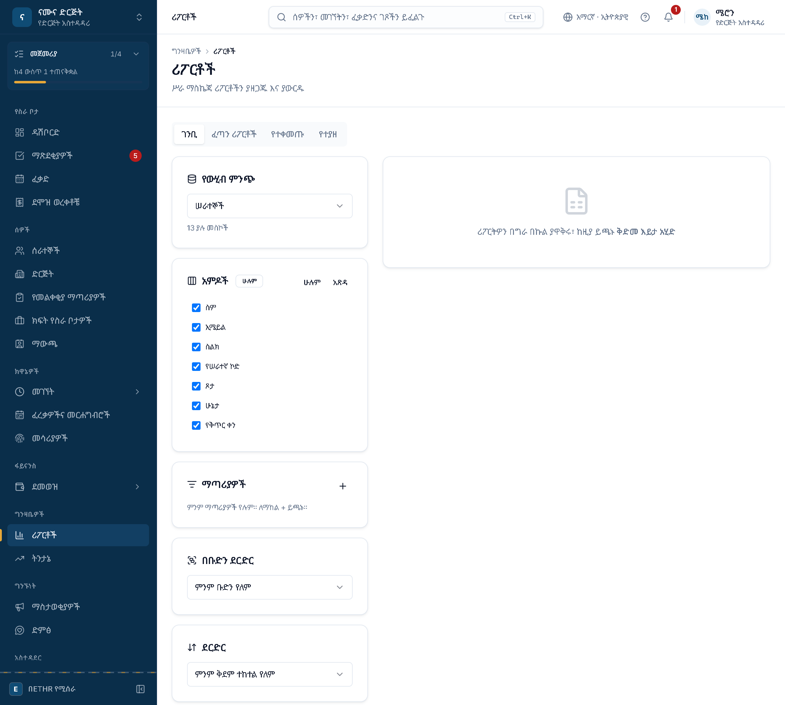

**ፈጣን ሪፖርቶች** ለእያንዳንዱ የውሂብ ምንጭ አንድ ዝግጁ ሪፖርት አላቸው፣ ለምሳሌ ወርሃዊ የሰዓት ሰሌዳ። **የተቀመጡ** ትር የተቀመጡ ሪፖርቶችን እንደገና ያስኬዳል ወይም በየቀኑ፣ በየሳምንቱ ወይም በየወሩ በኢሜይል እንዲላኩ ያቅዳል (**ያቅዱ**)። የተቀመጠ ሪፖርት ሊሰረዝ እንጂ ሊታረም አይችልም።

# ተጠቃሚዎች እና ሚናዎች

## ተጠቃሚዎችን መጋበዝ

**ቅንብሮች → ተጠቃሚዎችና መዳረሻ**፦

1. **ተጠቃሚ ጋብዝ** ይጫኑ።
2. **ሚና** አምዱ የእያንዳንዱን ሰው ሚና ያሳያል፤ በረድፉ ላይ ያለው የእርሳስ ምልክት ይቀይረዋል።

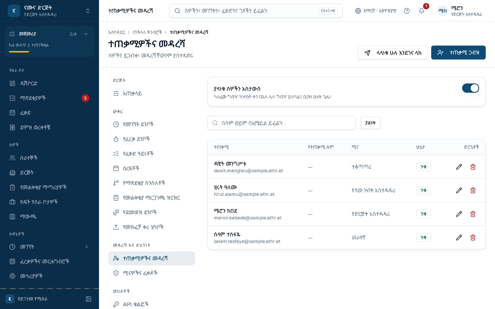

በግብዣው ቅጽ ውስጥ ኢሜይል፣ ከተፈለገ የተጠቃሚ ስም እና ሚና ያስገቡ፣ ከዚያ **ግብዣ ላክ** ይጫኑ። ተጠቃሚው ኢሜይል ደርሶት የራሱን የይለፍ ቃል ይመርጣል። ግብዣውን ያልተቀበሉ ሰዎች ከሦስት ቀን በኋላ እንደገና ይጋበዛሉ፣ ቢበዛ ሁለት ጊዜ፤ **ላላነቁ ሁሉ እንደገና ላክ** ወዲያውኑ ይልካል።

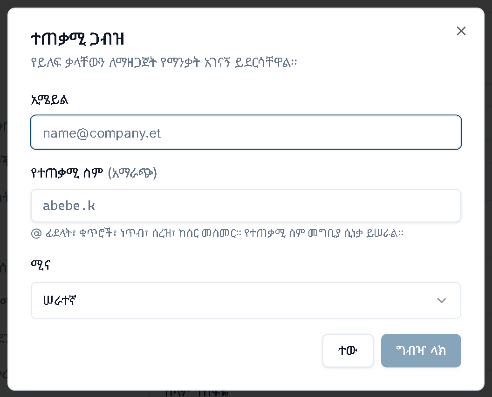{half}

## ባለሁለት ደረጃ ማረጋገጫን ማስጀመር

ተጠቃሚ የማረጋገጫ መተግበሪያውን ያለበትን ስልክ ካጣ፣ በ**ተጠቃሚዎችና መዳረሻ** ዝርዝር ውስጥ በስሙ ረድፍ ላይ ያለውን የጋሻ ምልክት ይጫኑ። ተጠቃሚው በይለፍ ቃሉ ገብቶ እንደገና ያዘጋጀዋል፣ ኢሜይልም ይደርሰዋል። በራስዎ መለያ ወይም ከእርስዎ በላይ በሆነ ሚና ላይ አይሠራም።

## ብጁ ሚናዎች

**ቅንብሮች → ሚናዎችና ፈቃዶች → ሚና ፍጠር** የራስዎን ሚና ይፈጥራል። ብጁ ሚና የተጠቃሚውን አብሮ የተሰራ ሚና ፈቃዶች ይተካል፣ እና ባለቤቶቹ የማንን መዝገብ እንደሚደርሱ ይወስናል፦ የራሳቸውን፣ ቀጥታ ሪፖርቶቻቸውን፣ ቡድናቸውን፣ ክፍላቸውን፣ ቅርንጫፋቸውን ወይም ሁሉንም። ሚናውን ለተጠቃሚ መስጠት የሚችለው ሚናው የሚሰጠውን ሁሉ የያዘ ሰው ብቻ ነው። ተጠቃሚ የያዘው ሚና አይሰረዝም።

# የድርጅቱ ይፋዊ ገጽ

እያንዳንዱ ድርጅት ሠራተኞቹ የሚገቡበት እና ሌሎች የሚያዩት ይፋዊ ገጽ አለው፦ የድርጅቱ ስም፣ አርማ፣ የእንኳን ደህና መጡ መልእክት፣ ዜና፣ በዓላት እና የመግቢያ ቁልፍ። የሚያዘጋጀው የድርጅት አስተዳዳሪ ነው፣ በ**ቅንብሮች → አጠቃላይ** ውስጥ።

## አድራሻ

**አጠቃላይ** ትር ላይ ያለው **አድራሻ** ሳጥን **የአሁኑ አድራሻ**ን ያሳያል። ከሦስቱ አንዱን ይምረጡ፦

| አይነት | አድራሻው |
|---|---|
| **የጋራ አድራሻ** | `ethr.et/<የድርጅትዎ ስም>` |
| **የራስ ንዑስ ጎራ** | `<የድርጅትዎ ስም>.ethr.et` |
| **የራስ ጎራ** | የድርጅትዎ የራሱ ጎራ። **ጎራ** ያስገቡ፣ የሚታዩትን ሁለት የDNS መዝገቦች በጎራዎ አስተዳዳሪ ዘንድ ያክሉ፣ ከዚያ **ጎራ ያረጋግጡ**። ሁኔታው **ማረጋገጫ በመጠባበቅ ላይ** ከሆነ ወደ **ተረጋግጧል** ይቀየራል። ዕቅድዎ የራስ ጎራን ካላካተተ ምርጫው አይገኝም |

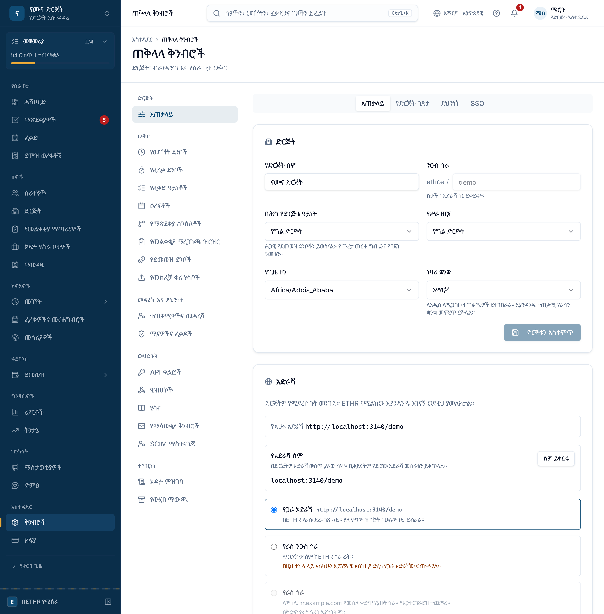

**ስም ይቀይሩ** የአድራሻውን ስም ይቀይራል። **አዲስ ስም** ሲተይቡ መገኘቱ ወዲያውኑ ይረጋገጣል (**ይገኛል**)፤ ከዚያ **ቀጥል** እና **አድራሻ ይቀይሩ**። የድሮው ስም መሥራቱን ይቀጥላል፣ ወደ አዲሱ ያስተላልፋል፣ ለሌላ ድርጅትም አይሰጥም። በድሮው ንዑስ ጎራ የገቡ ሰዎች እንደገና መግባት አለባቸው።

## የድርጅት ገጽታ

**የድርጅት ገጽታ** ትር ላይ፦

1. **አርማዎን ይጫኑ** (PNG፣ JPG ወይም WebP፣ እስከ 1 ሜባ)። ለጨለማ ዳራዎች የተለየ አርማ እና **ካሬ ምልክት** መጨመር ይችላሉ።
2. **ዋና ቀለም**፣ **ሁለተኛ ቀለም** እና **አጉልቶ ማሳያ ቀለም** ይምረጡ፣ ከዚያ **ገጽታን አስቀምጥ** ይጫኑ።

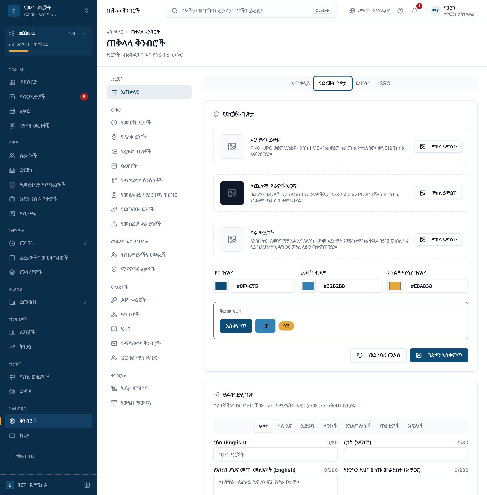

አርማው እና ቀለሞቹ በይፋዊ ገጹ፣ በመግቢያ ገጹ እና በጎን ምናሌው ላይ ይታያሉ። **ወደ ነባሪ መልስ** የETHR ቀለሞችን ይመልሳል።

## የገጹ ይዘት

በዚያው ትር ላይ ያለው **ይፋዊ ድረ ገጽ** ሳጥን የይፋዊ ገጹን ይዘት ያዘጋጃል። እዚህ የሚጻፈው ሁሉ ለማንም ይታያል።

| ትር | ይዘቱ |
|---|---|
| **ቃላት** | ርዕስ፣ የእንኳን ደህና መጡ መልእክት፣ እና ዳራ (የብራንድ ቀለም፣ ቅልመት፣ ንድፍ ወይም ፎቶ) |
| **ስለ እኛ** | የተመሠረተበት ዓመት፣ ዘርፍ እና የሠራተኞች ብዛት |
| **አድራሻ** | አድራሻ፣ የሥራ ሰዓት፣ የሰው ሀብት ኢሜይል እና ስልክ፣ ቅርንጫፎች |
| **ሊንኮች** | ድረ ገጽ፣ የግላዊነት እና የአጠቃቀም ደንቦች፣ ማኅበራዊ ሚዲያ |
| **አገልግሎቶች** | እስከ 8 አገልግሎቶች |
| **ጥያቄዎች** | እስከ 12 ተደጋግመው የሚጠየቁ ጥያቄዎች |
| **ክፍሎች** | በገጹ ላይ የሚታዩ ክፍሎች እና ቅደም ተከተላቸው |

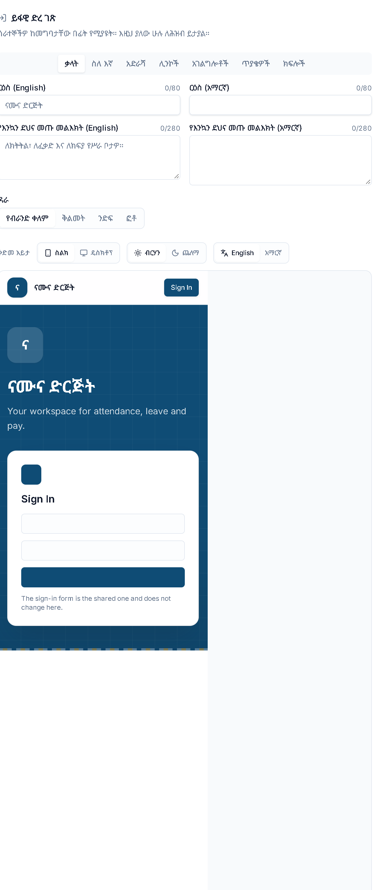

ባዶ ክፍል በርቶም ቢሆን አይታይም። **ይህን ገጽ በፍለጋ ሞተሮች ውስጥ ዘርዝር** በነባሪ በርቷል፤ ሲጠፋ ገጹ በፍለጋ ሞተሮች አይገኝም። ሲጨርሱ **ይፋዊ ድረ ገጹን አስቀምጥ** ይጫኑ። **ይፋዊ ድረ ገጽዎን ያጋሩ** ሊንኩን ይቀዳል፣ ገጹን ይከፍታል ወይም ለማስታወቂያ ሰሌዳ የሚሆን የQR ኮድ ያወርዳል።

## ዜና እና ክፍት የስራ ቦታዎች

ይፋ እንዲሆን የመረጡት ክፍት የስራ ቦታ (ክፍል 5.1) በገጹ «ክፍት የስራ ቦታዎች» ክፍል ውስጥ ይታያል።

ማስታወቂያ ሲጽፉ (ክፍል 13.1) **በድርጅቱ ይፋዊ ድረ ገጽ ላይ አሳይ** ካበሩ፣ ማስታወቂያው በይፋዊ ገጹ ዜና ውስጥም ይታያል። ይህ የሚሠራው ለመላው ድርጅት ለሆኑ ማስታወቂያዎች ብቻ ነው። **ለይተህ አቅርብ** ዜናውን ከፊት ያስቀምጠዋል።

## በETHR ድረ-ገጽ ላይ

**የድርጅት ገጽታ** ትር ላይ ያለው **ድርጅታችንን በETHR ድረ-ገጽ ላይ አሳይ** በነባሪ በርቷል፦ የድርጅትዎ ስም፣ አርማ እና ሊንክ በ`ethr.et` ላይ ይታያሉ። የሚታየው ሙከራው ወይም ምዝገባው ንቁ ሲሆን እና በቂ ሰዎች በETHR ውስጥ ሲመዘገቡ ብቻ ነው። ማሳየት ካልፈለጉ ያጥፉት።

# ከሌሎች ሥርዓቶች ጋር ማገናኘት

**ቅንብሮች → ውህደቶች** ETHRን ከሌሎች ሥርዓቶች ጋር ያገናኛል። ይህ ምዕራፍ ለድርጅትዎ የአይቲ ባለሙያም ጭምር ነው።

## API ቁልፎች

1. **ቁልፍ ፍጠር** ይጫኑ፦ **የቁልፍ ስም**፣ **ችሎታዎች** እና **የአገልግሎት ጊዜ** (30 ቀናት፣ 90 ቀናት፣ 1 ዓመት ወይም አያበቃም)።
2. ቁልፉ አንድ ጊዜ ብቻ ይታያል፤ አሁኑኑ ቀድተው በሚስጥር ያስቀምጡት።
3. **ሻር** ቁልፉን ወዲያውኑ ያቆማል፤ አይቀለበስም።

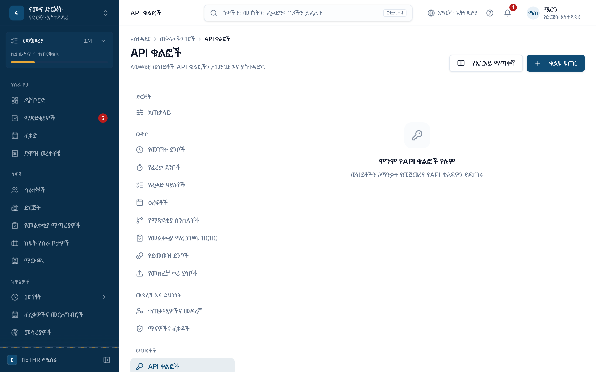

ችሎታዎቹ በእንግሊዝኛ ይታያሉ፦ `read` ማንኛውንም ማንበብ፣ `write` ማንኛውንም መቀየር ይፈቅዳሉ፤ `employees`፣ `attendance`፣ `leave`፣ `payroll` እና `reports` ደግሞ የዚያን ክፍል ሁሉ ይፈቅዳሉ። ቁልፉ እንደፈጠረው ሰው ይሠራል፣ ግን የትኛውም ቁልፍ ቁልፎችን፣ ዌብሁኮችን፣ ተጠቃሚዎችን፣ ሚናዎችን ወይም ቅንብሮችን መቀየር አይችልም። **የኤፒአይ ማጣቀሻ** ለገንቢዎች ጥሪዎቹን ያሳያል።

> [!warning]
> ቁልፉ እንደ ይለፍ ቃል ነው። በኢሜይል ወይም በመልእክት አይላኩት። የወጣ የመሰለዎትን ቁልፍ ወዲያውኑ ይሻሩት፣ አዲስ ይፍጠሩ።

## ዌብሁኮች

ዌብሁክ በETHR ውስጥ አንድ ነገር ሲሆን ለሌላ ሥርዓት ወዲያውኑ ያሳውቃል፤ ለምሳሌ ሠራተኛ ሲፈጠር፣ ፈቃድ ሲጸድቅ፣ ሰው ሲገባ ወይም ደመወዝ ሲጸድቅ።

1. **ዌብሁክ ጨምር** ይጫኑ፣ መልእክቱ የሚላክበትን **URL** ያስገቡ እና **ክስተቶች**ን ይምረጡ።
2. የHMAC ሚስጥሩ አንድ ጊዜ ብቻ ይታያል፤ ተቀባዩ ሥርዓት መልእክቱ ከETHR መምጣቱን በእሱ ያረጋግጣል።
3. **የሙከራ ክስተት ላክ** ግንኙነቱን ይሞክራል (በሰዓት እስከ 10 ጊዜ)፤ **የመላክ ታሪክ** የመጨረሻዎቹን 50 ሙከራዎች ያሳያል።

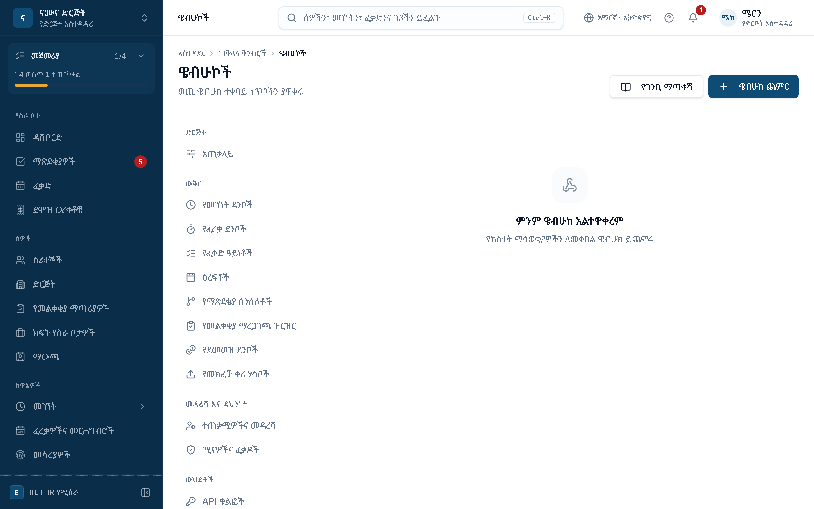

ያልደረሰ መልእክት ከ1 ደቂቃ፣ ከ5 ደቂቃ፣ ከ30 ደቂቃ፣ ከ2 ሰዓት እና ከ24 ሰዓት በኋላ እንደገና ይላካል። ከ10 ውድቀቶች በኋላ ዌብሁኩ ራሱን ያጠፋል፤ **ወደዚህ ዌብሁክ ላክ**ን መልሰው ሲያበሩት ቆጠራው እንደገና ይጀምራል። ሚስጥሩን ለመቀየር ዌብሁኩን ሰርዘው እንደገና ያክሉት። ዌብሁኮች በዕቅድዎ ውስጥ ካልተካተቱ የዕቅድ ማስታወቂያ ይታያል።

## የሂሳብ አያያዝ

**ሂሳብ** ገጹ የደመወዝ ወጪን ወደ ሂሳብ ሶፍትዌርዎ ያስተላልፋል።

1. **የሂሳብ ገበታ** ስድስቱን የደመወዝ መስመሮች ከድርጅትዎ **የሂሳብ ኮድ** እና **የሂሳብ ስም** ጋር ያዛምዳል፤ **ለውጦችን አስቀምጥ** ይጫኑ።
2. **የመዝገብ ግቤት ላክ** ውስጥ የደመወዝ ስሌት ይምረጡ። ዴቢቱ፣ ክሬዲቱ፣ ድምራቸው እና **የተመጣጠነ** መሆኑ ይታያል።
3. **CSV ላክ** ፋይሉን ያወርዳል።

## የውሂብ ማውጫ

**የውሂብ ማውጫ** የድርጅትዎን ውሂብ በአንድ ፋይል ያወጣል፤ ለምሳሌ ለመጠባበቂያ ወይም ወደ ሌላ ሥርዓት ለመሄድ። **ማውጫ ጠይቅ** ይጫኑ፤ ሲዘጋጅ ማሳወቂያ ይደርስዎታል፣ ከዚያ **አውርድ** ይጫኑ። በአንድ ጊዜ አንድ ማውጫ፣ በቀን እስከ ሦስት ይዘጋጃል፤ ለ7 ቀናት ይቀመጣል።

የይለፍ ቃሎች፣ የባለሁለት ደረጃ ማረጋገጫ ሚስጥሮች፣ ቁልፎች፣ TIN፣ የብሔራዊ መታወቂያ እና የባንክ ሒሳብ ቁጥሮች እና የመገኘት ፎቶዎች አይካተቱም።

# ማስታወቂያዎች እና ቅንብሮች

## ማስታወቂያዎች

**ግንኙነት → ማስታወቂያዎች → አዲስ ማስታወቂያ** ለድርጅቱ መልእክት ያወጣል። **ርዕስ**፣ **ይዘት**፣ ከተፈለገ **የሽፋን ፎቶ** እና እስከ ሦስት ፒዲኤፍ **ሰነዶች** ያስገቡ፣ **ምድብ** (ዜና፣ ማስታወቂያ፣ ዝግጅት ወይም የጊዜ ገደብ) ይምረጡ። ወዲያውኑ ማተም፣ ለሌላ ጊዜ **ቀጠሮ ያዝ** ማድረግ ወይም **እንደ ረቂቅ አስቀምጥ** ይችላሉ። ማስታወቂያው በሠራተኞች ዳሽቦርድ እና በማሳወቂያዎቻቸው ውስጥ ይታያል፤ በይፋዊ ገጹ ላይ እንዲታይ ክፍል 11.4 ይመልከቱ።

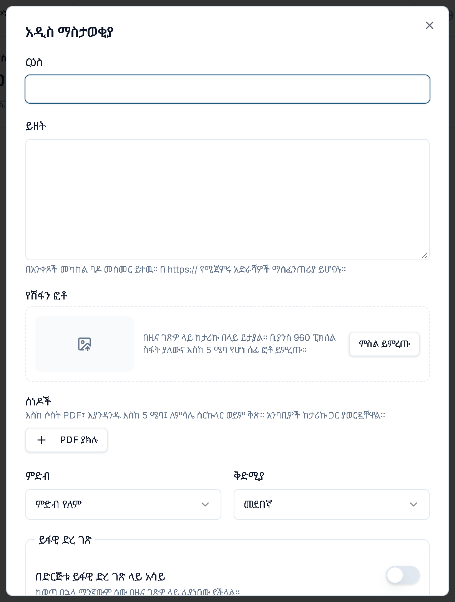{half}

## የሠራተኞች ድምፅ

**ግንኙነት → ድምፅ** ሠራተኞች ሐሳባቸውን የሚገልጹበት ነው፦ **ሳምንታዊ ስሜት** (ስም ሳይገለጽ ከ1 እስከ 5)፣ **ይናገሩ** (ለሰው ሀብት ስጋት ማንሳት፣ በስም ወይም ስም ሳይገለጽ) እና **ምስጋና** (የሥራ ባልደረባን ማመስገን)።

የሰው ሀብት የሚያየው **ግንዛቤዎች** ትር የአራት ሳምንት አማካይ ስሜትን፣ የመልሶቹን ብዛት፣ የሳምንቱን አዝማሚያ እና ርዕሶችን ያሳያል። በክፍል የሚታየው ውጤት 5 እና ከዚያ በላይ ሰዎች ላሏቸው ቡድኖች ብቻ ነው፣ ማንም እንዳይለይ። ለእያንዳንዱ ስጋት ሁኔታ (**አዲስ**፣ **በግምገማ ላይ**፣ **ተፈቷል** ወይም **ተዘግቷል**) እና መፍትሔ ይጻፉ፤ ያቀረበው ሰው ስሙ ባይገለጽም መልሱን ያያል።

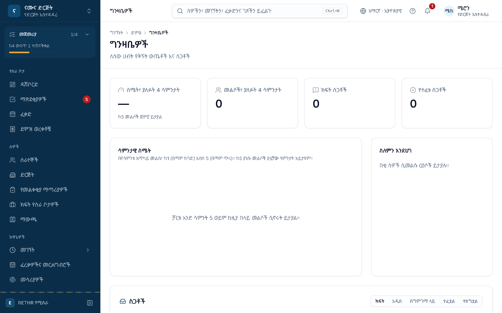

## የደንበኝነት ክፍያ

**አስተዳደር → ክፍያ** (የድርጅት አስተዳዳሪ ብቻ) **የአሁኑ ዕቅድ**ን፣ በሙከራ ላይ ከሆኑ የቀሩትን ቀናት፣ **ወርሃዊ ዋጋ**ን እና **ቀጣይ ክፍያ**ን ያሳያል። ክፍያ በባንክ ማስተላለፍ ነው፤ ባንኩ፣ የሂሳብ ቁጥሩ እና የሂሳብ ስሙ በገጹ ላይ አሉ።

- **የደረሰኝ ታሪክ** እያንዳንዱን ደረሰኝ ይዘረዝራል። የተከፈለውን **ደረሰኝ ያውርዱ**፤ ገና ያልተረጋገጠው «የክፍያ ማረጋገጫ በመጠበቅ ላይ» ይላል።
- **ዕቅድ ይቀይሩ** ዕቅዱን ወዲያውኑ ይቀይራል፤ የቀረው ጊዜ ተሰልቶ ይከፈላል ወይም ይመለሳል። በሙከራ ወቅት ዕቅድ መቀየር ሙከራውን ያበቃል።

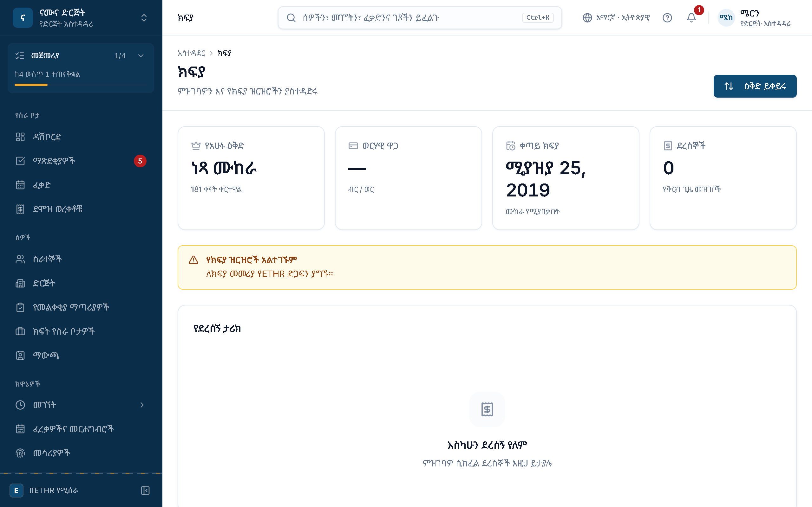

## የቅንብሮች ማጣቀሻ

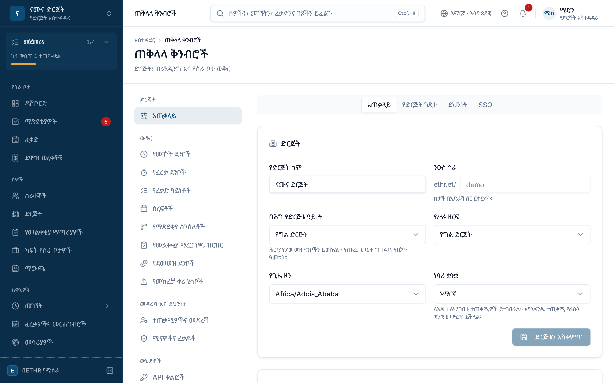

| ክፍል | የሚቆጣጠረው |
|---|---|
| **አጠቃላይ** | የድርጅት ስም፣ አድራሻ (ክፍል 11.1)፣ በሕግ የድርጅቱ ዓይነት፣ የጊዜ ዞን፣ ነባሪ ቋንቋ እና የቀን መቁጠሪያ |
| **የድርጅት ገጽታ** | አርማ፣ ቀለሞች እና ይፋዊ ድረ ገጽ (ምዕራፍ 11) |
| **ደህንነት** | የባለሁለት ደረጃ ማረጋገጫ ፖሊሲ እና የክፍለ ጊዜ ማብቂያ (ከ5 እስከ 480 ደቂቃ) |
| **SSO** | SAML ነጠላ መግቢያ |
| **የመገኘት ደንቦች** | ዘዴዎች፣ ቦታ፣ የራስ ፎቶ፣ ፒን፣ የቅርንጫፍ ደንቦች፣ የማጭበርበር መከላከያ |
| **የፈረቃ ደንቦች** | ፈረቃዎች፣ የሥራ ቀናት፣ የእፎይታ እና የእረፍት ደቂቃዎች |
| **የፈቃድ ዓይነቶች** | የፈቃድ አይነቶች እና የሥራ ሳምንት |
| **ዕረፍቶች** | ይፋዊ በዓላት |
| **የማጽደቂያ ሰንሰለቶች** | በደረጃ የሚጸድቁ ጥያቄዎች |
| **የመልቀቂያ ማረጋገጫ ዝርዝር** | ሠራተኛ ሲለቅ የሚፈተሹ ነገሮች (ክፍል 4.9) |
| **የደመወዝ ደንቦች** | መርሐ ግብር፣ የበጀት ዓመት፣ ጳጉሜ፣ ግብር፣ የትርፍ ሰዓት፣ አበሎች |
| **ተጠቃሚዎችና መዳረሻ** | የመግቢያ መለያዎች እና ሚናዎቻቸው |
| **ሚናዎችና ፈቃዶች** | ብጁ ሚናዎች |
| **API ቁልፎች**፣ **ዌብሁኮች**፣ **ሂሳብ** | ከሌሎች ሥርዓቶች ጋር ማገናኘት (ምዕራፍ 12) |
| **የውሂብ ማውጫ** | የድርጅቱን ውሂብ በአንድ ፋይል ማውጣት (ክፍል 12.4) |
| **የማሳወቂያ ቅንብሮች** | የኢሜይል መልእክቶች በአማርኛ እና በእንግሊዝኛ |
| **ኦዲት ምዝገባ** | በድርጅቱ ውስጥ የተደረገ እያንዳንዱ ድርጊት |

## ከሠራተኞች የሚመጡ የእርዳታ ጥያቄዎች

ሠራተኞች **እርዳታ ያግኙ** ሲጫኑ ጥያቄያቸው መጀመሪያ ወደ ድርጅትዎ ይመጣል። የሰው ሀብት ቡድኑ ይመልሳል ወይም ወደ ETHR ድጋፍ ያስተላልፋል። መልሱ ለሠራተኛው በገጹ እና በኢሜይል ይደርሳል።
