# ይህ መመሪያ ለማን ነው

ይህ መመሪያ በድርጅትዎ በር ላይ ያሉ የጣት አሻራ እና የፊት መሣሪያዎችን (ተርሚናሎችን) ከETHR ጋር ለማገናኘት እና ለማስተዳደር ለሚሠሩ ነው፦ ለ**የድርጅት አስተዳዳሪ** እና ለ**የሰው ሃብት አስተዳዳሪ**። መሣሪያን ከመመዝገብ እስከ ችግር መፍታት ያለውን መንገድ በቅደም ተከተል ይከተላል። ስለ ሌሎች የመገኘት መንገዶች (ኪዮስክ፣ ስልክ፣ QR) እና ስለ ሌሎች የአስተዳዳሪ ሥራዎች **የአስተዳዳሪ መመሪያ**ን ይመልከቱ።

> [!note] የጣት አሻራውን እና ፊቱን የሚመዘግበው መሣሪያው ራሱ ነው
> ETHR የሰውየውን ቁጥር እና ስም ወደ መሣሪያ ሊልክ ይችላል፤ የጣት አሻራው ወይም ፊቱ ግን በመሣሪያው ላይ ራሱ ይመዘገባል። ETHR የሚቀበለው እያንዳንዱን የመግቢያ እና የመውጫ ምዝገባ ነው።

## ማን ምን ማድረግ ይችላል

| ሚና | የሚችለው |
|---|---|
| **የድርጅት አስተዳዳሪ** | ሁሉንም፦ መሣሪያ ማከል፣ ማረም እና መሰረዝ፣ ግንኙነት መሞከር፣ መዛግብት ፑል ማድረግ፣ ታሪክ ማስገባት፣ አድራሻ (ቶከን) ዳግም መፍጠር፣ የተፈቀዱ IP አድራሻዎችን መቀየር፣ ወደ መሣሪያ ትዕዛዝ መላክ፣ ሠራተኛን በመሣሪያዎች ላይ ማስመዝገብ፣ እና ትኩረት የሚሹ ምዝገባዎችን እንደገና መላክ ወይም ማስወገድ |
| **የሰው ሃብት አስተዳዳሪ** | መሣሪያዎችን ማየት፦ ዝርዝሩን፣ የጤንነት ዳሽቦርዱን፣ የእያንዳንዱን መሣሪያ ገጽ፣ የማመሳሰል ታሪክን፣ ክስተቶችን እና ትዕዛዞችን፤ ግንኙነት መሞከር። እንዲሁም **ያልታወቁ ባጆች**ን ለሠራተኛ መመደብ ወይም ማስወገድ እና እንደ አዲስ ሠራተኛ ማስገባት ይችላል። መሣሪያ ማከል፣ ማረም፣ መሰረዝ፣ ፑል ማድረግ፣ ትዕዛዝ መላክ እና አድራሻ ዳግም መፍጠር አይችልም |
| ሌሎች ሚናዎች | በነባሪ ሚናዎች **መሣሪያዎች** በምናሌያቸው ውስጥ አይታይም |

> [!note] ማን ምን እንደሚያይ
> **መሣሪያውን ያገናኙ** ሳጥን፣ የተፈቀዱ IP አድራሻዎች እና የአድራሻው መጀመሪያ ክፍል የሚታዩት ለድርጅት አስተዳዳሪ ብቻ ነው። የሰው ሃብት አስተዳዳሪ መሣሪያው ምን ያህል እንደሠራ ያያል፤ የግንኙነቱን ምስጢር አያይም።

## መሣሪያ ከETHR ጋር የሚገናኝባቸው መንገዶች

መሣሪያ ከETHR ጋር በሁለት አቅጣጫ ሊገናኝ ይችላል። **ETHR መሣሪያውን ይጠራል** (ፑል)፣ ወይም **መሣሪያው ETHRን ይጠራል** (መሣሪያው እያንዳንዱን ምዝገባ ወዲያውኑ ይልካል)። ETHR በበይነመረብ ላይ ስለሚሠራ በቢሮ አውታረ መረብ ውስጥ ያለ የግል አድራሻ (ለምሳሌ 192.168.1.100) ሊደርስበት አይችልም፤ ስለዚህ አብዛኞቹ የቢሮ መሣሪያዎች ወደ ETHR የሚልኩበትን መንገድ ይጠቀማሉ።

| መንገድ | ማን ማን ይጠራል | መቼ ይመርጡታል |
|---|---|---|
| **ZKTeco (ADMS)** | መሣሪያው ETHRን ይጠራል | ማንኛውም የZKTeco መሣሪያ በቢሮ አውታረ መረብ ውስጥ ሆነ ውጭ። ZKTeco ሲሆን የሚመከረው ይህ ነው |
| **Hikvision**፣ **መሣሪያው በቢሮአችን አውታረ መረብ ውስጥ ነው** ሲበራ | መሣሪያው ETHRን ይጠራል | Hikvision መሣሪያ በቢሮ አውታረ መረብ ውስጥ ሲሆን |
| **Hikvision**፣ በአድራሻ | ETHR መሣሪያውን ይጠራል | መሣሪያው የበይነመረብ (የወል) አድራሻ እና ክፍት ወደብ ሲኖረው |
| **ZKTeco**፣ **Suprema** በአድራሻ | ETHR መሣሪያውን ወይም አገልጋዩን ይጠራል | አድራሻው የወል ሲሆን ብቻ። Suprema ከBioStar 2 አገልጋይ እና የAPI ቁልፍ ጋር ይገናኛል |

እያንዳንዱ መንገድ ምን እንደሚፈቅድ ይህ ሰንጠረዥ ያሳያል፦

| መንገድ | **ሞክር** | **ፑል** እና **የመገኘት ታሪክ አስገባ** | **የተመዘገቡ ተጠቃሚዎችን ያግኙ** | ትዕዛዞች |
|---|---|---|---|---|
| Hikvision በአድራሻ | አዎ | አዎ | አዎ | አዎ |
| Hikvision በቢሮ አውታረ መረብ (ይልካል) | የለም | የለም | የለም | የለም |
| ZKTeco (ADMS) | አዎ፣ የመጨረሻውን ግንኙነት ብቻ ያነባል | የለም | አዎ፣ መሣሪያው በመጨረሻ ያሳወቀውን ዝርዝር | አዎ |
| ZKTeco በአድራሻ | አዎ | አዎ | አዎ | የለም |
| Suprema | አዎ | አዎ | አዎ | የለም |

> [!tip] የትኛውን ልምረጥ
> መሪው ይህን ይመርጥልዎታል፤ ሁለት ጥያቄ ብቻ ይመልሱ፦ ምርቱ ማነው፣ እና መሣሪያው ወደ ETHR እንዴት ይደርሳል ([ክፍል 3.2](#s-3ko3l63pp3tyw3og3kt3lh3n))። ZKTeco ከቢሮ ብቻ የሚልክ ከሆነ መንገዱ ADMS ይሆናል። Hikvision ከቢሮ ከሆነ መሣሪያው ራሱ ይልካል። አድራሻ እና ወደብ የሚያስፈልገው መሣሪያዎ የወል አድራሻ ካለው ብቻ ነው።

# ከመጀመርዎ በፊት

## የዝግጅት ዝርዝር

መሣሪያውን ከመመዝገብዎ በፊት እነዚህ ዝግጁ ይሁኑ፦

- **የመገኘት ዘዴ።** በ**የመገኘት ደንቦች** ውስጥ **ባዮሜትሪክ መሣሪያ** መብራት አለበት ([ክፍል 2.2](#s-3qg3ko3rc3o83n9w3q03qs3p))። ከጠፋ መሣሪያው የላካቸው ምዝገባዎች አይመዘገቡም፤ ትኩረት በሚሹ ምዝገባዎች ውስጥ ይቀመጣሉ።
- **ቅርንጫፍ።** እያንዳንዱ መሣሪያ ለአንድ ቅርንጫፍ ይመዘገባል። ቅርንጫፍ ከሌለዎት መጀመሪያ በ**ሰዎች → ድርጅት** ውስጥ ይፍጠሩ።
- **የመሣሪያው ቁጥር ለእያንዳንዱ ሠራተኛ።** ሰዎች በባጅ ወይም በመሣሪያ መለያ ቁጥራቸው ይዛመዳሉ ([ክፍል 2.3](#s-3kw3l73n43oe3nh3o5w3mo3k))። ገና ከሌለ ከመሣሪያው ማምጣት ይችላሉ ([ክፍል 6.2](#s-3qg3n43ko3q03rc3mpw3n43s))።
- **የተከታታይ ቁጥር።** በመሣሪያው ላይ እንደሚታየው ይቅዱት። ለZKTeco (ADMS) ግዴታ ነው፤ ለሌሎች አማራጭ ነው።
- **በመሣሪያው ላይ የበይነመረብ ግንኙነት።** መሣሪያው ወደ ETHR የሚልክ ከሆነ ሁልጊዜ በይነመረብ ሊደርስ ይገባል። Hikvision በHTTPS መላክ መቻል አለበት።
- **የቢሮው የወል IP አድራሻ።** ለZKTeco (ADMS) ያስፈልጋል ([ክፍል 2.4](#s-3qg3mq3la3pp3o5w3qg3pk3k))።
- **የዕቅድ ቦታ።** ዕቅድዎ የመሣሪያ ገደብ አለው። ሲሞላ «ለዕቅድዎ የመሣሪያ ገደብ ደርሰዋል።» የሚል መልእክት ይታያል።
- **የመሣሪያው ሰዓት።** ትክክለኛውን ሰዓት እና ቀን ያሳይ። ልዩነት ካለ ምዝገባዎች ሊቆዩ ይችላሉ ([ክፍል 5.4](#s-3qg3ko3kz3l63qjw3lc3pv3n))።

## የመገኘት ዘዴውን ማብራት

**ቅንብሮች → የመገኘት ደንቦች** ይክፈቱ።

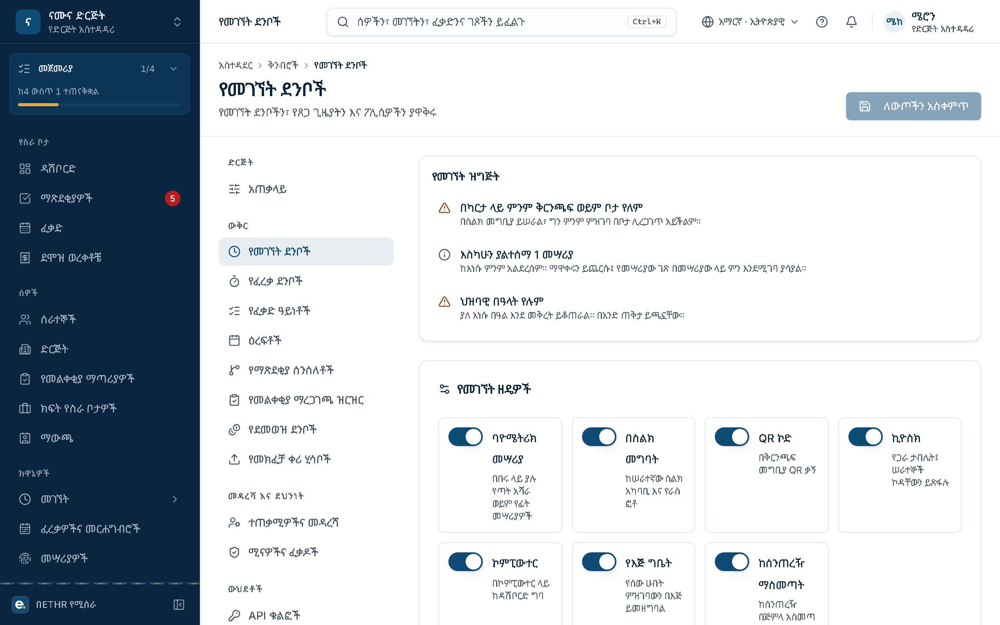

1. **የመገኘት ዝግጅት** የጎደለውን ያሳያል፤ ለምሳሌ በካርታ ላይ ቅርንጫፍ ወይም ቦታ አለመኖር። ያለውን ይመልከቱ፤ ለመሣሪያዎች ብቻ የሚያስፈልገው ቅርንጫፍ መኖሩ ነው።
2. **የመገኘት ዘዴዎች** ውስጥ **ባዮሜትሪክ መሣሪያ** (በበሩ ላይ ያሉ የጣት አሻራ ወይም የፊት መሣሪያዎች) መብራቱን ያረጋግጡ።
3. ለውጥ ካደረጉ **ለውጦችን አስቀምጥ** ይጫኑ።

> [!warning] ዘዴው ከጠፋ
> **ባዮሜትሪክ መሣሪያ** ሲጠፋ መሣሪያው ምዝገባዎችን መላኩን ይቀጥላል፤ ETHR ግን አይመዘግባቸውም። «የማሽን ምዝገባ በመገኘት ቅንብሮች ውስጥ ጠፍቷል።» በሚል ምክንያት ትኩረት በሚሹ ምዝገባዎች ውስጥ ይቆያሉ። ዘዴውን ካበሩ በኋላ እንደገና ይላካሉ ([ክፍል 5.5](#s-3n93op3l43n9w3qg3kq3llw3))።

## ሠራተኞችን በመሣሪያ ቁጥር ማዘጋጀት

መሣሪያው የሚልከው የሰውየውን **ቁጥር** ነው፤ ETHR ያንን ቁጥር በሠራተኛው **ባጅ / የመሣሪያ መለያ** ወይም በሠራተኛ ኮዱ ያገኘዋል።

1. **ሰዎች → ሰራተኞች** ውስጥ ሠራተኛውን ይክፈቱ።
2. አዲስ ሠራተኛ ሲጨምሩ ወይም መዝገቡ ላይ **አርም** ሲጫኑ፣ በ**ሥራ** ክፍል ውስጥ **ባጅ / የመሣሪያ መለያ** ውስጥ መሣሪያው ላይ ያለውን ቁጥር ይጻፉ።
3. ያስቀምጡ።

ቁጥሩ እስከ 32 ፊደላት፣ አሃዞች እና ሰረዞች ይይዛል፣ በድርጅቱ ውስጥ ለአንድ ሰው ብቻ ይሰጣል። የZKTeco መሣሪያዎች **አሃዝ ብቻ** ይቀበላሉ፤ ፊደል ያለበት ቁጥር ወደ ZKTeco መሣሪያ አይላክም።

> [!tip] ቁጥሩን ከቀየሩ
> የሠራተኛውን የባጅ ቁጥር ሲቀይሩ ትዕዛዝ የሚቀበሉ የቅርንጫፉ መሣሪያዎች ይዘምናሉ። ቁጥሩን ከመሣሪያው ላይ ያለው ጋር ማመሳሰልን አይርሱ።

## የቢሮውን የወል IP አድራሻ ማወቅ

ZKTeco (ADMS) መሣሪያ ወደ ETHR ሲደውል ETHR የሚያውቀው ከየትኛው የበይነመረብ አድራሻ እንደመጣ ነው። ይህ የቢሮዎ **የወል IP አድራሻ** ነው፤ በቢሮ አውታረ መረብ ውስጥ ያለው 192.168... የሚጀምረው አድራሻ አይደለም።

1. በቢሮው ውስጥ ካለ ኮምፒውተር በበይነመረብ ላይ «my IP address» የሚል ፍለጋ ያድርጉ፤ ገጹ አድራሻዎን ያሳያል።
2. ወይም የበይነመረብ አገልግሎት ሰጪዎን (ለምሳሌ ኢትዮ ቴሌኮም) ይጠይቁ። ቋሚ አድራሻ ካልተከራዩ አድራሻው ሊቀየር ይችላል።
3. አድራሻው ሲቀያየር ከአገልግሎት ሰጪው ክልል (ለምሳሌ 196.188.0.0/16) ማከል ይቻላል፤ ብዙ አድራሻዎችን በአንድ ጊዜ ይፈቅዳል። ዝርዝሩ ቢበዛ 20 አድራሻዎችን ይይዛል።

# መሣሪያ መመዝገብ

## መሣሪያ ጨምር

**ክዋኔዎች → መሣሪያዎች** ይክፈቱ። የሁሉም መሣሪያዎች ዝርዝር በካርድ ይታያል፤ እያንዳንዱ ካርድ ስም፣ አምራች፣ የተከታታይ ቁጥር፣ ቅርንጫፍ፣ ሁኔታ እና የመጨረሻ ግንኙነትን ያሳያል።

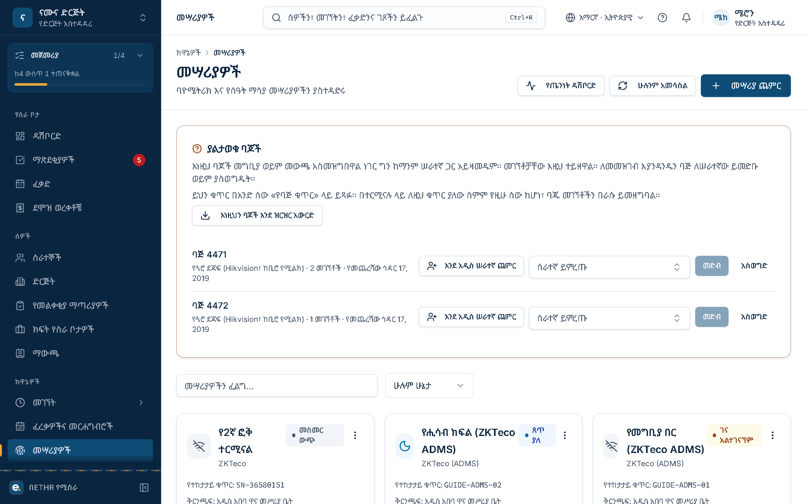

1. **መሣሪያ ጨምር** የማዋቀሪያ መሪውን ይከፍታል ([ክፍል 3.2](#s-3ko3l63pp3tyw3og3kt3lh3n)። መሣሪያ ከሌለ ባዶው ገጽ ላይም ይህ ቁልፍ አለ።
2. **የጤንነት ዳሽቦርድ** የሁሉንም መሣሪያዎች ሁኔታ በአንድ ገጽ ያሳያል ([ምዕራፍ 9](#s-3qg3s43o53o03n9w3qr3lp3m)።
3. የሁኔታ ማጣሪያው **ሁሉም ሁኔታ**፣ **መስመር ላይ**፣ **ጸጥ ያለ**፣ **መስመር ውጭ**፣ **ስህተት** እና **ገና አልተገናኘም** ያላቸውን ይለያል። በስም ወይም በተከታታይ ቁጥር ለመፈለግ **መሣሪያዎችን ፈልግ...** ይጠቀሙ።

**ሁሉንም አመሳስል** ETHR ለሚጠራቸው መሣሪያዎች ሁሉ ፑል ይልካል፤ ወደ ETHR ለሚልኩት ምንም አያደርግም።

## መሪው፦ አምስት ደረጃዎች

**መሣሪያ ጨምር** ሲጫኑ **መሣሪያ ጨምር** የሚል መስኮት ይከፈታል፤ ከላይ **ደረጃ 1 ከ 5** እያለ እድገቱን ያሳያል። መሪው ሁለት ቀላል ጥያቄዎችን ይጠይቃል፣ ከዚያ በመሣሪያው ላይ ምን ማስገባት እንዳለብዎ ያሳያል፣ መሣሪያው ሲደውል ደግሞ ራሱ ያውቃል።

**ደረጃ 1፦ ሁለት ጥያቄዎች።** **የመሣሪያው ምርት ማነው?** (**Hikvision**፣ **ZKTeco** ወይም **Suprema**) እና **መሣሪያው ወደ ETHR እንዴት ይደርሳል?** (**ETHR በይፋዊ አድራሻ ሊደርስበት ይችላል** ወይም **ከቢሮው አውታረ መረብ ብቻ ይልካል**)። ከዚያ **ቀጣይ** ይጫኑ።

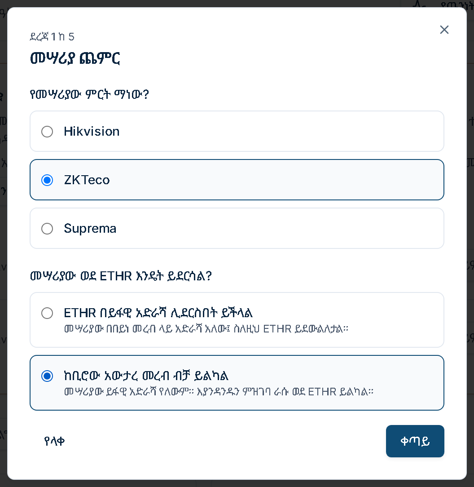

መልሶቹ መሣሪያው የሚገናኝበትን መንገድ በራሳቸው ይወስናሉ። **የላቀ** በማንኛውም ጊዜ ሙሉውን ቅጽ ይከፍታል፦

| ምርት | ይፋዊ አድራሻ አለው | ከቢሮው አውታረ መረብ ብቻ ይልካል |
|---|---|---|
| **ZKTeco** | ETHR መሣሪያውን ይጠራል (ZKTeco በአድራሻ) | **ZKTeco (ADMS)**፦ መሣሪያው ETHRን ይጠራል። የሚመከረው ይህ ነው |
| **Hikvision** | ETHR መሣሪያውን ይጠራል | መሣሪያው እያንዳንዱን ምዝገባ ይልካል |
| **Suprema** | ETHR የBioStar 2 አገልጋዩን ይጠራል | አይቻልም |

> [!note] Suprema ይፋዊ አድራሻ ከሌለው
> ይፋዊ አድራሻ የሌለው የSuprema መሣሪያ ምዝገባዎችን ወደ ETHR መላክ አይችልም። ይህን ጥምረት ሲመርጡ መሪው ይህንኑ ይነግርዎታል፤ አድራሻ ይስጡት፣ ወይም መንገዱን ካወቁ **የላቀ**ን ይምረጡ።

**ደረጃ 2፦ ዝርዝሮች።** ከላይ የመረጡት መንገድ በአንድ መስመር ይነገራል (ለምሳሌ «መሣሪያው ወደ ETHR ይደውላል፤ ETHR በመለያ ቁጥሩ ያገኘዋል።»)። **የመሣሪያ ስም**፣ **የተከታታይ ቁጥር** (ለADMS ግዴታ ነው፤ በመሣሪያው ላይ እንደሚታየው ይጻፉት) እና **ቅርንጫፍ** ያስገቡ፤ ETHR መሣሪያውን የሚጠራ ከሆነ **የIP አድራሻ**፣ **ወደብ**፣ እና ካስፈለገ **የተጠቃሚ ስም**፣ **የይለፍ ቃል** ወይም **የAPI ቁልፍ** ይጨምራሉ። ወደቡ ለZKTeco 4370፣ ለሌሎች 80 ተሞልቶ ይመጣል። **ወደዚህ መሣሪያ ትዕዛዝ ላክ** ማብሪያ እዚህም አለ፤ ለአሁን ሳይነኩት ይተዉት ([ክፍል 7.1](#s-3n93px3q33q63nh3o5w3kr3m))። ከዚያ **መዝግብና ቀጥል** ይጫኑ፤ **ተመለስ** ወደ ቀዳሚው ደረጃ ይመልስዎታል።

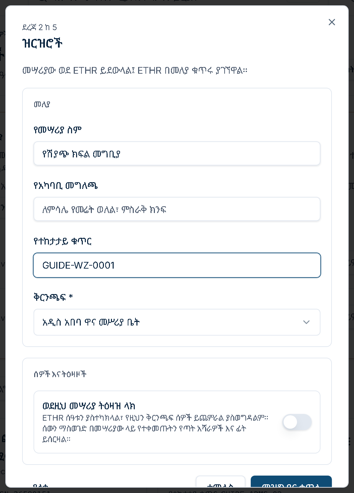

**ደረጃ 3፦ በመሣሪያው ላይ።** መሣሪያው ተቀምጧል፤ መስኮቱ «… ተቀምጧል። አሁን መሣሪያውን ራሱን ያዘጋጁ።» ይላል። በመሣሪያው ላይ የሚያደርጉት እንደ መንገዱ ይለያያል፤ እያንዳንዱ እሴት ከጎኑ **ቅዳ** ቁልፍ አለው፣ ስለዚህ እንደገና መተየብ አያስፈልግም።

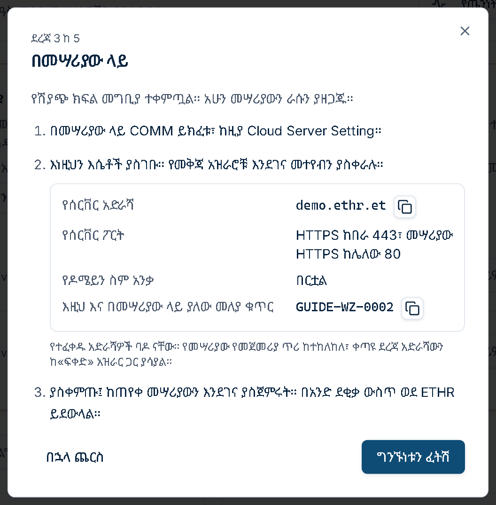

- **ZKTeco (ADMS)**፦ በመሣሪያው ላይ **COMM**፣ ከዚያ **Cloud Server Setting** ይክፈቱ እና የሰርቨር አድራሻ፣ ፖርት እና የዶሜይን ስም ማንቃትን ያስገቡ። ያስቀምጡ፣ ከጠየቀ መሣሪያውን እንደገና ያስጀምሩት። የተፈቀዱ የIP አድራሻዎች ባዶ ከሆኑ መሪው ይነግርዎታል፤ የመሣሪያው የመጀመሪያ ጥሪ ከተከለከለ በቀጣዩ ደረጃ አድራሻው **ፍቀድ** ከሚል ቁልፍ ጋር ይታያል።
- **Hikvision፣ መሣሪያው ከቢሮ ሲልክ**፦ በመሣሪያው የራሱ ድረ ገጽ ላይ **Network**፣ ከዚያ **HTTP listening** ይክፈቱ (አንዳንድ ፈርምዌር **Event alarm** ወይም **Alarm host** ይለዋል)፣ እና አራቱን እሴቶች ያስገቡ። ሙሉው አድራሻ የሚታየው **አሁን ብቻ** ነው፤ ከመቀጠልዎ በፊት ይቅዱት። መሣሪያው የበይነመረብ ግንኙነት ያስፈልገዋል፣ HTTPSንም መደገፍ አለበት።
- **ETHR የሚጠራው መሣሪያ**፦ በመሣሪያው ላይ የሚተየብ ነገር የለም። ETHR የሚጠራበትን አድራሻ እና ወደብ መሪው ያሳያል፤ ወደቡን ለበይነመረብ ክፈቱ (በቢሮው ራውተር ላይ ወደቡን ወደ መሣሪያው የራሱ አድራሻ ያስተላልፉ)።

ሲጨርሱ **ግንኙነቱን ፈትሽ** ይጫኑ። **በኋላ ጨርስ** ማዋቀሩን ለሌላ ጊዜ ይተዋል።

**ደረጃ 4፦ የመጀመሪያውን ግንኙነት በመጠበቅ ላይ።** ለሚልኩ መሣሪያዎች ይህ ገጽ በየ5 ሰከንዱ ራሱ ይፈትሻል፤ ምንም ነገር መጫን አያስፈልግም። ግንኙነቱ ሲረጋገጥ **ቀጣይ** ይነቃል፤ **ወደ መሣሪያው ደረጃዎች ተመለስ** ወደ ቀዳሚው ይመልሳል።

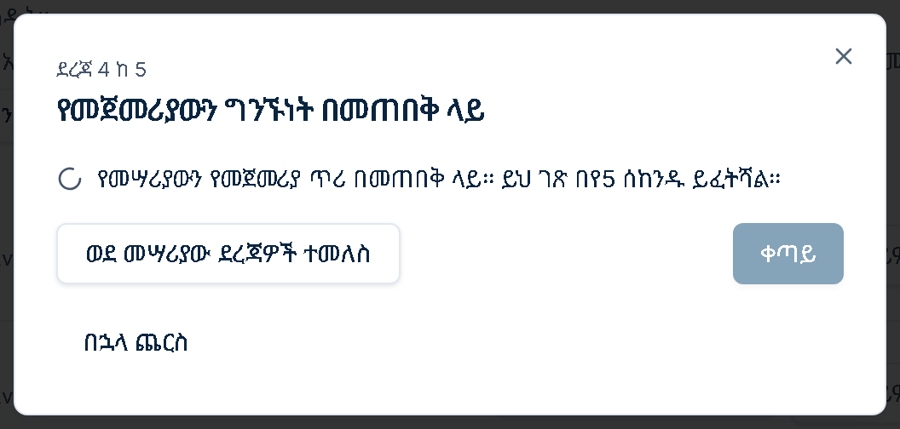

- **ADMS**፦ «የመሣሪያውን የመጀመሪያ ጥሪ በመጠበቅ ላይ።» ይላል። መሣሪያው ከተፈቀደ አድራሻ ሲደውል «ተገናኝቷል።» ይታያል። ከዝርዝሩ ውጭ ካለ አድራሻ ከደወለ «መሣሪያው ከ… ደውሎ ተከልክሏል።» ይላል፤ **ፍቀድ** ቁልፉ አድራሻው የቢሮዎ ከሆነ ወደ ዝርዝሩ ይጨምረዋል።
- **መሣሪያው የሚልክ ከሆነ**፦ «አንድ ሰው በመሣሪያው ላይ አንድ ጊዜ እንዲመዘግብ ይጠይቁ።» ይላል። ምዝገባው ሲደርስ «ከመሣሪያው ምዝገባ ደርሷል።» ይታያል፤ ለአንድ ሰው ከተመዘገበ «ለአንድ ሰው ተመዝግቧል።»፣ የባጅ ቁጥሩ ገና ከማንም ጋር ካልተዛመደ ደግሞ በ**ያልታወቁ ባጆች** ስር እንዲመድቡት ይነገራል።
- **ETHR የሚጠራው መሣሪያ**፦ ፈተናውን ያሂዱ (**ግንኙነት ሞክር**)፤ ETHR መሣሪያውን ካገኘ «ETHR መሣሪያውን አግኝቷል።» ይላል።

**ደረጃ 5፦ መሣሪያው ተገናኝቷል።** ቀጥሎ ሰዎችን ወደ መሣሪያው ያምጡ፦ **የተመዘገቡ ተጠቃሚዎችን ያግኙ** ([ክፍል 6.2](#s-3qg3n43ko3q03rc3mpw3n43s) እና፣ መሣሪያው ትዕዛዝ ከተቀበለ እና ትዕዛዞች ከበሩ፣ **ሁሉንም ሠራተኞች ላክ** ([ክፍል 7.2](#s-3lc3pv3n53o5w3kr3lh3n43o)። መሣሪያው ማን እንደተመዘገበበት ሊጠየቅ ካልቻለ መሪው ለእያንዳንዱ ሠራተኛ በመሣሪያው የሚጠቀምበትን የባጅ ቁጥር በመገለጫው ላይ እንዲሰጡ ይነግርዎታል። **የመሣሪያውን ገጽ ክፈት** ወደ መሣሪያው ገጽ ይወስዳል፤ **ተጠናቀቀ** መስኮቱን ይዘጋል።

> [!tip] ሳይጨርሱ መውጣት
> ማዋቀሩን በኋላ ለመጨረስ **በኋላ ጨርስ** ይጫኑ። መሣሪያው ተቀምጧል፤ ከመሣሪያ ዝርዝሩ ከፍተው ይቀጥላሉ። መሣሪያው የሚልክ ከሆነ እና አድራሻውን ገና ካልቀዱት «ሳይጨርሱ ይውጡ?» ብሎ ይጠይቃል፤ ከዚያ በኋላ አድራሻው እንደገና አይታይም፣ ከመሣሪያው ገጽ ዳግም መፍጠር ይኖርብዎታል ([ክፍል 10.2](#s-3og3qt3l73ln3pp3o5w3qr3r)።

## ሙሉው ቅጽ፦ «የላቀ»

እሴቶቹን አስቀድመው ካወቁ ከመሪው አናት ላይ **የላቀ** ይጫኑ፤ ሙሉው ቅጽ **መሣሪያ መዝግብ** በሚል ይከፈታል። **አርም** የሚከፍተው **መሣሪያ አርትዕ** ቅጽም ያው ቅጽ ነው፤ ስለዚህ ማረም እና መመዝገብ አንድ አይነት ይሰማቸዋል። ቅጹ በአራት ክፍሎች ተከፍሏል፦

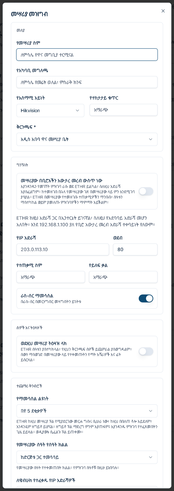

| ክፍል | መስክ | ምን ያስገባሉ |
|---|---|---|
| **መለያ** | **የመሣሪያ ስም** | ለምሳሌ «የዋና መግቢያ ተርሚናል»። ግዴታ ነው |
| | **የአካባቢ መግለጫ** | መሣሪያው የት እንዳለ ለማስታወስ |
| | **የአስማሚ አይነት** | **Hikvision**፣ **ZKTeco**፣ **ZKTeco (ADMS፦ መሣሪያው ከ ETHR ጋር ይገናኛል)** ወይም **Suprema**። [ክፍል 1.2](#s-3ko3kz3l63qjw3oo1x2c202a) የትኛውን እንደሚመርጡ ይነግርዎታል |
| | **የተከታታይ ቁጥር** | በመሣሪያው ላይ እንደሚታየው። ለADMS ግዴታ ነው፤ ለሌሎች አማራጭ። አንድ ቁጥር ለአንድ የመሣሪያ አይነት አንድ ጊዜ ብቻ ይመዘገባል |
| | **ቅርንጫፍ** | መሣሪያው የሚገኝበት ቅርንጫፍ። ግዴታ ነው። አንድ ቅርንጫፍ ብቻ ካለዎት ራሱ ይሞላል |
| **ግንኙነት** | **መሣሪያው በቢሮአችን አውታረ መረብ ውስጥ ነው** | ለHikvision ብቻ። ሲበራ አድራሻ አያስፈልግም፤ መሣሪያው ምዝገባዎችን ራሱ ይልካል። ETHR የተመዘገቡ ተጠቃሚዎችን ማንበብ፣ ሰዓቱን ማስተካከል ወይም ያመለጡ ምዝገባዎችን ማምጣት አይችልም |
| | **የIP አድራሻ**፣ **ወደብ** | ለHikvision በአድራሻ፣ ለZKTeco እና ለSuprema። የወል አድራሻ መሆን አለበት፤ እንደ 192.168.1.100 ያለ የቢሮ አድራሻ ተቀባይነት የለውም። ፕሮቶኮል፣ ወደብ ወይም መንገድ ሳይጨምሩ አድራሻውን ብቻ ይጻፉ |
| | **የተጠቃሚ ስም**፣ **የይለፍ ቃል** | የመሣሪያው መግቢያ። አማራጭ ናቸው |
| | **የAPI ቁልፍ** | ለSuprema ብቻ፤ የBioStar 2 API ቁልፍ |
| | **ራስ-ሰር ማመሳሰል** | ETHR ከመሣሪያው በመርሐ ግብር መዛግብት እንዲጎትት። ወደ ETHR ለሚልኩ እና ለADMS መሣሪያዎች አይቀርብም |
| **ሰዎች እና ትዕዛዞች** | **ወደዚህ መሣሪያ ትዕዛዝ ላክ** | ETHR ሰዎችን ወደ መሣሪያ እንዲልክ እና ሰዓቱን እንዲያስተካክል። ትዕዛዝ ለሚቀበል መሣሪያ ብቻ ይታያል ([ክፍል 7.1](#s-3n93px3q33q63nh3o5w3kr3m) |
| **ተጨማሪ ቅንብሮች** | **የማመሳሰል ልዩነት** | ETHR ለሚጠራቸው መሣሪያዎች ብቻ ([ክፍል 4.3](#s-202x2z3a2x372x33323tyw1x) |
| | **የመሣሪያው ሰዓት የሰዓት ክልል** | የመሣሪያው ሰዓት ከድርጅቱ የተለየ ክልል ከሆነ ([ክፍል 5.4](#s-3qg3ko3kz3l63qjw3lc3pv3n) |
| | **የተፈቀዱ የIP አድራሻዎች** | ለADMS የቢሮው የወል አድራሻ። ለአሁን ባዶ መተው ይቻላል፤ የመጀመሪያ ጥሪው ከተከለከለ የመሣሪያው ገጽ አድራሻውን በአንድ ቁልፍ እንዲፈቅዱ ያሳያል |

ከዚያ **መዝግብ** (ሲያርሙ **ለውጦችን አስቀምጥ**) ይጫኑ። **ተው** ቅጹን ይዘጋል።

> [!note] ሲያርሙ የተቀመጡ ምስጢሮች አይታዩም
> የመሣሪያው የይለፍ ቃል እና የAPI ቁልፍ ከተቀመጡ በኋላ አይታዩም። በ**አርም** ውስጥ አድራሻውን ባዶ ከተዉት የተቀመጠው ግንኙነት ይቀጥላል፤ የሚቀየረው አዲስ ሲያስገቡ ብቻ ነው።

## ከተመዘገበ በኋላ የሚታየው አድራሻ

በመሪው የተመዘገበ የሚልክ መሣሪያ አድራሻውን በ[ክፍል 3.2](#s-3ko3l63pp3tyw3og3kt3lh3n) ደረጃ 3 ላይ ያሳያል። በሙሉው ቅጽ ሲመዘግቡ ደግሞ «መሣሪያ ተመዝግቧል» የሚል መልእክት ከታየ በኋላ **የመሣሪያው አዲስ አድራሻ** የሚል መስኮት ይከፈታል። ይህ አድራሻ መሣሪያው ምዝገባዎችን የሚልክበት ነው፤ ምስጢራዊ ቶከን ይዟል።

1. አድራሻውን በ**አድራሻውን ቅዳ** ይቅዱ።
2. በመሣሪያው ላይ ያስገቡት ([ክፍል 4.2](#s-202x2z3a2x372x33323tyw3k)። መስኮቱ አድራሻውን ለመሣሪያው በአራት ክፍል (የአገልጋይ አድራሻ፣ ፖርት፣ ፕሮቶኮል፣ ዱካ) ያሳያል።
3. ሁሉንም ካስገቡ በኋላ ብቻ **ተጠናቀቀ** ይጫኑ።

> [!warning] አድራሻው የሚታየው አንድ ጊዜ ብቻ ነው
> ETHR የቶከኑን መጀመሪያ ክፍል ብቻ ያስቀምጣል፤ ሙሉው አድራሻ ከ**ተጠናቀቀ** በኋላ እንደገና ሊታይ አይችልም። **ተጠናቀቀ** ብቻ መስኮቱን ይዘጋል። ከጠፋ ወይም ካልገባ አድራሻውን ዳግም ይፍጠሩ ([ክፍል 10.2](#s-3og3qt3l73ln3pp3o5w3qr3r)። በኋላ የመሣሪያው ገጽ **አድራሻ፣ ቶከኑ አጥሯል** በሚል የተቆረጠ አድራሻ ብቻ ያሳያል።

> [!note] ለZKTeco (ADMS) ይህ አድራሻ አያስፈልግም
> ADMS መሣሪያ የሚታወቀው በተከታታይ ቁጥሩ እና ከተፈቀደ IP አድራሻ በመምጣቱ ነው። መሣሪያውን የሚያገናኘው የመሣሪያው ገጽ **መሣሪያውን ያገናኙ** ሳጥን ነው።

# መሣሪያውን ማገናኘት

## ZKTeco (ADMS)

ADMS የZKTeco «cloud server» ዘዴ ነው። መሣሪያው ETHRን ይጠራል፤ ስለዚህ ከማንኛውም የቢሮ አውታረ መረብ ይሠራል። ETHR ከመሣሪያው ፈጽሞ አይጎትትም፤ መሣሪያው ያላደረሰውን ሁሉ በራሱ እንደገና ይልካል።

1. **መሣሪያ ጨምር** ይጫኑ፣ **ZKTeco** እና **ከቢሮው አውታረ መረብ ብቻ ይልካል** ይምረጡ፣ **ቀጣይ** ይጫኑ። **የመሣሪያ ስም**፣ **የተከታታይ ቁጥር** (በመሣሪያው ላይ እንደሚታየው) እና **ቅርንጫፍ** ያስገቡ፣ **መዝግብና ቀጥል** ይጫኑ። አድራሻ አይጠየቁም ([ክፍል 3.2](#s-3ko3l63pp3tyw3og3kt3lh3n))።
2. **በመሣሪያው ላይ** ደረጃ ላይ መሪው የሚያሳየውን በመሣሪያው ያስገቡ። ተመሳሳይ ሳጥን በመሣሪያው ገጽ ላይ ይቀራል፤ ስሙ **መሣሪያውን ያገናኙ** ነው።
3. በመሣሪያው ላይ **COMM → Cloud Server Setting** ይክፈቱ እና ከዚህ ያስገቡ፦
   - **የሰርቨር አድራሻ**፦ ሳጥኑ እንደሚያሳየው በትክክል ይጻፉት፤ ከድርጅትዎ አድራሻ ሊለይ ስለሚችል በእጅ አይገምቱት።
   - **የሰርቨር ፖርት**፦ HTTPS ከበራ 443፣ መሣሪያው HTTPS ከሌለው 80።
   - **የዶሜይን ስም አንቃ**፦ በርቷል።
   - የተከታታይ ቁጥሩ በመሣሪያው ላይ እና በETHR ውስጥ ተመሳሳይ መሆን አለበት።
4. የቢሮዎን የወል IP አድራሻ ([ክፍል 2.4](#s-3qg3mq3la3pp3o5w3qg3pk3k)) ሁለት መንገድ ማስገባት ይችላሉ፦ ከመጀመሪያው ጥሪ በፊት መሣሪያው ገጽ ላይ **አርም**፣ ከዚያ **ተጨማሪ ቅንብሮች** ውስጥ **የተፈቀዱ የIP አድራሻዎች** (በአንድ መስመር አንድ)፤ ወይም አሁን ባዶ ትተው የመጀመሪያው ጥሪ ከተከለከለ በኋላ **ፍቀድ** ቁልፉን ይጫኑ።
5. ያስቀምጡ እና ጥቂት ደቂቃ ይጠብቁ። መሣሪያው ሲደውል ሁኔታው **መስመር ላይ** ይሆናል፤ መሪው «ተገናኝቷል።» ይላል። የመጀመሪያ ግንኙነት ላይ መሣሪያው የያዛቸውን ምዝገባዎች ሊልክ ይችላል።

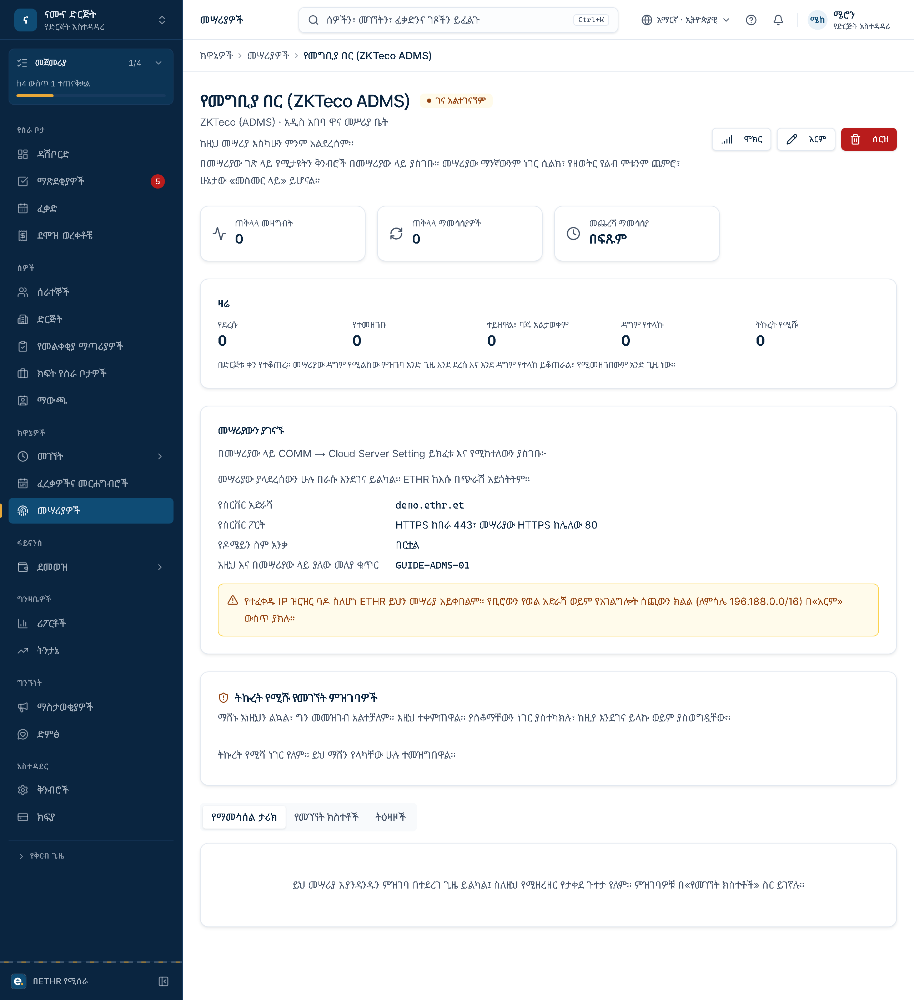

> [!warning] የተፈቀደው IP ዝርዝር ባዶ ከሆነ
> የተከታታይ ቁጥር በመሣሪያው አካል ላይ ታትሟል፤ ስለዚህ ብቻውን ማንንም አያረጋግጥም። የተፈቀደው IP ዝርዝር ባዶ ከሆነ ETHR መሣሪያውን አይቀበልም፤ ሳጥኑ ይህን ያሳውቃል። መሣሪያው ከዝርዝሩ ውጭ ካለ አድራሻ ከደወለ መሣሪያው ገጽ ላይ «ከ 196.188.10.25 የመጣ ግንኙነት ውድቅ ተደርጓል» የሚል መልእክት ከ**ፍቀድ** ቁልፍ ጋር ይታያል (በቁልፉ ላይ አድራሻው ተጽፏል)። ያ አድራሻ የቢሮዎ ከሆነ ቁልፉን ይጫኑት፤ ወደ ዝርዝሩ ይጨመራል።

## Hikvision፦ መሣሪያው በቢሮ አውታረ መረብ ውስጥ ሲሆን

ይህ ለአብዛኞቹ የHikvision መሣሪያዎች ትክክለኛው መንገድ ነው፤ መሣሪያው በቢሮ አውታረ መረብ ውስጥ ስለሆነ ETHR ሊደርስበት አይችልም፣ ስለዚህ መሣሪያው ራሱ ይልካል።

1. **መሣሪያ ጨምር** ይጫኑ፣ **Hikvision** እና **ከቢሮው አውታረ መረብ ብቻ ይልካል** ይምረጡ፣ **ቀጣይ** ይጫኑ። **የመሣሪያ ስም** እና **ቅርንጫፍ** ያስገቡ፣ **መዝግብና ቀጥል** ይጫኑ። የአድራሻ መስኮች አይኖሩም።
2. **በመሣሪያው ላይ** ደረጃ ላይ **የአገልጋይ አድራሻ**፣ **ፖርት**፣ **ፕሮቶኮል** እና **ዱካ (URL)** አራት እሴቶች ይታያሉ፤ እያንዳንዳቸው **ቅዳ** ቁልፍ አላቸው። **ሙሉ አድራሻ** የሚታየው አሁን ብቻ ነው፤ ይቅዱት።
3. የመሣሪያውን የራሱን የድር ገጽ ይክፈቱ። **Network** ከዚያ **HTTP listening** ይክፈቱ (አንዳንድ ፈርምዌር **Event alarm** ወይም **Alarm host** ይለዋል) እና አራቱን እሴቶች ያስገቡ። መሣሪያው የበይነመረብ ግንኙነት ያስፈልገዋል፣ HTTPSንም መደገፍ አለበት።
4. **ግንኙነቱን ፈትሽ** ይጫኑ።
5. በመሣሪያው አንድ ጊዜ ይመዝገቡ። የመጀመሪያው ምዝገባ ወይም የመሣሪያው የሕይወት ምልክት ሲደርስ ሁኔታው **መስመር ላይ** ይሆናል፤ መሪው «ከመሣሪያው ምዝገባ ደርሷል።» ይላል።

ከዚያ በኋላ የመሣሪያው ገጽ **የዌብሁክ ውቅር** ሳጥን ውስጥ የተቆረጠውን አድራሻ እና ተመሳሳይ አራት ክፍሎች ያሳያል።

> [!note] ይህ መንገድ ምን አይችልም
> ETHR ይህን መሣሪያ መጥራት ስለማይችል **ሞክር**፣ **ፑል**፣ **የተመዘገቡ ተጠቃሚዎችን ያግኙ**፣ **የመገኘት ታሪክ አስገባ** እና ትዕዛዞች አይቀርቡም። ሰዎችን መጨመር እና ሰዓት ማስተካከል በመሣሪያው ላይ ይደረጋል። መሣሪያው የላከው ያልታወቀ ባጅ ሲኖር በ**ያልታወቁ ባጆች** ውስጥ ይታያል።

## Hikvision፦ ETHR መሣሪያውን ሲጠራ

መሣሪያው የወል አድራሻ እና ለበይነመረብ ክፍት የሆነ ወደብ ካለው ይህን ይጠቀሙ።

1. **መሣሪያ ጨምር** ይጫኑ፣ **Hikvision** እና **ETHR በይፋዊ አድራሻ ሊደርስበት ይችላል** ይምረጡ፣ **ቀጣይ** ይጫኑ።
2. **የIP አድራሻ** ውስጥ የወል አድራሻውን፣ **ወደብ** ውስጥ የመሣሪያውን HTTP ወደብ (ብዙውን ጊዜ 80፤ መስኩ በ80 ተሞልቶ ይመጣል) ያስገቡ። **የተጠቃሚ ስም** እና **የይለፍ ቃል** ያስገቡ።
3. **ራስ-ሰር ማመሳሰል** ሲበራ ETHR ከመሣሪያው በመርሐ ግብር ይጎትታል፤ **የማመሳሰል ልዩነት** (5፣ 10፣ 15፣ 30 ደቂቃ ወይም 1 ሰዓት) በመሣሪያው ገጽ **አርም** ውስጥ **ተጨማሪ ቅንብሮች** ስር ይመርጣሉ። ማመሳሰሉ በዚህ ልዩነት ቢበዛ ነው፤ አንዳንዴ ዘግይቶ ይሠራል፤ ምዝገባዎች ግን ያለቁበትን ጊዜ ይይዛሉ፣ ምንም አይጠፋም።
4. **መዝግብና ቀጥል** ይጫኑ፣ ከዚያ በመሪው **ግንኙነት ሞክር** ይጫኑ ([ክፍል 5.1](#s-3rh3o53o93o03n9w3ku3ot3l))።

> [!warning] የSDK ወደብ 8000 ሳይሆን የHTTP ወደብ
> ETHR የሚያነበው የመሣሪያውን HTTP ወደብ ነው፤ 8000 የHikvision SDK ወደብ ነው። ETHR የሚገባው በBasic ማረጋገጫ ብቻ ነው፤ ብዙ Hikvision መሣሪያዎች Digest ይጠይቃሉ፣ ስለዚህ ትክክለኛ የይለፍ ቃልም ሊከለከል ይችላል። ይህ ከሆነ መሣሪያው ራሱ እንዲልክ ያዋቅሩት ([ክፍል 4.2](#s-202x2z3a2x372x33323tyw3k))።

## ZKTeco በአድራሻ እና Suprema

ሁለቱም ETHR የሚጠራቸው ሲሆኑ አድራሻው የወል መሆን አለበት።

1. **መሣሪያ ጨምር** ይጫኑ፣ **ZKTeco** ወይም **Suprema** እና **ETHR በይፋዊ አድራሻ ሊደርስበት ይችላል** ይምረጡ።
2. **የIP አድራሻ** እና **ወደብ** ያስገቡ (ለZKTeco 4370 ተሞልቶ ይመጣል)። Suprema የBioStar 2 አገልጋይ አድራሻ ነው፤ **የAPI ቁልፍ** ውስጥ የBioStar 2 API ቁልፍ ያስገቡ።
3. **የተጠቃሚ ስም** እና **የይለፍ ቃል** ካስፈለጉ ያስገቡ።
4. **ቅርንጫፍ** ይምረጡ፣ **መዝግብና ቀጥል** ይጫኑ፣ ከዚያ **ግንኙነት ሞክር** ይጫኑ።

ከተመዘገበ በኋላ የሚሰጠው አድራሻ መሣሪያው ወይም አገልጋዩ ምዝገባዎችን ወደ ETHR እንዲልክ ለማዋቀር ሊያገለግል ይችላል። ይህ አማራጭ ነው።

> [!tip] ZKTeco ሲሆን ADMSን ይምረጡ
> የZKTeco መሣሪያ ከወል አድራሻ ጋር መመዝገብ ቢቻልም፣ ሰዎችን መላክ እና ሰዓት ማስተካከልን የሚደግፈው ADMS ብቻ ነው። ስለዚህ አብዛኛውን ጊዜ [ክፍል 4.1](#s-2i232c2t2r33w141t1w252b1)ን ይከተሉ።

# ሁኔታውን ማንበብ

## ግንኙነት ሞክር

በካርዱ ላይ **ሞክር**፣ ወይም በካርዱ ምናሌ (**ድርጊቶች**) ውስጥ **ግንኙነት ሞክር** ይጫኑ።

- ሲሳካ «መሣሪያው መስመር ላይ ነው እና ምላሽ እየሰጠ ነው» ይታያል።
- ሲከሽፍ «መሣሪያው :status ነው» እና ከምክንያቱ ምክር ጋር ይታያል (ለምሳሌ አድራሻው ምላሽ አልሰጠም)፤ ምክሮቹ በ[ክፍል 11.1](#s-3oo3kt3kd3ot3n5w3pk3qow3) ሰንጠረዥ ውስጥ አሉ።

ለZKTeco (ADMS) **ሞክር** መሣሪያውን አይጠራም፤ የመጨረሻውን ግንኙነት ብቻ ያነባል። ወደ ETHR ለሚልኩ የHikvision መሣሪያዎች **ሞክር** የለም።

## አምስቱ የመሣሪያ ሁኔታዎች

እያንዳንዱ መሣሪያ ከእነዚህ አንዱ ሁኔታ አለው፦

| ሁኔታ | ምን ማለት ነው | ምን ያደርጋሉ |
|---|---|---|
| **መስመር ላይ** | ETHR ከመሣሪያው በቅርብ ጊዜ ሰምቷል። ለሚልኩ መሣሪያዎች ባለፉት 15 ደቂቃ ውስጥ ነው | ምንም |
| **ጸጥ ያለ** | ለሚልኩ መሣሪያዎች ብቻ፦ ከ15 ደቂቃ በላይ ግን ከ24 ሰዓት በታች ዝም ብሏል። ETHR መሣሪያውን መጥራት ስለማይችል የጠፋ ወይም ዝም ብሎ ጥቅም ላይ ያልዋለ መሆኑን መለየት አይችልም። ይህ ስያሜ ብቻ ነው፤ ማሳወቂያ የሚላከው በሥራ ሰዓት ባለው የተለየ ደንብ ነው ([ክፍል 9.2](#s-3kr3lf3pk3lu3qj3pq3nh)) | በመሣሪያው አንድ ጊዜ ይመዝገቡ እና ወደ **መስመር ላይ** እንደሚመለስ ይመልከቱ |
| **መስመር ውጭ** | ለሚልኩ መሣሪያዎች ከ24 ሰዓት በላይ ዝም ብሏል፤ ለሚጠሩ ETHR ሊደርስበት አልቻለም። የሳምንት መጨረሻ ሲያልፍ ሊታይ ይችላል | መብራቱን፣ በይነመረቡን እና አድራሻውን ያረጋግጡ ([ክፍል 11.1](#s-3oo3kt3kd3ot3n5w3pk3qow3)) |
| **ስህተት** | ETHR የሚጠራው መሣሪያ ሲመሳሰል ከሁሉም ሙከራ በኋላ ስህተት ተፈጠረ | የማመሳሰል ታሪኩን ያንብቡ፤ ስህተቱ እና ምክሩ እዚያ አለ |
| **ገና አልተገናኘም** | መሣሪያው ተመዝግቧል፤ እስካሁን ምንም አልደረሰም | አድራሻውን በመሣሪያው ላይ ያስገቡ (ካርዱ **የማዋቀር ደረጃዎችን አሳይ** የሚል አገናኝ አለው) |

> [!note] ትኩረት የሚሹ ምዝገባዎች የመሣሪያ ሁኔታ አይደሉም
> «ትኩረት የሚሹ የመገኘት ምዝገባዎች» ስለ ምዝገባዎች እንጂ ስለ መሣሪያው ሁኔታ አይደለም። መሣሪያው **መስመር ላይ** ሆኖ አንዳንድ ምዝገባዎች ሊቆዩ ይችላሉ ([ክፍል 5.5](#s-3n93op3l43n9w3qg3kq3llw3))።

> [!note] ጸጥ ያለ ወይም መስመር ውጭ የሚል መሣሪያ የላከው ይመዘገባል
> ስያሜው መለያ ብቻ ነው። ከ**ጸጥ ያለ** ወይም ከ**መስመር ውጭ** መሣሪያ የመጣ ምዝገባ ይመዘገባል፤ ምዝገባው ራሱ መሣሪያውን **መስመር ላይ** ያደርገዋል።

## የመሣሪያው ገጽ

ካርዱ ላይ የመሣሪያውን ስም ወይም ምናሌ ውስጥ **ዝርዝር ይመልከቱ** ይጫኑ። ገጹ እነዚህን ያሳያል፦

- ከላይ ስም፣ ሁኔታ፣ አምራች፣ ቅርንጫፍ፣ እና **ሞክር**፣ **ፑል**፣ **አርም**፣ **ሰርዝ** (እያንዳንዱ ለሚችለው ሰው ብቻ)። ወደ ETHR ለሚልኩ መሣሪያዎች «መጨረሻ የተሰማው» መስመር ይታያል።
- **ዛሬ**፦ በድርጅቱ ቀን ከዚህ መሣሪያ የደረሱ፣ የተመዘገቡ፣ **ተይዘዋል፣ ባጁ አልታወቀም**፣ ዳግም የተላኩ እና ትኩረት የሚሹ ምዝገባዎች ብዛት፤ መሣሪያው ዳግም የሚልከው ምዝገባ አንድ ጊዜ ብቻ ይመዘገባል።
- የ**መሣሪያ ሰዓት** መስመር ([ክፍል 5.4](#s-3qg3ko3kz3l63qjw3lc3pv3n))።
- **የዌብሁክ ውቅር** ሳጥን (የድርጅት አስተዳዳሪ ብቻ) ከአድራሻው ጋር፣ ወይም ለADMS **መሣሪያውን ያገናኙ**።
- **ትኩረት የሚሹ የመገኘት ምዝገባዎች** ([ክፍል 5.5](#s-3n93op3l43n9w3qg3kq3llw3))።
- ሦስት ትሮች፦ **የማመሳሰል ታሪክ** (ሁኔታ፣ የተገኘ፣ የተከናወነ፣ ያልተሳካ፣ ቆይታ እና ጊዜ፤ ስህተት ካለ ምክሩ)፣ **የመገኘት ክስተቶች** (ከዚህ መሣሪያ የተመዘገቡ ምዝገባዎች) እና **ትዕዛዞች** ([ክፍል 7.1](#s-3n93px3q33q63nh3o5w3kr3m))።

ወደ ETHR ለሚልኩ መሣሪያዎች የማመሳሰል ታሪክ ባዶ ነው፤ ምክንያቱም የሚታቀድ ፑል የለም። ምዝገባዎቹ በ**የመገኘት ክስተቶች** ውስጥ ይገኛሉ።

> [!warning] ከመሣሪያው የተከለከሉ ጥሪዎች
> መሣሪያው ደውሎ ETHR ከከለከለው የመሣሪያው ገጽ ቢጫ ሳጥን «መሣሪያው :time ደውሎ ETHR ውድቅ አድርጎታል።» ብሎ ከምክንያቱ ጋር ያሳያል፤ መሣሪያው ከዚያ በኋላ ከተሰማ ይጠፋል። ምክንያቶቹ [ክፍል 11.1](#s-3oo3kt3kd3ot3n5w3pk3qow3) ውስጥ ናቸው።

## የመሣሪያ ሰዓት

የመሣሪያ ሰዓት ከETHR ሰዓት ከተለየ ምዝገባዎች በተሳሳተ ሰዓት ይመዘገባሉ። ገጹ **የመሣሪያ ሰዓት** ብሎ **ትክክል ነው**፣ **ቀድሟል** ወይም **ዘግይቷል** ያሳያል። ከሁለት ደቂቃ በላይ ልዩነት ሲኖር ማስጠንቀቂያ ይታያል።

- መሣሪያው ከሁለት ደቂቃ በላይ ቀድሞ ከሆነ ምዝገባው ይመዘገባል፤ ግን ለግምገማ ምልክት ይደረግበታል።
- ከአሥር ደቂቃ በላይ ቀድሞ ከሆነ ምዝገባው አይመዘገብም፤ ትኩረት በሚሹ ምዝገባዎች ውስጥ ይቆያል።
- መሣሪያው ወደ ስድስት ሰዓት የቀረበ ልዩነት ካለው ሰዓቱ በኢትዮጵያ አቆጣጠር የተቀመጠ ሳይሆን አይቀርም። ወደ 24 ሰዓት አቆጣጠር ይቀይሩ ወይም ከበይነመረብ የሰዓት አገልጋይ (NTP) ያስተካክሉ። የዓመታት ልዩነት ካለ ቀኑ በኢትዮጵያ ዘመን አቆጣጠር ተቀምጧል፤ ወደ ጎርጎሪያን ይቀይሩ።
- የመሣሪያው የሰዓት ሰቅ ስህተት ከሆነ በመሣሪያው ላይ ወደ UTC+3 (ምሥራቅ አፍሪካ) ያስቀምጡት። ETHR ውስጥ የመሣሪያው ሰዓት የተቀመጠበት ክልል ከድርጅቱ የተለየ ከሆነ በመሣሪያው ገጽ **አርም** ውስጥ **የመሣሪያው ሰዓት የሰዓት ክልል** ይምረጡ።

ትዕዛዝ የሚቀበል መሣሪያ ሰዓቱን ከETHR ማስተካከል ይቻላል ([ክፍል 7.2](#s-3lc3pv3n53o5w3kr3lh3n43o))። አንዳንድ መሣሪያዎች ሰዓት አይልኩም፤ ያኔ **መለካት አይቻልም** ይታያል።

## ትኩረት የሚሹ የመገኘት ምዝገባዎች

መሣሪያው ምዝገባ ልኮ ETHR መመዝገብ ካልቻለ ምዝገባው አይጠፋም፤ በመሣሪያው ገጽ ላይ **ትኩረት የሚሹ የመገኘት ምዝገባዎች** ሳጥን ውስጥ ይቀመጣል። ለእያንዳንዱ ምዝገባ ምክንያቱ ይጻፋል፦

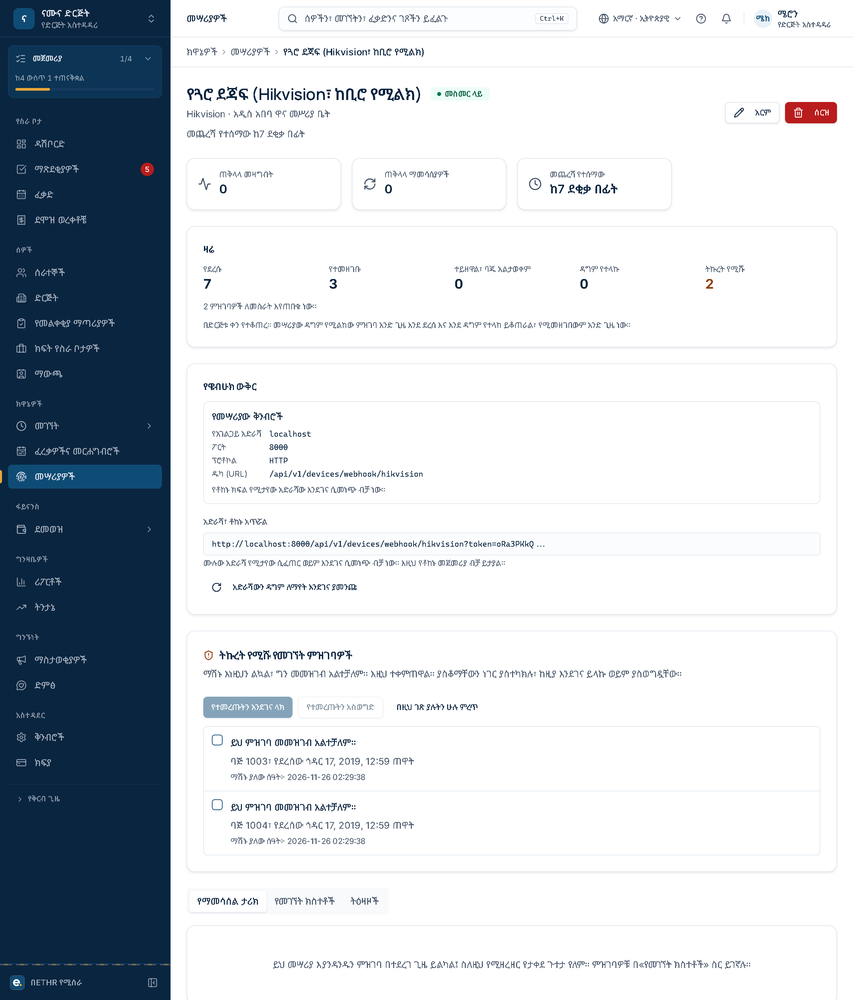

| ምክንያት | ምን ያደርጋሉ |
|---|---|
| ሰውየው ለቅቋል | የመልቀቂያ ቀኑ ስህተት ከሆነ ያስተካክሉ፣ ከዚያ እንደገና ይላኩ |
| ከዚህ በፊት መግቢያ የሌለው መውጫ | የጎደለውን መግቢያ ያክሉ፣ ከዚያ እንደገና ይላኩ |
| የማሽን ምዝገባ በመገኘት ቅንብሮች ውስጥ ጠፍቷል | **ባዮሜትሪክ መሣሪያ**ን ያብሩ ([ክፍል 2.2](#s-3qg3ko3rc3o83n9w3q03qs3p))፣ ከዚያ እንደገና ይላኩ |
| ምዝገባው ለሌላ ሰው ቀድሞ ጥቅም ላይ ውሏል | ይመልከቱ፤ አብዛኛውን ጊዜ ማስወገድ ይበቃል |
| የማሽኑ ሰዓት ከእውነተኛው ቀድሞ ነበር | ETHR ውስጥ ለዚህ መሣሪያ የተቀመጠው የሰዓት ክልል ስህተት ከነበረ እንደገና ይላኩ፤ ማሽኑ ራሱ ስህተት ከነበረ ያስወግዱት እና በእጅ ያስገቡ |
| ማሽኑ ሰዓት አልላከም | ያስወግዱት እና ምዝገባውን በእጅ ያስገቡ |
| በእኛ በኩል ችግር ተፈጥሯል | እንደገና ይላኩ |
| ማሽኑ ETHR ሊያነበው የማይችል መስመር ልኳል | ካነበቡት በኋላ ያስወግዱት |

1. ምዝገቦቹን ይምረጡ (**በዚህ ገጽ ያሉትን ሁሉ ምረጥ** ሁሉንም ይመርጣል)።
2. **የተመረጡትን እንደገና ላክ** ወይም **የተመረጡትን አስወግድ** ይጫኑ። ማስወገድ ምዝገባዎቹ እንዳይመዘገቡ ያደርጋል፤ ለአንድ ሳምንት ቆይተው ይጠፋሉ።

ሁለቱም ቁልፎች የሚሠሩት ለድርጅት አስተዳዳሪ ብቻ ነው፤ የሰው ሃብት አስተዳዳሪ ያያቸዋል።

# ሰዎችን ማዛመድ

## በቁጥር እንዴት እንደሚዛመድ

መሣሪያው የሚልከው የሰውየውን ቁጥር እና ጊዜ ነው። ETHR ያንን ቁጥር ከሠራተኛው **ባጅ / የመሣሪያ መለያ** ወይም ከሠራተኛ ኮዱ ጋር ያወዳድራል። አንድ ሠራተኛ ብቻ ሲዛመድ ምዝገባው ይመዘገባል። ማንም ሲዛመድ ወይም ከአንድ በላይ ሲዛመዱ ምዝገባው **አይጣልም፤ ይያዛል**፤ ባጁ ከታወቀ በኋላ ይመዘገባል።

## የተመዘገቡ ተጠቃሚዎችን ማግኘት

መሣሪያው ላይ ያሉትን ሰዎች ከETHR ሠራተኞች ጋር ለማዛመድ፦

1. በካርዱ ምናሌ (**ድርጊቶች**) ውስጥ **የተመዘገቡ ተጠቃሚዎችን ያግኙ** ይጫኑ።
2. ዝርዝሩ **ሰው**፣ **የመሣሪያ መለያ** እና **ዝምድና** ያሳያል (**ተዛምዷል**፣ **ሊሆን ይችላል**፣ **ግልጽ ያልሆነ**፣ **አዲስ**፣ **ቀደም ብሎ ወደ ማህደር የተወሰደ**)። ምንም አይፈጠርም።
3. ያልተገኙትን እንደ ሠራተኛ ለማስገባት **እነዚህን ሰዎች ወደ ETHR ያስገቡ** ይጫኑ። ወደ ሠራተኞች ማስገቢያ ገጽ ይወስድዎታል፤ እዚያ እያንዳንዱን ግጥሚያ ገምግመው ያረጋግጣሉ (የአስተዳዳሪ መመሪያ ምዕራፍ 4)።

ለZKTeco (ADMS) መሣሪያ ETHR መሣሪያውን በቀጥታ ማንበብ ስለማይችል መሣሪያው በመጨረሻ የላከውን ዝርዝር ያሳያል። «መሣሪያውን በመጠበቅ ላይ» ካለ **መሣሪያውን እንደገና ይጠይቁ** ይጫኑ፤ መሣሪያው በሚቀጥለው ግንኙነቱ (ብዙውን ጊዜ በአንድ ደቂቃ ውስጥ) ዝርዝሩን ይልካል። ከመተማመንዎ በፊት ቁጥሩን ከመሣሪያው ጋር ያነጻጽሩ። መሣሪያው ከ1,000 በላይ ሰዎች ከያዘ ዝርዝሩ ጥቅም ላይ አይውልም፤ በምትኩ ከፋይል ያስገቡ።

## ያልታወቁ ባጆች

ከማንም ሠራተኛ ጋር ያልተዛመደ ባጅ ምዝገባ ሲልክ ምዝገባዎቹ በ**መሣሪያዎች** ገጽ ላይ **ያልታወቁ ባጆች** ሳጥን ውስጥ ይቀመጣሉ። ሳጥኑ ባጁን፣ መሣሪያውን፣ የምዝገባዎቹን ብዛት እና መጨረሻ የታየበትን ቀን ያሳያል። መሣሪያው ለቁጥሩ ስም ከላከ «ተርሚናሉ ይህን ሰው አበበ ከበደ ብሎ ይጠራዋል» ይታያል። የሰው ሃብት አስተዳዳሪም የድርጅት አስተዳዳሪም ይህን ማድረግ ይችላሉ፦

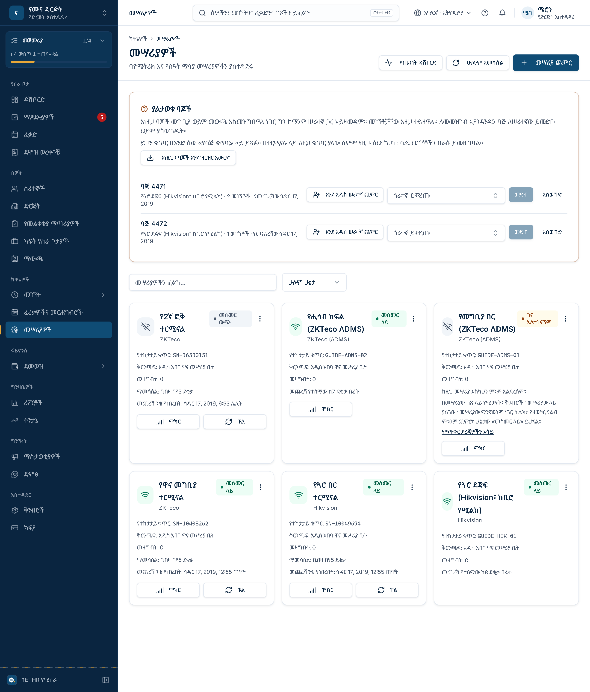

1. ETHR የገመተውን ሰው ካሳየ («ይህ አበበ ከበደ ነው» ወይም «ምናልባት አበበ ከበደ») እሱን ይምረጡ፤ ያለበለዚያ ከመፈለጊያው ሠራተኛውን ይምረጡ።
2. **መድብ** ይጫኑ። ሳጥኑ የተያዙ ምዝገባዎችን እንደገና ያስገባቸዋል። ብዙ ሲሆኑ በቅደም ተከተል ይሠራል፤ **አቁም** ማቆም ይችላል፣ ከተቋረጠ **ቀጥል** ይቀጥላል። ሰውየው የተገመተ ከሆነ ቁልፉ «ይስጡና 12 መዝገቦችን እንደገና ይመዝግቡ» ይላል።
3. ባጁ የማንም ካልሆነ **አስወግድ** ይጫኑ። ማረጋገጫው «የተያዙት 12 መገኘቶች አይመዘገቡም።» ይላል።
4. ሰውየው ገና ETHR ውስጥ ከሌለ **እንደ አዲስ ሠራተኛ ጨምር** ይጫኑ (ሠራተኛ የመጨመር ፈቃድ ላለው)። ብዙ ባጆችን በአንድ ጊዜ ለማስገባት **እነዚህን ባጆች እንደ ዝርዝር አውርድ** ይጫኑ፤ ፋይሉ የባጅ ቁጥሮቹን እና መሣሪያው የላከውን ስም ይዟል።

> [!tip] በራሱ የሚመዘገብበት ጊዜ
> የሠራተኛውን **ባጅ / የመሣሪያ መለያ** ከጻፉ እና መሣሪያው የላከው ስም ከአንድ ሰው ብቻ ጋር ከተዛመደ ETHR የተያዙትን ምዝገባዎች በአምስት ደቂቃ ውስጥ በራሱ ይመዘግባል። ሳጥኑ «በቁጥሩና በተርሚናሉ ላይ ባለው ስም ተዛምዷል። ተይዘው የቆዩ መገኘቶች አሁን እየተመዘገቡ ነው።» ይላል። ቁጥሩ ወይም ስሙ ከሌላ ሰው ወይም ከሁለት ሰዎች ጋር ከተዛመደ በራሱ አይመዘገብም፤ **መድብ** ይጫኑ።

> [!warning] ከተመደበ በኋላ ማስተካከል
> ባጅ ለተሳሳተ ሰው ከተመደበ ከዚህ ሳጥን ማስተካከል አይቻልም። ከመጫንዎ በፊት ስሙን ያረጋግጡ።

# ወደ መሣሪያ መላክ

## ትዕዛዞችን ማብራት

ETHR ሰዎችን ወደ መሣሪያ ሊልክ እና ሰዓቱን ሊያስተካክል ይችላል፤ ሆኖም ይህ በነባሪ **ጠፍቷል**፤ ሰውን ከመሣሪያ ማስወገድ የጣት አሻራውን እና ፊቱን ከመሣሪያው ስለሚሰርዝ ማንም እንዳይደነቅ።

1. የመሣሪያውን ገጽ ይክፈቱ፣ **አርም** ይጫኑ።
2. **ወደዚህ መሣሪያ ትዕዛዝ ላክ** ያብሩ (መሣሪያው ትዕዛዝ ከተቀበለ ብቻ ይታያል)። **ለውጦችን አስቀምጥ** ይጫኑ።

ሲበራ በዚህ ቅርንጫፍ አዲስ ተቀጣሪዎች ይጨመራሉ፣ የለቀቁ ይወገዳሉ፣ ሰዓቱም በየቀኑ ይስተካከላል። የጣት አሻራ እና ፊት አሁንም በመሣሪያው ላይ ይመዘገባሉ። መታገድ ማንንም አያስወግድም፤ የሚያስወግዱት ሥራ መልቀቅ፣ መሰናበት እና ጡረታ ብቻ ናቸው።

**ትዕዛዞች** ትር እያንዳንዱ ትዕዛዝ (ሰውን መጨመር ወይም ማዘመን፣ ሰውን ማስወገድ፣ ሰዓቱን ማስተካከል፣ የተመዘገቡትን መጠየቅ)፣ ለማን እንደሆነ እና ሁኔታውን (**በመጠባበቅ ላይ**፣ **ተልኳል**፣ **ተፈጽሟል**፣ **አልተሳካም**፣ **ተተክቷል**) ያሳያል። ትዕዛዙ ያልተላከበት ምክንያት ከስሩ ይጻፋል፤ ለምሳሌ ZKTeco መሣሪያ አሃዝ ብቻ ስለሚቀበል ፊደል ያለበት ቁጥር አልተላከም።

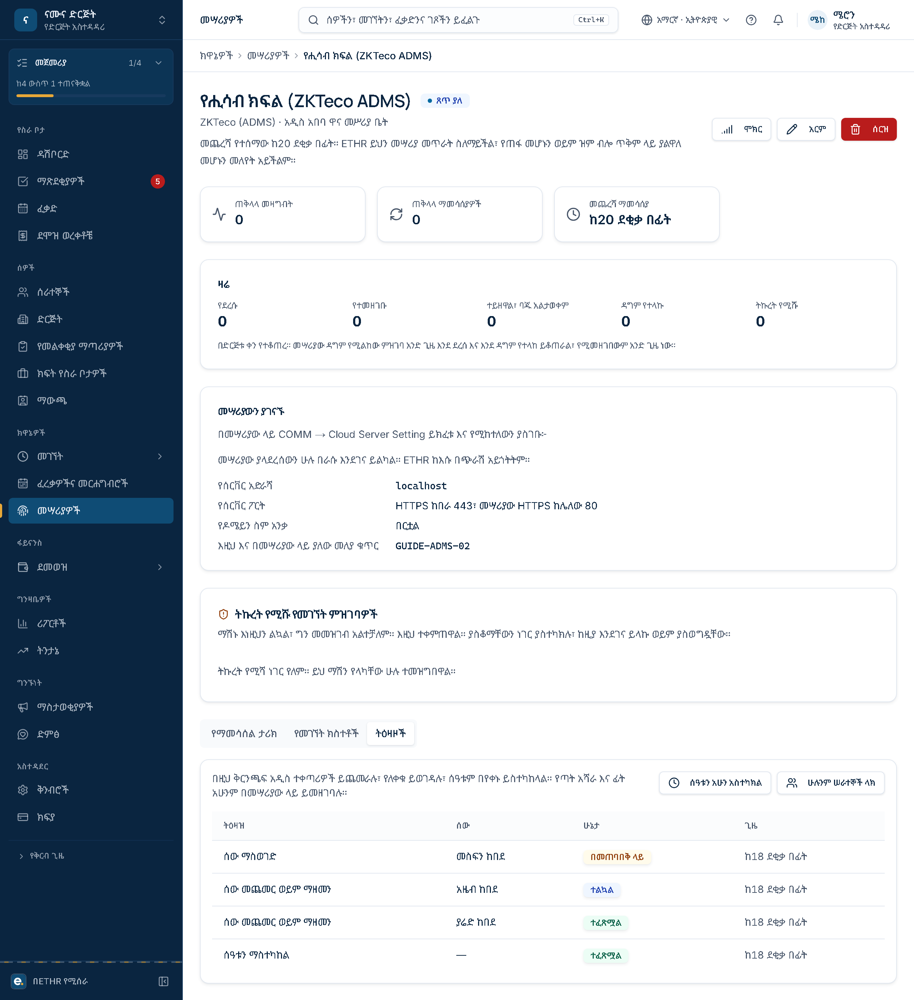

> [!note] በቢሮ አውታረ መረብ ውስጥ ያሉ መሣሪያዎች
> ETHR ወደ ቢሮ አውታረ መረብ ሊደርስ ስለማይችል ትዕዛዞች የሚደርሱት መሣሪያው ሲደውል ነው (ZKTeco ADMS)። Hikvision በአድራሻ ትዕዛዝ ይቀበላል፤ ይህ በእውነተኛ መሣሪያ ላይ በብዛት አልተሞከረም። ወደ ETHR የሚልክ Hikvision፣ ZKTeco በአድራሻ እና Suprema ትዕዛዝ አይቀበሉም።

## ሰዓቱን ማስተካከል እና ሁሉንም ሠራተኞች መላክ

ትዕዛዞች ከበሩ በኋላ በ**ትዕዛዞች** ትር ወይም በካርዱ ምናሌ ውስጥ (**ሠራተኞች እና ሰዓት**) ሁለት ቁልፎች አሉ፦

1. **ሰዓቱን አሁን አስተካክል**። መሣሪያው በሚቀጥለው ጊዜ ሲደረስ ሰዓቱ ይስተካከላል።
2. **ሁሉንም ሠራተኞች ላክ**። የቅርንጫፉን ሰዎች ሁሉ ወደ መሣሪያው ይልካል። የባጅ ቁጥር የሌላቸው አይላኩም፤ መልእክቱ «:queued ሰዎች ለዚህ መሣሪያ ተሰልፈዋል፤ :skipped የባጅ ቁጥር ስለሌላቸው ተዘልለዋል።» ይላል።

አዲስ ተቀጣሪ፣ ስም መቀየር እና የባጅ ቁጥር መቀየር ራሱ ይላካል፤ ሁሉንም መላክ የሚያስፈልገው መሣሪያው ዳግም ከተቀናበረ ወይም ከተተካ ወይም ትዕዛዞች ከመብራታቸው በፊት የነበሩ ሰዎች ካሉ ነው።

## አንድ ሠራተኛን ማስመዝገብ

አንድን ሰው ብቻ ወደ መሣሪያዎች ለመላክ **ሰዎች → ሰራተኞች** ውስጥ ሠራተኛውን ይክፈቱ እና መዝገቡ ላይ **በመሣሪያዎች ላይ አስመዝግብ** ይጫኑ (ለድርጅት አስተዳዳሪ)። ሠራተኛው የባጅ ቁጥር እና ትዕዛዝ የበራለት መሣሪያ ያለው ቅርንጫፍ ያስፈልገዋል። ሲሳካ «በቅርንጫፋቸው ላሉ :devices መሣሪያ(ዎች) ተሰልፏል።» ይታያል፤ ካልሆነ «የሚላክ የለም» የሚል ምክንያት ይታያል።

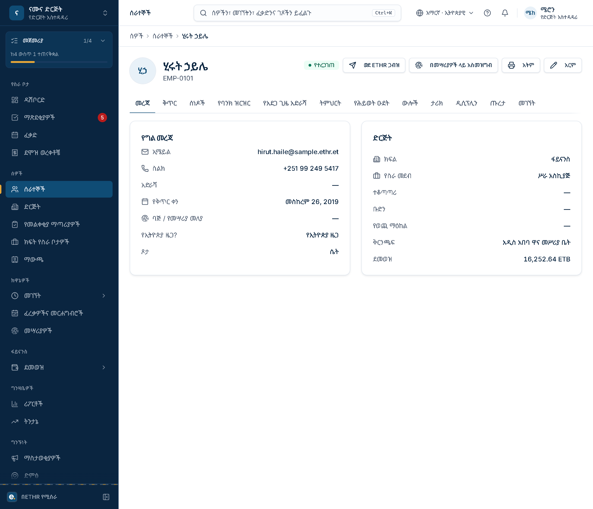

## ሰውን ከመሣሪያ ማስወገድ

ሠራተኛ ሲለቅ፣ ሲሰናበት ወይም ጡረታ ሲወጣ እና ትዕዛዞች ሲበሩ ETHR ከቅርንጫፉ መሣሪያዎች ያስወግደዋል። ሠራተኛው ሲሰረዝ ወይም ከቅርንጫፍ ሲወጣም እንዲሁ ነው።

> [!warning] ከመሣሪያ ማስወገድ
> ሰው ከመሣሪያ ሲወገድ የጣት አሻራው እና ፊቱ ከመሣሪያው ይሰረዛሉ። መሣሪያን ከETHR መሰረዝ ግን የመገኘት መዛግብቱን አያጠፋም፤ ሰዎቹንም ከመሣሪያው አያስወግድም።

# ያለፈ የመገኘት ታሪክ ማስገባት

መሣሪያው አዲስ ከመመዝገቡ በፊት የያዛቸውን ምዝገባዎች ለማስገባት ይህን ይጠቀሙ። ይህ ETHR ለሚጠራቸው መሣሪያዎች ብቻ ነው (የድርጅት አስተዳዳሪ)።

1. በካርዱ ምናሌ ውስጥ **የመገኘት ታሪክ አስገባ** ይጫኑ።
2. **ጊዜ** ውስጥ ይምረጡ፦ **ያለፉት 30 ቀናት**፣ **ያለፉት 90 ቀናት** (ነባሪ)፣ **ከተወሰነ ቀን ጀምሮ** ወይም **ሙሉ ታሪክ**። **ከተወሰነ ቀን ጀምሮ** ሲመርጡ **የመጀመሪያ ቀን** ይምረጡ።
3. **ማስገባት ጀምር** ይጫኑ። «የታሪክ ማስገባት ተሰልፏል። መዝገቦች ሲመሳሰሉ ይታያሉ።» ይታያል።

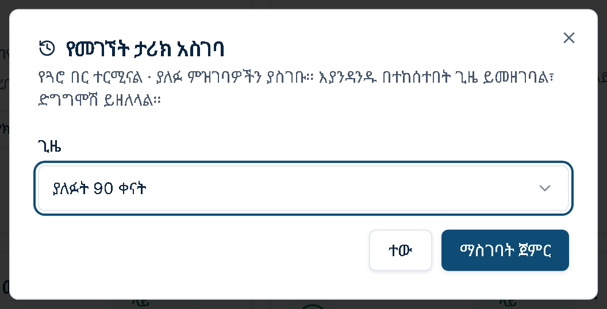

እያንዳንዱ ምዝገባ በተከሰተበት ጊዜ ይመዘገባል (ከ90 ቀን በፊት የነበረው ከ90 ቀን በፊት ይሆናል)፣ የተደገሙት ይዘለላሉ። የተለመደው ማመሳሰል አይረበሽም። ሙሉ ታሪክ መሣሪያው የያዘውን ሁሉ ያመጣል።

> [!note] ወደ ETHR ለሚልኩ መሣሪያዎች
> ለZKTeco (ADMS) እና ለHikvision በቢሮ አውታረ መረብ **የመገኘት ታሪክ አስገባ** አይቀርብም። ZKTeco ADMS መሣሪያ ያላደረሰውን በራሱ እንደገና ይልካል፤ ሲገናኝ የያዛቸውንም ሊልክ ይችላል። የሠራተኞች ባጅ ቁጥር ከመሣሪያው ጋር ካልተዛመደ ምዝገባዎቹ ባልታወቁ ባጆች ውስጥ ይቆያሉ፤ ከተመደቡ በኋላ ይመዘገባሉ።

# የጤንነት ዳሽቦርድ እና ማሳወቂያዎች

## ዳሽቦርዱ

**መሣሪያዎች** ገጽ ላይ **የጤንነት ዳሽቦርድ** ይጫኑ። ከላይ ወደ **ሁሉም መሣሪያዎች** መመለሻ እና **መሣሪያ ጨምር** አለ። ዳሽቦርዱ እነዚህን ያሳያል፦

- እስከ ሦስት ማሳሰቢያዎች (ካሉ)፦ **ጸጥ ያሉ መሣሪያዎች** (መሣሪያው እና «ጸጥ ያለው ከ… ጀምሮ» ወይም «ዛሬ ምንም ምዝገባ አልመጣም»፣ ወደ መሣሪያው ገጽ ይወስዳል)፣ **ትኩረት የሚሹ የመገኘት ምዝገባዎች** (በመሣሪያው ስም እና ብዛት፣ ወደ መሣሪያው ገጽ ይወስዳል) እና **ያልታወቁ ባጆች** (ከ**ባጆችን ይመልከቱ** ጋር)።
- ቆጣሪዎች፦ **ጠቅላላ መሣሪያዎች**፣ **መስመር ላይ**፣ **ጸጥ ያለ**፣ **ገና አልተገናኘም**፣ **መስመር ውጭ** እና **ስህተት**።
- **የዛሬ መገኘቶች**፦ **እንደ መገኘት ተመዝግበዋል**፣ **ተይዘዋል፣ ባጁ አልታወቀም** እና **ሊሠሩ በመጠበቅ ላይ**፣ እና ከመሣሪያ የተሰማበት የመጨረሻ ጊዜ።
- **የማመሳሰል አጠቃላይ እይታ (24 ሰዓት)**፦ **የተሳካ**፣ **ከፊል**፣ **ያልተሳካ** ብዛት እና **ራስ-ሰር ማመሳሰል ነቅቷል** ያላቸው መሣሪያዎች።
- **የመሣሪያ ሁኔታ** ሰንጠረዥ፦ **የመሣሪያ ስም**፣ **አምራች**፣ **ተከታታይ**፣ **ቅርንጫፍ**፣ **ሁኔታ**፣ **መዛግብት**፣ **የመጨረሻ ግንኙነት** እና **ዛሬ**።

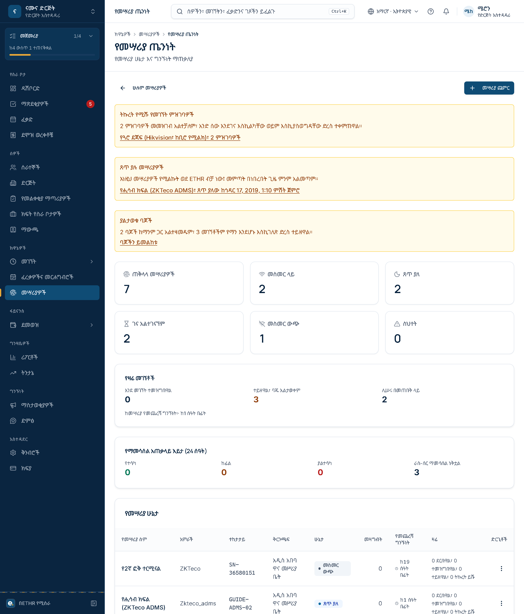

> [!tip] ዕለታዊ ልማድ
> ጠዋት ዳሽቦርዱን ይክፈቱ። **ሊሠሩ በመጠበቅ ላይ** ቁጥር ከጥቂት ደቂቃ በላይ ካልቀነሰ ወይም ማሳሰቢያ ካለ ወደ [ክፍል 11.1](#s-3oo3kt3kd3ot3n5w3pk3qow3) ይሂዱ።

## ማሳወቂያዎች

ETHR ለድርጅት አስተዳዳሪዎች እና ለሰው ሃብት አስተዳዳሪዎች በደወሉ እና በኢሜይል ያሳውቃል። ማሳወቂያዎቹ በሁለት ቡድን ናቸው።

**ETHR የሚጠራው መሣሪያ ሲቋረጥ**፦

- «የባዮሜትሪክ መሣሪያ ከመስመር ውጭ ሆኗል» ETHR መሣሪያውን መድረስ ሳይችል ሲቀር።
- «የባዮሜትሪክ መሣሪያ ማመሳሰል አልተሳካም» ከሁሉም ሙከራ በኋላ ማመሳሰሉ ሲከሽፍ፣ መሣሪያው ያሳወቀውን ምክንያት ጨምሮ።

**ወደ ETHR ብቻ የሚልክ መሣሪያ ሲጸጥ**፦ ZKTeco (ADMS)፣ በቢሮ አውታረ መረብ ያለ Hikvision፣ እና አድራሻ ሳይሰጥ የተመዘገበ ZKTeco ወይም Suprema። ETHR እነዚህን መጥራት ስለማይችል ዝምታቸውን የሚለየው ከላኩት ብቻ ነው፤ ሁለት ዓይነት መሣሪያ ሁለት ደንብ አለው፦

| መሣሪያ | መቼ ይነገራል | የኢሜይሉ ርዕስ |
|---|---|---|
| **ZKTeco (ADMS)**፣ ሁልጊዜ የሚደውል | በሥራ ሰዓት ከ30 ደቂቃ በላይ ሳይደውል ሲቆይ | «የባዮሜትሪክ መሣሪያ አልተገናኘም፦ ስም» |
| ምዝገባ ሲኖር ብቻ የሚሰማ (Hikvision እና ሌሎች) | የሥራ ቀኑ ከጀመረ ከ60 ደቂቃ በኋላ ከመሣሪያው ምንም ምዝገባ ሳይመጣ፣ የመሣሪያው ቅርንጫፍ የባጅ ቁጥር ያላቸው ሰዎች ሲኖሩት | «ዛሬ ከባዮሜትሪክ መሣሪያ ምንም ምዝገባ አልመጣም፦ ስም» |

- **የሥራ ሰዓት** የድርጅቱ ነባሪ ፈረቃ ቀናት፣ መጀመሪያ እና መጨረሻ ሲሆን በዓላት አይቆጠሩም። ነባሪ ፈረቃ ከሌለ የሚለካበት ሰዓት የለም፣ ስለዚህ ማሳወቂያ አይላክም።
- ማሳወቂያው በአንድ መሣሪያ ቢበዛ በቀን አንድ ጊዜ ይላካል። ጽሑፉ «ዛሬ መሥሪያ ቤቱ ዝግ ከሆነ ምንም ማድረግ አያስፈልግም። ካልሆነ መሣሪያው መብራቱንና ኢንተርኔት ማግኘቱን ያረጋግጡ።» ይላል፤ **መሣሪያውን ይመልከቱ** ወደ መሣሪያው ገጽ ይወስዳል።
- የጤንነት ዳሽቦርዱ **ጸጥ ያሉ መሣሪያዎች** በሚል ተመሳሳይ ዝርዝር ያሳያል ([ክፍል 9.1](#s-3qr3lp3mu3l93qp))፣ ስለዚህ ገጹ እና ማሳወቂያው አይለያዩም።
- ከ15 ደቂቃ በላይ ዝም ባለ መሣሪያ ላይ የሚታየው **ጸጥ ያለ** ሁኔታ ስያሜ ብቻ ነው ([ክፍል 5.2](#s-3og3kt3lh3n5w3qg3ko3kz3l))። ማሳወቂያ የሚያስነሳው ከላይ ያለው የሥራ ሰዓት ደንብ ነው።

### ማሳወቂያውን ማስተካከል

**ቅንብሮች → የመገኘት ደንቦች** ውስጥ ከታች **ጸጥ ያሉ መሣሪያዎች** የሚል ካርድ አለ (ቅንብሮችን መቀየር ለሚችል ሰው ብቻ ይታያል)። በነባሪ በርቷል።

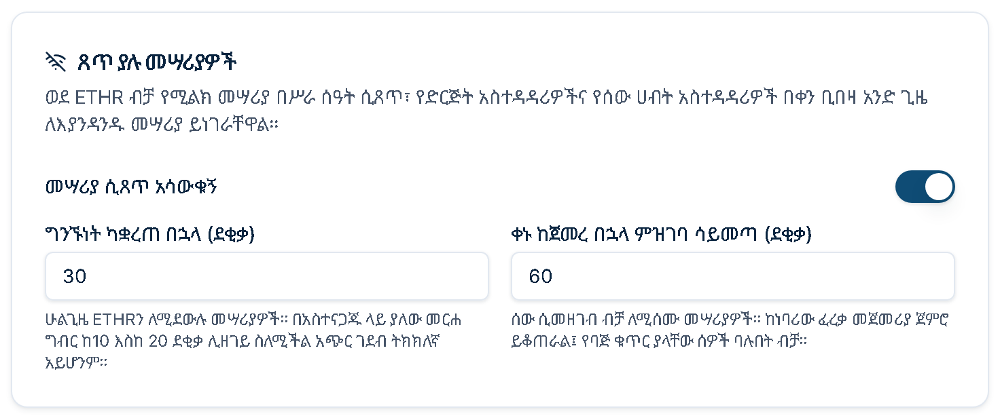

1. **መሣሪያ ሲጸጥ አሳውቁኝ** ማብሪያው ማሳወቂያዎቹን ያበራል ወይም ያጠፋል።
2. **ግንኙነት ካቋረጠ በኋላ (ደቂቃ)** ለADMS መሣሪያዎች ነው፤ ነባሪው 30 ሲሆን ከ15 እስከ 240 ያሉ ሙሉ ደቂቃዎችን ይቀበላል። በአስተናጋጁ ላይ ያለው መርሐ ግብር ከ10 እስከ 20 ደቂቃ ሊዘገይ ስለሚችል ከዚህ አጭር ገደብ ትክክለኛ አይሆንም።
3. **ቀኑ ከጀመረ በኋላ ምዝገባ ሳይመጣ (ደቂቃ)** ምዝገባ ሲኖር ብቻ ለሚሰሙ መሣሪያዎች ነው፤ ነባሪው 60 ሲሆን ከ30 እስከ 480 ይቀበላል። ከነባሪው ፈረቃ መጀመሪያ ጀምሮ ይቆጠራል።
4. **አስቀምጥ** ይጫኑ።

> [!note] በኢትዮጵያ አውድ
> የሥራ ቀን ባልሆኑ ቀናት እና በበዓላት በሥራ ሰዓቱ ውስጥ አይቆጠሩም፤ ስለዚህ በእነዚህ ቀናት ጸጥ ያለ መሣሪያ ማሳወቂያ አያስነሳም።

# መሣሪያን ማስተዳደር

## መሣሪያን ማረም

በመሣሪያ ላይ ለውጥ የሚያደርጉት የድርጅት አስተዳዳሪ ነው። **አርም** በዝርዝሩ ካርድ ምናሌ ውስጥ እና በመሣሪያው ገጽ ላይ አለ፤ ሁለቱም **መሣሪያ አርትዕ** የሚለውን ያው ቅጽ ይከፍታሉ፣ መመዝገቢያው የሚጠቀምበትን ([ክፍል 3.3](#s-3kp3k93ppw3lx3st3tyw4r3q))። ስለዚህ የተፈቀዱ የIP አድራሻዎች፣ ትዕዛዞችን ማብራት፣ የሰዓት ክልል እና የማመሳሰል ልዩነት ከየትኛውም ቦታ ሲከፍቱ በ**ተጨማሪ ቅንብሮች** እና በ**ሰዎች እና ትዕዛዞች** ክፍሎች ውስጥ ያገኟቸዋል። **ለውጦችን አስቀምጥ** ይጫኑ።

ለHikvision መሣሪያ በ**አርም** ውስጥ **መሣሪያው በቢሮአችን አውታረ መረብ ውስጥ ነው** መቀየር ይችላሉ። ወደ አድራሻ ሲመልሱ **የIP አድራሻ** እና **ወደብ** ያስገቡ። ወደ መላክ ሲቀይሩ ETHR ያለውን አድራሻ እና የይለፍ ቃል ይረሳል።

## አድራሻውን ዳግም መፍጠር

አድራሻው (ቶከኑ) ከጠፋ፣ ከተሰረቀ ወይም መሣሪያው ከተዛወረ አዲስ ይፍጠሩ።

1. ካርዱ ምናሌ ውስጥ **ቶከን ዳግም ፍጠር** (ወይም በመሣሪያው ገጽ **አድራሻውን ዳግም ለማየት እንደገና ያመንጩ**) ይጫኑ።
2. «አድራሻውን ለምን ይቀይራሉ?» ሲል አንዱን ይምረጡ፦
   - **ጠፍቷል ወይም ተሰርቋል፦ አሮጌው አድራሻ አሁኑኑ ይቆማል።**
   - **መሣሪያው እየተዛወረ ወይም እንደገና እየተዋቀረ ነው፦ አሮጌው አድራሻ ለ24 ሰዓት መስራቱን ይቀጥላል።**
3. **ቶከን ዳግም ፍጠር** ይጫኑ። አዲሱ አድራሻ አንድ ጊዜ ይታያል፤ በመሣሪያው ላይ ያስገቡ እና **ተጠናቀቀ** ይጫኑ።

አድራሻው የሚቀየረው ቶከን የሚጠቀሙ መሣሪያዎች (Hikvision፣ እና ለማገናኘት ለመረጡ ZKTeco ወይም Suprema) ብቻ ነው። ZKTeco (ADMS) ቶከን አይጠቀምም፤ ለእሱ የተፈቀዱ IP አድራሻዎች እና የተከታታይ ቁጥር ይጠቅማሉ።

## መሣሪያን ማቆም

ETHR ውስጥ መሣሪያን ለጊዜው የሚያቆም ቁልፍ የለም። በምትኩ፦

- ETHR የሚጠራው መሣሪያ ከሆነ **ራስ-ሰር ማመሳሰል** ያጥፉ፤ ETHR ከመሣሪያው መጎተት ያቆማል።
- **ወደዚህ መሣሪያ ትዕዛዝ ላክ** ያጥፉ፤ ወደ መሣሪያው ምንም አይላክም።
- መሣሪያው ወደ ETHR የሚልክ ከሆነ አድራሻውን ዳግም ይፍጠሩ እና **ጠፍቷል ወይም ተሰርቋል** ይምረጡ፤ የድሮው አድራሻ ወዲያውኑ ይቆማል።

## መሰረዝ

**መሣሪያ ሰርዝ** ከካርዱ ምናሌ (**ሰርዝ**) ወይም ከመሣሪያው ገጽ ይጫኑ። ሁለቱም ቦታ አንድ ማረጋገጫ ይከፈታል፤ ጽሑፉ አምስት መስመር ነው፦

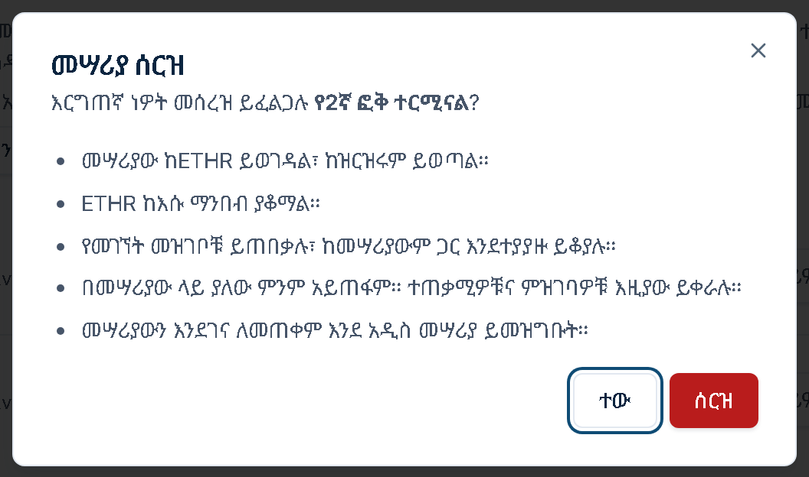

- መሣሪያው ከETHR ይወገዳል፣ ከዝርዝሩም ይወጣል።
- ETHR ከእሱ ማንበብ ያቆማል።
- የመገኘት መዝገቦቹ ይጠበቃሉ፣ ከመሣሪያውም ጋር እንደተያያዙ ይቆያሉ።
- በመሣሪያው ላይ ያለው ምንም አይጠፋም። ተጠቃሚዎቹና ምዝገባዎቹ እዚያው ይቀራሉ።
- መሣሪያውን እንደገና ለመጠቀም እንደ አዲስ መሣሪያ ይመዝግቡት።

መጨረስ ከፈለጉ **ሰርዝ** ይጫኑ፤ **ተው** ይዘጋዋል። መሣሪያው ከዕቅዱ የመሣሪያ ቁጥር ይቀነሳል፣ የተከታታይ ቁጥሩም እንደገና ሊመዘገብ ይችላል።

# ችግር ሲገጥም

## ከምልክቱ ወደ መፍትሔ

| ምልክት | ምክንያት | መፍትሔ |
|---|---|---|
| ካርዱ «ከዚህ መሣሪያ እስካሁን ምንም አልደረሰም።» ይላል፤ ሁኔታ **ገና አልተገናኘም** | አድራሻው በመሣሪያው ላይ አልገባም፣ ወይም መሣሪያው በይነመረብ የለውም | አድራሻውን ከመሣሪያው ገጽ በመሣሪያው ላይ ያስገቡ፤ የመሣሪያውን በይነመረብ ይፈትሹ |
| «ቶከኑ ዳግም ከመፈጠሩ በፊት የነበረውን ቶከን አሁንም እየላከ ነው።» | አድራሻ ዳግም ተፈጥሯል፣ መሣሪያው አሮጌውን ይልካል | በመሣሪያው ላይ የአሁኑን አድራሻ ያስገቡ |
| «የቶከኑን መጀመሪያ ብቻ ልኳል፣ ስለዚህ በመሣሪያው ላይ ያለው አድራሻ ተቆርጧል።» | የመሣሪያው አድራሻ መስክ አጭር ነው | ሙሉውን አድራሻ ያስገቡ፤ መሣሪያው ሙሉውን መያዙን ያረጋግጡ |
| «ያለ ቶከን ደውሏል።» | አድራሻው ከ ?token= በኋላ ያለ ክፍል ጎድሎታል | ሙሉውን አድራሻ ያስገቡ |
| «ከ 196.188.10.25 ደውሏል፣ ይህ አድራሻ በዚህ መሣሪያ የተፈቀዱ አድራሻዎች ዝርዝር ውስጥ የለም።» | የቢሮው የወል IP አድራሻ አልተፈቀደም ወይም ተቀይሯል | አድራሻው የቢሮዎ ከሆነ በመሣሪያው ገጽ የ**ፍቀድ** ቁልፍን ይጫኑ ወይም በ**አርም** ውስጥ ያክሉት። ዝርዝሩ ቢበዛ 20 አድራሻ ይይዛል |
| ADMS መሣሪያ አይቀበልም፣ «የተፈቀዱ IP ዝርዝር ባዶ ስለሆነ ETHR ይህን መሣሪያ አይቀበልም» | ዝርዝሩ ባዶ ነው | **አርም** ውስጥ የቢሮውን IP ያክሉ |
| ሙከራ ሲከሽፍ «በወደብ 8000 ላይ ምንም አልመለሰም» | ይህ የHikvision SDK ወደብ ነው | የHTTP ወደብ ያስገቡ፣ ብዙውን ጊዜ 80 |
| «በዚያ አድራሻና ወደብ ላይ ምንም አልመለሰም» ወይም «አድራሻው በጊዜ አልመለሰም» | አድራሻ ወይም ወደብ ስህተት፣ ወይም መሣሪያው ጠፍቷል፣ ወይም ወደቡ ለበይነመረብ ዝግ ነው | አድራሻውን፣ ወደቡን እና መብራቱን ያረጋግጡ። መሣሪያው በቢሮ አውታረ መረብ ውስጥ ከሆነ **መሣሪያው በቢሮአችን አውታረ መረብ ውስጥ ነው** ያብሩ |
| «አድራሻው አልተገኘም» | የአድራሻ አጻጻፍ ስህተት | ያስተካክሉ |
| «መሣሪያው መልሷል ግን ETHR የላከውን የመግቢያ መረጃ አልተቀበለም።» | የተጠቃሚ ስም ወይም የይለፍ ቃል ስህተት፣ ወይም Hikvision Digest ይጠይቃል | መረጃውን ያስተካክሉ፤ ካልተሳካ መሣሪያውን እንዲልክ ያዋቅሩት |
| መመዝገብ ሲሞክሩ «የመሣሪያው አድራሻ ይህ ሰርቨር የማይገናኝበትን የግል ወይም የውስጥ አውታረ መረብ ያመለክታል።» | የቢሮ (192.168...) አድራሻ አስገብተዋል | የወል አድራሻ ያስገቡ፣ ወይም ወደ ETHR ወደሚልክ ሁነታ ይለውጡ (Hikvision፣ ADMS) |
| «ይህ የመለያ ቁጥር ለዚህ የመሣሪያ ዓይነት አስቀድሞ ተመዝግቧል።» | ቁጥሩ ቀድሞ ተመዝግቧል (በራስዎ ድርጅት ወይም ሌላ) | አጻጻፉን ይፈትሹ፤ ያረጀ መዝገብ ካለ ሰርዘው እንደገና ይመዝግቡ። የእርስዎ ካልሆነ የETHR ድጋፍን ያነጋግሩ |
| «ለዕቅድዎ የመሣሪያ ገደብ ደርሰዋል።» | የዕቅዱ መሣሪያ ብዛት ሞልቷል | ያልተጠቀሙበትን ይሰርዙ ወይም ዕቅድ ያሻሽሉ |
| **የመሣሪያ ሰዓት** ቀድሟል ወይም ዘግይቷል | የመሣሪያው ሰዓት ስህተት | [ክፍል 5.4](#s-3qg3ko3kz3l63qjw3lc3pv3n) |
| ምዝገባዎች **ያልታወቁ ባጆች** ውስጥ | የባጅ ቁጥር ከሠራተኛ ጋር አልተዛመደም (ወይም ZKTeco ፊደል ያለበትን አይቀበልም) | [ክፍል 6.3](#s-3qj3kd3n73pk3ltw3mr3ra3n) |
| ምዝገባዎች **ትኩረት የሚሹ** ውስጥ | ሰውዬው ለቅቋል፣ ዘዴው ጠፍቷል፣ ሰዓቱ ስህተት ነው ወዘተ | [ክፍል 5.5](#s-3n93op3l43n9w3qg3kq3llw3) |
| መሣሪያው ሠርቷል ግን ምዝገባው ወዲያውኑ አይታይም | ምዝገባዎች ተሰልፈው ይሠራሉ | **ሊሠሩ በመጠበቅ ላይ** ሲቀንስ ይጠብቁ፤ ጥቂት ደቂቃዎች ይወስዳል |
| መሣሪያው ይሠራል ግን **ጸጥ ያለ** ወይም **መስመር ውጭ** | ለሚልኩ መሣሪያዎች ከ15 ደቂቃ ወይም ከ24 ሰዓት በላይ ዝም ብሏል (የሳምንት መጨረሻ ሊሆን ይችላል) | አንድ ጊዜ ይመዝገቡ፤ ካልተቀየረ አድራሻውን እና የበይነመረብ ግንኙነቱን ይፈትሹ |
| ማሳወቂያ ደርሷል፦ «የባዮሜትሪክ መሣሪያ አልተገናኘም» | ADMS መሣሪያ በሥራ ሰዓት ከ30 ደቂቃ (ወይም ከሚያስቀምጡት ገደብ) በላይ አልደወለም | መብራቱን እና በይነመረቡን ይፈትሹ፤ የቢሮው የወል IP አድራሻ ተቀይሮ ከሆነ የተፈቀደውን ዝርዝር ያዘምኑ |
| ማሳወቂያ ደርሷል፦ «ዛሬ ከባዮሜትሪክ መሣሪያ ምንም ምዝገባ አልመጣም» | የሥራ ቀኑ ከጀመረ ከ60 ደቂቃ በኋላ ከመሣሪያው ምንም አልመጣም፣ በዚያ ቅርንጫፍ ግን የባጅ ቁጥር ያላቸው ሰዎች አሉ | ዛሬ መሥሪያ ቤቱ ዝግ ከሆነ ምንም ማድረግ አያስፈልግም። ካልሆነ መብራቱን እና በይነመረቡን ይፈትሹ፣ አንድ ጊዜ ይመዝገቡ |
| መሣሪያው ምንም ወደ ETHR አይልክም፣ በበይነመረብ ግን ይሠራል | የቢሮው ፋየርዎል ወደ ETHR አድራሻ (ወደብ 443 ወይም 80) እየከለከለ ነው | የአይቲ ባለሙያዎን ወደ ETHR አድራሻ ግንኙነት እንዲፈቅድ ይጠይቁ። Hikvision በHTTPS መላክ አለበት |
| መሣሪያው 503 ይመልሳል | የETHR አስተዳዳሪዎች የመሣሪያ ምዝገባ መቀበልን ለጊዜው አጥፍተው ይሆናል | የETHR ድጋፍን ያነጋግሩ |

## ድጋፍ ከመጠየቅዎ በፊት

ለETHR ድጋፍ ሲጽፉ እነዚህን ያካትቱ፦ የመሣሪያው ስም እና የተከታታይ ቁጥር፣ የአስማሚው አይነት፣ ሁኔታው፣ መጨረሻ የተሰማበት ጊዜ፣ በገጹ ላይ የሚታየው የስህተት ጽሑፍ እና ምን እንደሞከሩ። የአድራሻውን ቶከን (ከ?token= በኋላ ያለውን) በጭራሽ አይላኩ።

# ፈጣን የማረጋገጫ ዝርዝር

## አንድ ገጽ

አዲስ መሣሪያ ሲያገናኙ በቅደም ተከተል ይሂዱ፦

1. **የመገኘት ደንቦች** ውስጥ **ባዮሜትሪክ መሣሪያ** መብራቱን እና ቅርንጫፍ መኖሩን ያረጋግጡ።
2. ሠራተኞቹ **ባጅ / የመሣሪያ መለያ** አላቸው (ZKTeco አሃዝ ብቻ)።
3. የተከታታይ ቁጥሩን ከመሣሪያው ይቅዱ።
4. **መሣሪያ ጨምር** ይጫኑ፣ በመሪው ሁለቱን ጥያቄዎች ይመልሱ፦ ZKTeco ከቢሮ ከሆነ መንገዱ ADMS ነው፣ በቢሮ ውስጥ ያለ Hikvision መሣሪያው ራሱ ይልካል፣ የወል አድራሻ ካለው ብቻ ETHR ይጠራዋል።
5. ዝርዝሮቹን ያስገቡ፣ **መዝግብና ቀጥል** ይጫኑ።
6. ለADMS፦ በመሣሪያው **COMM → Cloud Server Setting** ውስጥ መሪው ያሳየውን ያስገቡ። የመጀመሪያው ጥሪ ከተከለከለ **ፍቀድ** ይጫኑ፣ ወይም የቢሮውን የወል IP በ**አርም** ውስጥ **ተጨማሪ ቅንብሮች** ስር ያክሉ።
7. ለHikvision በቢሮ ውስጥ፦ አድራሻውን ቅዱ፣ በመሣሪያው HTTP listening ውስጥ አራቱን እሴቶች ያስገቡ፣ ከዚያ **ግንኙነቱን ፈትሽ** ይጫኑ።
8. በመሣሪያው አንድ ጊዜ ይመዝገቡ፤ መሪው «ተገናኝቷል» እስኪል፣ ሁኔታው **መስመር ላይ** እስኪሆን እና ምዝገባው **የመገኘት ክስተቶች** ውስጥ እስኪታይ ይጠብቁ።
9. **ያልታወቁ ባጆች** እና **ትኩረት የሚሹ የመገኘት ምዝገባዎች** ባዶ መሆናቸውን ይፈትሹ።
10. የመሣሪያ ሰዓቱ **ትክክል ነው** የሚል መሆኑን ይፈትሹ።
11. ትዕዛዞች ከፈለጉ **ወደዚህ መሣሪያ ትዕዛዝ ላክ** ያብሩ፣ ከዚያ **ሁሉንም ሠራተኞች ላክ**።
12. **ቅንብሮች → የመገኘት ደንቦች** ውስጥ **ጸጥ ያሉ መሣሪያዎች** በርቶ መሆኑን ያረጋግጡ።
13. ከዚያ በኋላ በየጠዋቱ **የጤንነት ዳሽቦርድ** ይመልከቱ።

[[qr:https://ethr.et/login|ETHRን ለመክፈት ይቃኙ]]
