# ከመጀመርዎ በፊት

ETHR የድርጅትዎ የሰው ሀብት ሥርዓት ነው። በእሱ መገኘትዎን ይመዘግባሉ፣ ፈቃድ ይጠይቃሉ፣ የደመወዝ ወረቀትዎን ያያሉ፣ የግል መረጃዎን ያዘምናሉ። ከኮምፒውተር በአሳሽ፣ ወይም ከስልክዎ በተጫነው መተግበሪያ ይሠራል።

## ይህን መመሪያ እንዴት እንደሚያነቡት

እያንዳንዱ ክፍል አንድ ሥራን ያሳያል። በሥዕሎቹ ላይ ያሉት ቢጫ ቁጥሮች ((1)) ((2)) ((3)) ከደረጃዎቹ ቁጥሮች ጋር አንድ ናቸው፤ ደረጃ 2 ላይ ያለው ቁልፍ በሥዕሉ ላይ ቁጥር 2 የተጻፈበት ነው።

| ምልክት | ትርጉሙ |
|---|---|
| **ደማቅ ጽሑፍ** | በማያ ገጹ ላይ የሚያዩት የቁልፍ ወይም የገጽ ስም፣ እንዳለ |
| ጠቃሚ ምክር (አረንጓዴ ሳጥን) | ሥራውን የሚያቀልልዎ ምክር |
| ማስታወሻ (ሰማያዊ ሳጥን) | ማወቅ የሚገባዎ ተጨማሪ መረጃ |
| ጥንቃቄ (ቢጫ ሳጥን) | ስሕተትን ወይም ጉዳትን ለማስቀረት የሚያስፈልግ |

> [!note] ሁሉም ገጽ ላይኖርዎት ይችላል
> ድርጅትዎ የትኞቹን አገልግሎቶች እንደሚጠቀም ይወስናል። ለምሳሌ QR ቅኝት ወይም የስልክ ምዝገባ ካልተከፈተልዎ በምናሌዎ ውስጥ አይታዩም። በዚህ መመሪያ ያለ ገጽ የማያገኙ ከሆነ የሰው ሀብት ክፍልን ይጠይቁ።

## በአጭሩ፦ የመጀመሪያው ቀን

:::card አምስት ደቂቃ የሚወስዱ ስድስት ሥራዎች
1. የድርጅትዎን አድራሻ ይክፈቱ እና ይግቡ (ምዕራፍ 2)።
2. ቋንቋውን **አማርኛ**፣ የቀን መቁጠሪያውን **ኢትዮጵያዊ** ያድርጉ (ምዕራፍ 3)።
3. በስልክዎ ETHRን እንደ መተግበሪያ ይጫኑ (ምዕራፍ 10)።
4. ወደ ሥራ ሲደርሱ **ግባ**፣ ሲወጡ **ውጣ** ይጫኑ (ምዕራፍ 4)።
5. ስልክ ቁጥርዎን እና የአደጋ ጊዜ ተጠሪዎን ያስገቡ (ምዕራፍ 8)።
6. ባለሁለት ደረጃ ማረጋገጫን ያብሩ (ምዕራፍ 8)።
:::

# ወደ ETHR መግባት

## የድርጅትዎ አድራሻ

ETHR ለእያንዳንዱ ድርጅት የራሱ አድራሻ አለው፦ `ethr.et/የድርጅትዎ-ስም`። ለምሳሌ ድርጅቱ «ናሙና» ከሆነ አድራሻው `ethr.et/namuna` ነው። አንዳንድ ድርጅቶች የራሳቸውን ጎራ ይጠቀማሉ። ትክክለኛውን አድራሻ ከሰው ሀብት ክፍል ወይም ከደረሰዎት የግብዣ ኢሜይል ያገኙታል።

[[qr:https://ethr.et/login|በስልክዎ ካሜራ ይቃኙ፤ የመግቢያ ገጹ ይከፈታል]]

## መግባት

1. በ**የድርጅት ንዑስ ጎራ** ሳጥን ውስጥ የድርጅትዎን ስም ያስገቡ። በድርጅትዎ አድራሻ ከከፈቱ ይህ ሳጥን አስቀድሞ የተሞላ ነው።
2. **ኢሜይል** ሳጥኑ ውስጥ የሥራ ኢሜይልዎን ይጻፉ።
3. **የይለፍ ቃል** ሳጥኑ ውስጥ የይለፍ ቃልዎን ይጻፉ። የዓይን ምልክቱ የጻፉትን ያሳያል።
4. **ግባ** ይጫኑ።
5. የይለፍ ቃልዎን ከረሱ **የይለፍ ቃል ረሳኽ?** የሚለውን ይጫኑ (ክፍል 2.4)።
6. ያለ ይለፍ ቃል ለመግባት **በአንድ ጊዜ ኮድ ይግቡ** ይጫኑ፤ ኮዱ ወደ ኢሜይልዎ ይላካል።

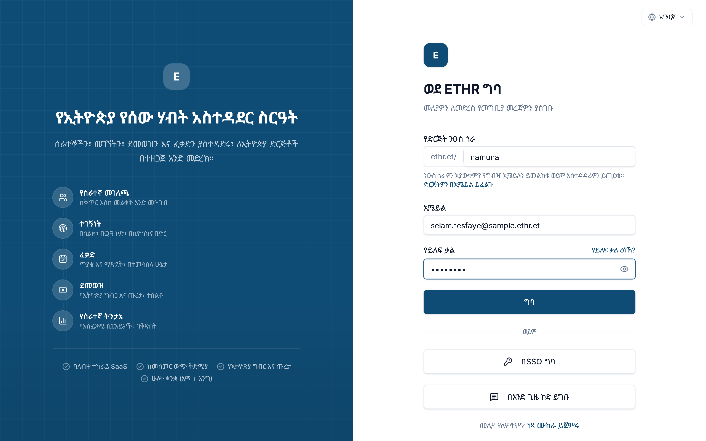

> [!tip]
> ድርጅትዎን ካላወቁ ከ**የድርጅት ንዑስ ጎራ** ሳጥኑ ሥር ያለውን **ድርጅትዎን በኢሜይል ይፈልጉ** ይጫኑ። ኢሜይልዎን ሲያስገቡ የድርጅትዎ አድራሻ ይላክልዎታል።

## ለመጀመሪያ ጊዜ መግባት

መለያዎ ከሁለት በአንዱ መንገድ ይከፈታል፦

- **በኢሜይል ግብዣ።** የሰው ሀብት ክፍል ሲጋብዝዎ ኢሜይል ይደርስዎታል። በኢሜይሉ ውስጥ ያለውን አገናኝ ይጫኑ እና የራስዎን የይለፍ ቃል ይምረጡ። ከዚያ በኋላ በክፍል 2.2 እንዳለው ይገባሉ።
- **በአካል በሚሰጥ ኮድ።** ኢሜይል ወይም ስልክ ከሌለዎት የሰው ሀብት ክፍል የአንድ ጊዜ **የማግበሪያ ኮድ** በእጅዎ ይሰጥዎታል። የመግቢያ ገጹን ይክፈቱ፣ ኮዱን ያስገቡ እና የራስዎን የይለፍ ቃል ይምረጡ። የይለፍ ቃሉን ራስዎ ይተይቡት፤ የሰው ሀብት ክፍል ማየት የለበትም።

## የይለፍ ቃልዎን ከረሱ

1. በመግቢያ ገጹ ላይ **የይለፍ ቃል ረሳኽ?** ይጫኑ።
2. የሥራ ኢሜይልዎን ያስገቡ እና ይላኩ።
3. በኢሜይል በሚደርስዎ አገናኝ አዲስ የይለፍ ቃል ይምረጡ።

ኢሜይል ካልደረሰዎ የአይፈለጌ መልእክት (Spam) ማህደርዎን ይመልከቱ፤ ከዚያም የሰው ሀብት ክፍልን ይጠይቁ።

## ባለሁለት ደረጃ ማረጋገጫ ኮድ

ባለሁለት ደረጃ ማረጋገጫ ካበሩ (ክፍል 8.4)፣ ከይለፍ ቃሉ በኋላ ETHR ባለ 6 አሃዝ ኮድ ይጠይቃል። ኮዱን በስልክዎ ካለው የማረጋገጫ መተግበሪያ ይውሰዱ።

> [!warning] የማረጋገጫ መተግበሪያ ያለበትን ስልክ ካጡ
> የድርጅትዎን አስተዳዳሪ ማረጋገጫውን እንዲያስጀምሩልዎ ይጠይቁ። ከዚያ በይለፍ ቃልዎ ብቻ ገብተው በ**መገለጫዬ → ደህንነት** እንደገና ያዘጋጁታል። ሲጀመርልዎ ኢሜይል ይደርስዎታል።

## መውጣት

በላይኛው ቀኝ ጥግ ያለውን ስምዎን ይጫኑ፣ በሚከፈተው ምናሌ መጨረሻ ላይ **ውጣ** ይጫኑ። በጋራ ኮምፒውተር ሲሠሩ ሁልጊዜ ይውጡ።

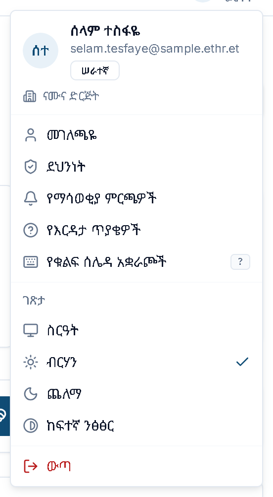{half}

# ዳሽቦርድ እና በገጾች መካከል መንቀሳቀስ

## ዳሽቦርዱ

ከገቡ በኋላ የሚከፈተው ገጽ **ዳሽቦርድ** ነው። ዛሬ ስለእርስዎ የሚያስፈልገውን በአንድ እይታ ያሳያል።

1. **የጎን ምናሌ።** ወደ ሁሉም ገጾች የሚወስዱት አገናኞች፦ **ዳሽቦርድ**፣ **የእኔ መገኘት**፣ **ፈቃድ**፣ **ደሞዝ ወረቀቶቼ** እና ሌሎችም።
2. **ግባ።** መገኘትዎን ከዚሁ ይመዘግባሉ (ምዕራፍ 4)።
3. **ፈቃድ ጠይቅ** (ምዕራፍ 6)።
4. **የእኔ ቀን** ካርዶች አራት ነገሮችን ይነግሩዎታል፦ ዛሬ መግባትዎን፣ የቀረዎትን የፈቃድ ቀናት፣ የመጨረሻውን የተጣራ ደመወዝዎን እና ቀጣዩን በዓል።
5. **ቀጣይ እርምጃዎች** መገለጫዎን ለማጠናቀቅ የሚቀሩትን ይዘረዝራል፤ እያንዳንዱን ይጫኑ እና ይሙሉ።

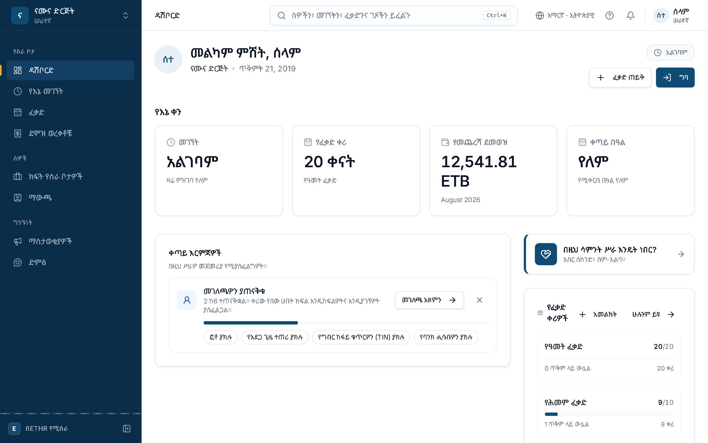

## የላይኛው አሞሌ

በእያንዳንዱ ገጽ አናት ላይ ያለው አሞሌ አምስት መሣሪያዎችን ይዟል፦

1. **ፍለጋ።** ሰዎችን፣ ገጾችን እና መዝገቦችን በስም ይፈልጋል። [[key:Ctrl]] + [[key:K]] ተጭነው መክፈትም ይችላሉ።
2. **ቋንቋ እና የቀን መቁጠሪያ** (ክፍል 3.4)።
3. **እርዳታ ያግኙ** (ምዕራፍ 9)።
4. **ማሳወቂያዎች።** ያልተነበቡ ማሳወቂያዎች ሲኖሩ ቁጥር ያሳያል (ምዕራፍ 9)።
5. **የመለያ ምናሌ።** መገለጫዎ፣ ደህንነት እና መውጫ።

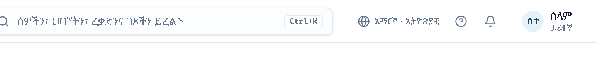

## በስልክ ላይ

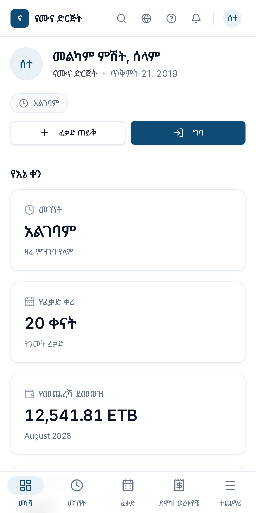{side}

በስልክ ሲከፍቱ የጎን ምናሌው ወደ ታችኛው የማያ ገጽ ጠርዝ ይዛወራል፦

1. **መነሻ** ዳሽቦርዱን ይከፍታል።
2. **መገኘት** የስልክ መግቢያ ገጹን ይከፍታል።
3. **ፈቃድ**
4. **ደሞዝ ወረቀቶቼ**
5. **ተጨማሪ** የቀሩትን ገጾች ሁሉ ይዘረዝራል።

ከላይ ያሉት ምልክቶች በኮምፒውተሩ ላይ እንዳሉት ናቸው፦ ፍለጋ፣ ቋንቋ፣ እርዳታ፣ ማሳወቂያዎች እና የመለያ ምናሌ።

## ቋንቋ እና የቀን መቁጠሪያ

ETHR በአማርኛ እና በእንግሊዝኛ ይሠራል። ቀኖችን በኢትዮጵያ ወይም በግሪጎሪያን ቀን መቁጠሪያ ያሳያል።

1. በላይኛው አሞሌ ላይ ያለውን የሉል ምልክት (**ቋንቋ እና የቀን መቁጠሪያ**) ይጫኑ፤ ቋንቋ ይምረጡ።
2. ከሥሩ የቀን መቁጠሪያ ይምረጡ። ከእያንዳንዱ አጠገብ የዛሬው ቀን በዚያ የቀን መቁጠሪያ ይታያል።

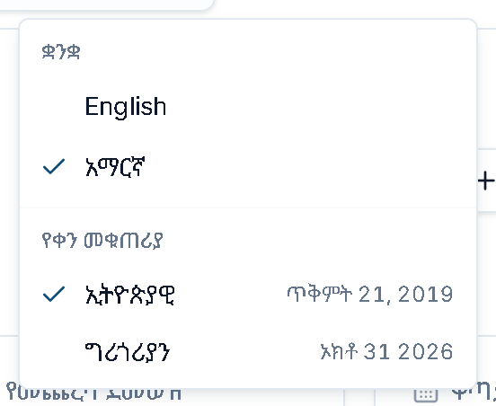{half}

ምርጫዎ ለመለያዎ ይቀመጣል። በሌላ ኮምፒውተር ወይም ስልክ ሲገቡም ይከተልዎታል፤ የሚላኩልዎ ኢሜይሎች እና የደመወዝ ወረቀቶችም በዚሁ ቋንቋ ይመጣሉ።

> [!note]
> አፋን ኦሮሞ፣ ትግርኛ፣ ሶማሊኛ እና ሲዳምኛ በቅርቡ ይጨመራሉ፤ እስከዚያ መምረጥ አይቻልም።

# መገኘትዎን መመዝገብ

ድርጅትዎ የትኞቹን የመመዝገቢያ መንገዶች እንደሚጠቀም ይወስናል፦ ከኮምፒውተር፣ ከስልክ፣ በQR ቅኝት ወይም በጣት አሻራ መሣሪያ። ሲደርሱ **ግባ**፣ ሲወጡ **ውጣ** ያስመዘግባሉ።

## ከኮምፒውተር

1. በዳሽቦርዱ ወይም በ**የእኔ መገኘት** ገጽ ላይ **ግባ** ይጫኑ።
2. ሲወጡ በዚሁ ቦታ የሚታየውን **ውጣ** ይጫኑ።

## ከስልክ

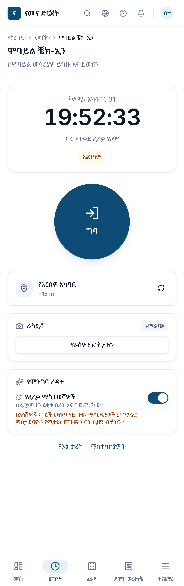{side}

1. በስልክዎ ETHRን ይክፈቱ እና ከታች **መገኘት** ይጫኑ፤ ትልቁን **ግባ** ቁልፍ ይጫኑ። ስልኩ አካባቢዎን ይወስዳል፤ በቅርንጫፍዎ ወይም በተመደቡበት የሥራ ቦታ ውስጥ መሆንዎ ይረጋገጣል።
2. ድርጅትዎ የራስ ፎቶ ከጠየቀ **የራስዎን ፎቶ ያንሱ** ይጫኑ። ስልኩ መጀመሪያ ዓይንዎን እንዲያርገበግቡ ወይም ራስዎን እንዲያዞሩ ሊጠይቅ ይችላል።
3. **የምዝገባ ረዳት** የፈረቃ ማስታወሻዎችን ያበራል (ክፍል 4.6)።
4. ታሪክዎን ለማየት **የእኔ ታሪክ** ይጫኑ።

ከላይ ያለው ሰዓት፣ የዛሬው ፈረቃዎ እና ሁኔታዎ (ለምሳሌ **አልገባም**) ከመጫንዎ በፊት ይታያሉ።

> [!note] ስለ ራስ ፎቶ
> የራስ ፎቶ ከመነሳቱ በፊት ፈቃድዎ ይጠየቃል (**መገለጫዬ → ምርጫዎች → የሰዓት መቆጣጠሪያ ፎቶ**)። የፊት ቼኩ በስልክዎ ላይ ብቻ ይሠራል፤ ወደ ድርጅቱ የሚላከው ፎቶው እና ቼኩ ማለፉ ብቻ ነው። ቼኩ ባያልፍም መግቢያዎ ይመዘገባል።

> [!tip] «አካባቢ ያስፈልጋል» ካለ
> በስልክዎ ቅንብሮች ውስጥ ለአሳሹ ወይም ለETHR መተግበሪያ የአካባቢ (GPS) ፈቃድ ይስጡ፣ ከዚያ ገጹን ያድሱ። ከቤት ውጭ ወይም ከመስኮት አጠገብ GPS በፍጥነት ይገኛል።

## የተመዘገበ ስልክ

ድርጅትዎ ከራስዎ ስልክ ብቻ እንዲመዘገቡ ሊጠይቅ ይችላል። ይህ አንድ ሰው በሌላው ስም እንዳይመዘገብ ይከላከላል።

1. ለመጀመሪያ ጊዜ፣ **በሥራ ቦታዎ ሆነው**፣ በስልክዎ የመገኘት ገጹን ይክፈቱ።
2. **አስመዝግብ** ይጫኑ። ስልኩ የጣት አሻራዎን፣ ፊትዎን ወይም ፒንዎን ይጠይቃል።
3. ከዚያ በኋላ በእያንዳንዱ ምዝገባ ስልኩ ይህንኑ ይጠይቃል። ከሌላ ስልክ ወይም አሳሽ የሚደረግ ምዝገባ ተቀባይነት የለውም።

**አዲስ ስልክ ወይም የጠፋ ስልክ፦** በአዲሱ ስልክ የመገኘት ገጹን ይክፈቱ። የተመዘገበ ስልክዎን እና **ይህን ስልክ አስመዝግብ** ቁልፍ ያሳያል። ይጫኑት፤ የሰው ሀብት ክፍል ያጸድቀዋል። እስኪያጸድቅ ድረስ የድሮው ስልክዎ ይሠራል። ሲጸድቅ፣ ውድቅ ሲደረግ ወይም ሲሰረዝ ምክንያቱን የያዘ ማሳወቂያ ይደርስዎታል። ከሥራ ቦታ ውጭ ሆነው ካስመዘገቡ ኃላፊ መጀመሪያ ያጸድቃል።

## QR ቅኝት እና የጣት አሻራ መሣሪያ

- **QR ቅኝት።** በ**የእኔ መገኘት** ገጽ ላይ **QR ቃኝ** ይጫኑ እና በቅርንጫፍዎ መግቢያ የተለጠፈውን QR ኮድ በካሜራው ይቃኙ። አካባቢዎ አብሮ ይላካል።
- **የጣት አሻራ ወይም የፊት መሣሪያ።** በሥራ ቦታዎ መግቢያ ባለው መሣሪያ ላይ ይመዝገቡ። መዝገቡ በራሱ ወደ ETHR ይገባል፤ ምንም ማድረግ አያስፈልግዎትም።

## የሥራ ቦታ ጉብኝቶች

በመስክ የሚሠሩ ከሆነ እያንዳንዱን ጉብኝት በስልክዎ ይመዝግቡ፦ በመገኘት ገጹ ላይ **ጉብኝት መዝግብ** ይጫኑ፣ ማስታወሻ እና ከተጠየቀ ፎቶ ያክሉ። ጉብኝቱ የት እንደነበሩ ያሳያል፤ የሥራ ሰዓትዎን አይቀይርም። ኔትወርክ ከሌለ ይቀመጥ እና በኋላ ይላካል።

## ማስታወሻዎች

በስልኩ የመገኘት ገጽ ላይ **የፈረቃ ማስታወሻዎች**ን ያብሩ። ETHR ፈረቃዎ ከመጀመሩ 10 ደቂቃ በፊት፣ እና ፈረቃው ሲያበቃ ያስታውስዎታል። **ETHR ዝግ ቢሆንም** የሚለውን ካበሩ መተግበሪያው ተዘግቶም ማሳወቂያ ይደርስዎታል። በአይፎን ላይ መጀመሪያ መተግበሪያውን ወደ መነሻ ማያ ገጽ ይጫኑ (ምዕራፍ 10)።

## የመገኘት ታሪክዎ

**የእኔ መገኘት** ገጽ እያንዳንዱን ቀን ያሳያል፦ የገቡበትን እና የወጡበትን ሰዓት፣ የተመዘገቡበትን መንገድ (**ምንጭ**) እና **ሁኔታ**ውን (ለምሳሌ **ያለ** ወይም **ዘግይቷል**)።

1. **ግባ** ከዚህም ገጽ ይሠራል።
2. **QR ቃኝ** የQR ቅኝቱን ይከፍታል።
3. **የሞባይል ግብዓት** የስልክ መግቢያ ገጹን ይከፍታል።
4. **ማስተካከያዎች** የማስተካከያ ጥያቄዎችዎን ይከፍታል (ምዕራፍ 5)።
5. **ማጣሪያዎች** በቀን ወይም በሁኔታ ይለያሉ።
6. እያንዳንዱ ረድፍ አንድ ቀን ነው።

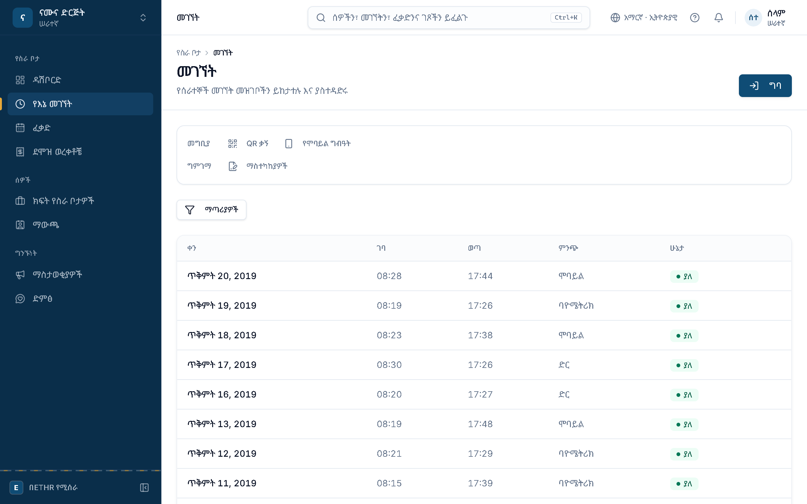

# የመገኘት ማስተካከያ መጠየቅ

መውጣትዎን ከረሱ፣ መሣሪያው ካልሠራ ወይም ሰዓቱ በስሕተት ከተመዘገበ ማስተካከያ ይጠይቁ።

1. በ**የእኔ መገኘት → ማስተካከያዎች** ላይ **ማስተካከያ ይጠይቁ** ይጫኑ። የሚስተካከለውን **ቀን** በኢትዮጵያ ቀን መቁጠሪያ ያስገቡ፦ ዓመት፣ ወር፣ ቀን። ከሥሩ ተመሳሳዩ ቀን በግሪጎሪያን ይታያል።
2. **ትክክለኛ መግቢያ** እና **ትክክለኛ መውጫ** ሰዓቶችን ያስገቡ።
3. **ምክንያት** ይጻፉ። ይህ ግዴታ ነው። አጽዳቂው ማወቅ ያለበትን ሁሉ እዚህ ይጻፉ፤ ሰነድ ማያያዝ አይቻልም።
4. **ጥያቄ አስገባ** ይጫኑ።

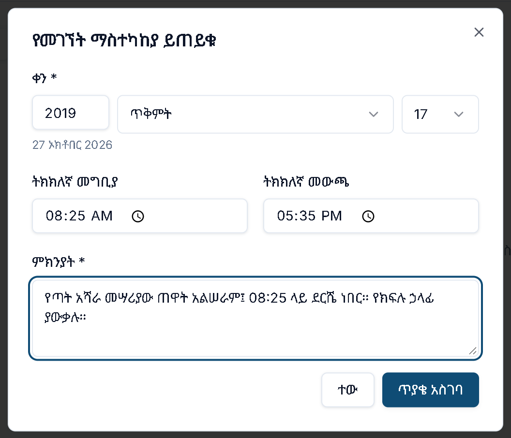{half}

ጥያቄዎ ብዙውን ጊዜ ወደ ኃላፊዎ ወይም ወደ የሰው ሀብት ክፍል ይሄዳል። ሲጸድቅ ወይም ውድቅ ሲደረግ ማሳወቂያ ይደርስዎታል። ሲጸድቅ አዲሶቹ ሰዓቶች በመዝገብዎ ላይ ይገባሉ፤ የመጀመሪያዎቹ ሰዓቶች ለታሪክ ይቀመጣሉ።

# ፈቃድ

## የፈቃድ ቀሪዎን ማየት

በጎን ምናሌው **ፈቃድ** ይጫኑ። ለእያንዳንዱ የፈቃድ ዓይነት አንድ ካርድ ይታያል፦

| በካርዱ ላይ | ትርጉሙ |
|---|---|
| ትልቁ ቁጥር | አሁንም መጠየቅ የሚችሏቸው ቀናት። የቀረቡ ግን ገና ያልጸደቁ ቀናት አስቀድመው ተቀንሰዋል |
| ከሥሩ ያለው መስመር | ከዓመቱ ጠቅላላ ቀናትዎ ውስጥ እስካሁን የተጠቀሙት |

1. **ፈቃድ ጠይቅ** አዲስ ጥያቄ ይከፍታል።
2. የፈቃድ ቀሪ ካርድ።
3. **የእኔ የፈቃድ ጥያቄዎች** ሰንጠረዥ ሁሉንም ጥያቄዎችዎን እና ሁኔታቸውን ያሳያል።
4. **በመጠባበቅ ላይ** ያለ ጥያቄን በ✕ ምልክቱ መሰረዝ ይችላሉ።

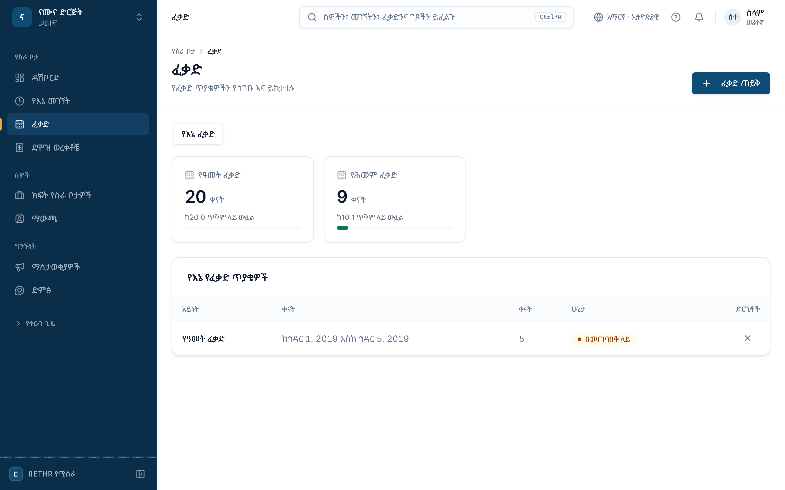

## ፈቃድ መጠየቅ

1. **ፈቃድ ጠይቅ** ይጫኑ እና **የፈቃድ አይነት** ይምረጡ።
2. **የመጀመሪያ ቀን** ያስገቡ፦ ዓመት፣ ወር፣ ቀን።
3. **የመጨረሻ ቀን** ያስገቡ። ፈቃድ በሙሉ ቀን ብቻ ነው።
4. ምክንያት ይጻፉ። ይህ አማራጭ ነው።
5. **ላክ** ይጫኑ።

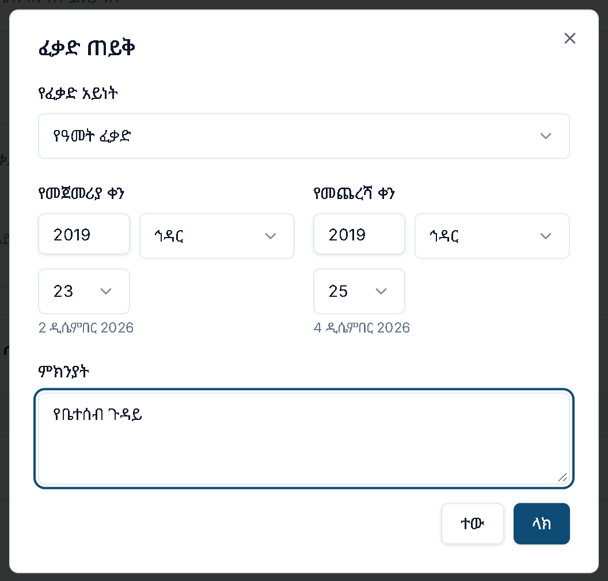{half}

> [!tip]
> የድርጅትዎ የሥራ ቀናት ያልሆኑ ቀናት እና ይፋዊ በዓላት ከፈቃድ ቀሪዎ አይቀነሱም። ከመጠየቅዎ በፊት ቀሪዎን በካርዱ ላይ ይመልከቱ፤ ቅጹ ቀሪውን አያሳይም።

> [!note]
> ሰነድ (ለምሳሌ የሐኪም ማስረጃ) ከፈቃድ ጥያቄ ጋር ማያያዝ አይቻልም። ካስፈለገ በቀጥታ ለሰው ሀብት ክፍል ይስጡ።

ድርጅትዎ ባዘጋጀው የማጽደቅ ቅደም ተከተል መሠረት አንድ ሰው ወይም በተራ ብዙ ሰዎች ጥያቄዎን ይወስናሉ። ውሳኔው እንደተሰጠ ማሳወቂያ ይደርስዎታል።

# የደመወዝ ወረቀት

በጎን ምናሌው **ደሞዝ ወረቀቶቼ** ይጫኑ። እያንዳንዱ ካርድ አንድ ወር ነው።

1. **ተጣራ ክፍያ** ወደ ባንክ ሒሳብዎ የሚገባው ገንዘብ ነው። ከላይ **መሰረታዊ ደመወዝ** እና **ጠቅላላ** ገቢ፣ ከዚያ **የገቢ ግብር** እና **የሰራተኛ ጡረታ** ተቀናሾች ይታያሉ።
2. በካርዱ ጥግ ያለው የማውረጃ ምልክት የደመወዝ ወረቀቱን እንደ ፒዲኤፍ ያወርዳል።

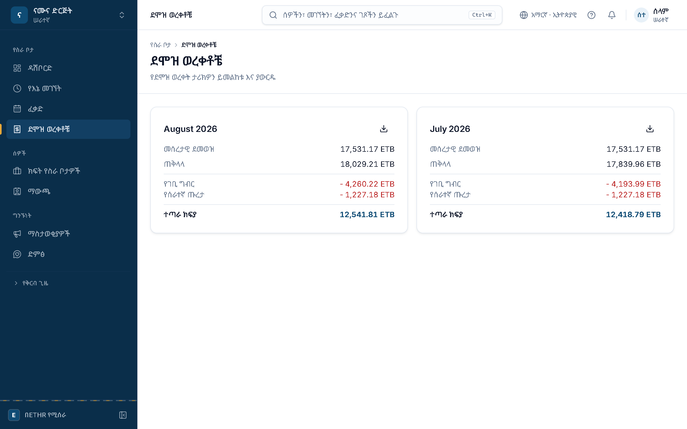

የደመወዝ ወረቀት የሚታየው የወሩ የደመወዝ ሂደት ከጸደቀ በኋላ ነው። ፒዲኤፉ የአሠሪውን የጡረታ መዋጮም ያሳያል።

> [!note]
> የሠራተኛ ጡረታ ከመሠረታዊ ደመወዝ 7 በመቶ ነው፤ አሠሪው 11 በመቶ ይጨምራል። የገቢ ግብሩ በኢትዮጵያ የግብር ደረጃዎች ይሰላል። ስለ ስሌቱ ጥያቄ ካለዎት የሰው ሀብት ወይም የፋይናንስ ክፍልን ይጠይቁ።

# መገለጫዎ

በላይኛው ቀኝ ጥግ ስምዎን ይጫኑ፣ ከዚያ **መገለጫዬ**። መገለጫው ስድስት ትሮች አሉት፦

1. **አጠቃላይ እይታ፦** የመለያ፣ የድርጅት እና የቅጥር መረጃዎ።
2. **የግል ዝርዝሮች፦** ራስዎ የሚያዘምኗቸው መረጃዎች።
3. **የለውጥ ጥያቄዎች፦** የሰው ሀብት ክፍል የሚያጸድቃቸው ለውጦች።
4. **ሰነዶች፦** ድርጅቱ ያስቀመጠልዎ ሰነዶች።
5. **ደህንነት፦** የይለፍ ቃል እና ባለሁለት ደረጃ ማረጋገጫ።
6. **ምርጫዎች፦** ቋንቋ፣ ገጽታ፣ የቀን መቁጠሪያ እና የፎቶ ፈቃድ።

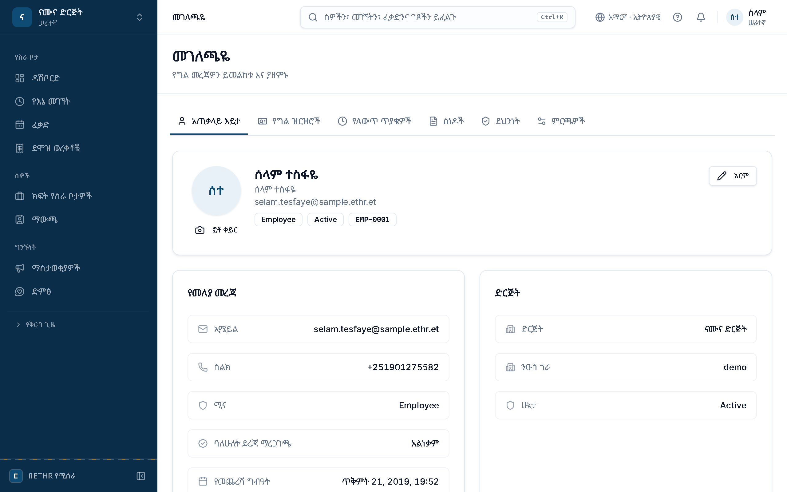

## ራስዎ የሚያዘምኑት

በ**የግል ዝርዝሮች** ትር ውስጥ የሚከተሉትን ወዲያውኑ ማዘመን ይችላሉ፦ ስልክ ቁጥር፣ የጋብቻ ሁኔታ፣ ዜግነት፣ የአደጋ ጊዜ ተጠሪዎች እና የመገለጫ ፎቶ።

1. **ስልክ ቁጥር**ን እና ሌሎቹን መስኮች ያርሙ።
2. **ለውጦችን አስቀምጥ** ይጫኑ።
3. የአደጋ ጊዜ ተጠሪ ለማከል **አድራሻ ጨምር** ይጫኑ።

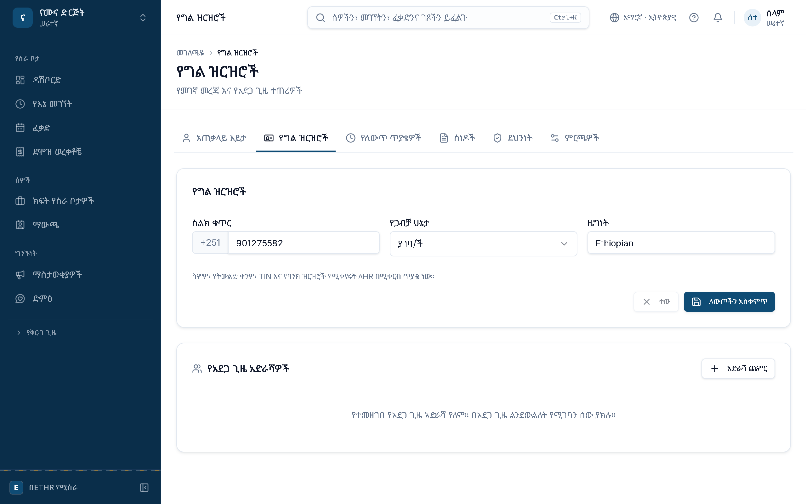

## በሰው ሀብት ክፍል የሚጸድቁ ለውጦች

ስም፣ የትውልድ ቀን፣ የግብር ከፋይ መለያ ቁጥር (TIN) እና የባንክ መረጃ የደመወዝ እና የሕግ መዝገቦችን ይነካሉ። ስለዚህ የሰው ሀብት ክፍል ከመገምገሙ በፊት አይለወጡም።

1. በ**የለውጥ ጥያቄዎች** ትር ውስጥ መቀየር የሚፈልጉትን መስክ ብቻ ይሙሉ (ለምሳሌ **ሕጋዊ ስም**)። በእያንዳንዱ መስክ ሥር **በመዝገብ ላይ** ያለው ዋጋ ይታያል።
2. የባንክ ሒሳብ ለማስገባት **የባንክ ስም** እና **የባንክ ሒሳብ ቁጥር** ይሙሉ።
3. **ለግምገማ ላክ** ይጫኑ።

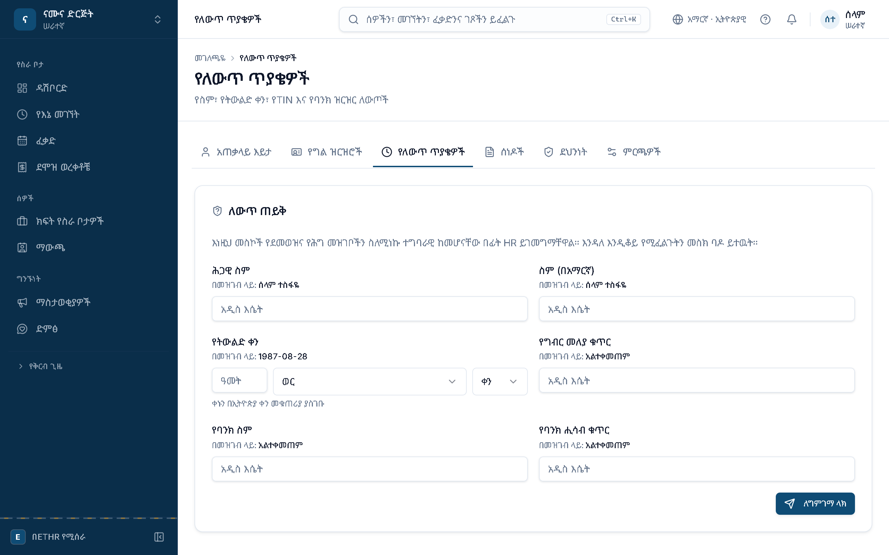

ጥያቄው እስኪወሰን ድረስ መገለጫዎ «በመጠባበቅ ላይ» ይላል። ሲወሰን ማሳወቂያ ይደርስዎታል።

## ምርጫዎች

1. **የመተግበሪያ ቋንቋ፦** አማርኛ ወይም English።
2. **የቀን አቀራረብ፦** ኢትዮጵያዊ ወይም ግሪጎሪያን። እስኪመርጡ ድረስ የድርጅትዎ ነባሪ ይሠራል።
3. **የሰዓት መቆጣጠሪያ ፎቶ፦** በስልክ ሲገቡ የራስ ፎቶ እንዲነሳ ከተስማሙ **እስማማለሁ** ይጫኑ። ከመስማማትዎ በፊት **ማስታወቂያውን ያንብቡ**።

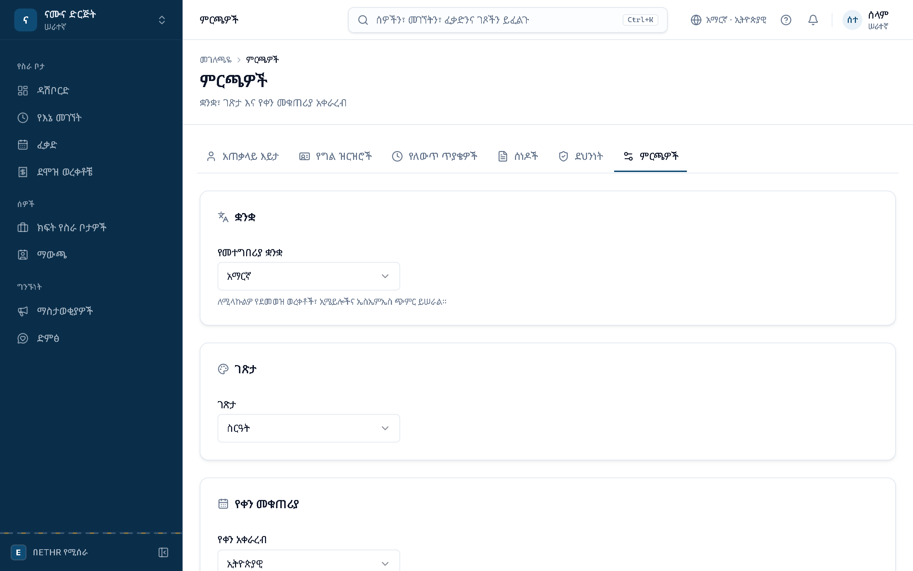

## ደህንነት

1. **MFA አንቃ** ባለሁለት ደረጃ ማረጋገጫን ያበራል። በስልክዎ የማረጋገጫ መተግበሪያ (ለምሳሌ Google Authenticator ወይም Microsoft Authenticator) የሚታየውን QR ኮድ ይቃኙ፣ የሚሰጠውን ኮድ ያስገቡ።
2. **የይለፍ ቃል ቀይር** የይለፍ ቃልዎን ይቀይራል። ለETHR ብቻ የሚጠቀሙበት ጠንካራ የይለፍ ቃል ይምረጡ።
3. **ንቁ ክፍለ ጊዜዎች** የገቡባቸውን መሣሪያዎች ይዘረዝራል። የማያውቁትን መሣሪያ ከዚህ ያስወጡ።

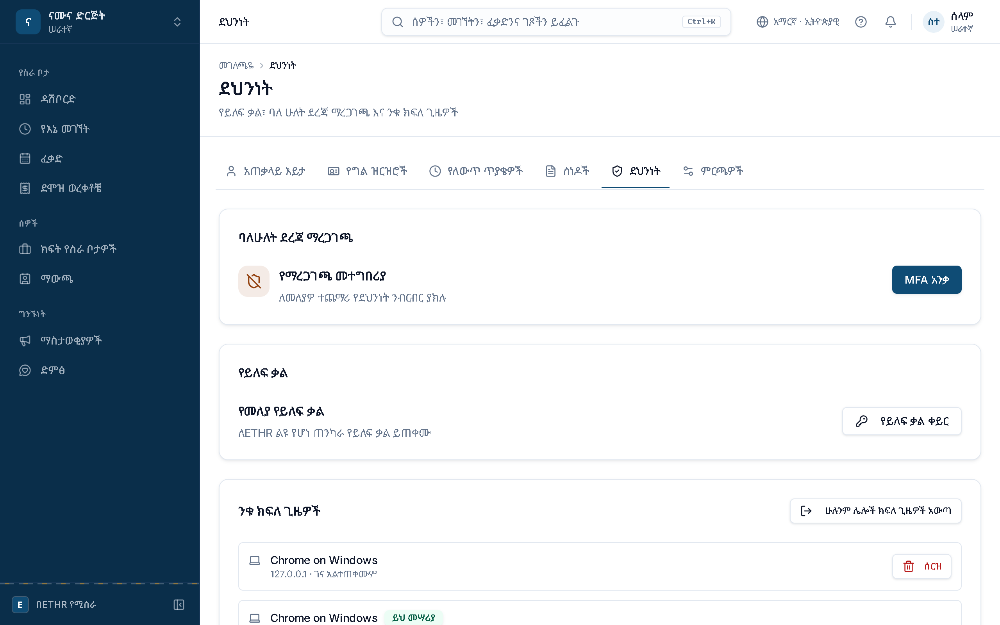

# ማሳወቂያዎች እና እርዳታ

## ማሳወቂያዎች

ፈቃድዎ ሲጸድቅ፣ የደመወዝ ወረቀትዎ ሲዘጋጅ ወይም ማስታወቂያ ሲወጣ ETHR ያሳውቅዎታል። በላይኛው አሞሌ ላይ ያለው የደወል ምልክት ያልተነበቡትን ቁጥር ያሳያል። ይጫኑት፤ የቅርብ ጊዜ ማሳወቂያዎች ይከፈታሉ። **ሁሉንም ማሳወቂያዎች ይዩ** ሙሉውን ዝርዝር ይከፍታል፤ **ሁሉንም ምልክት አድርግ** ሁሉንም እንደተነበቡ ያደርጋል።

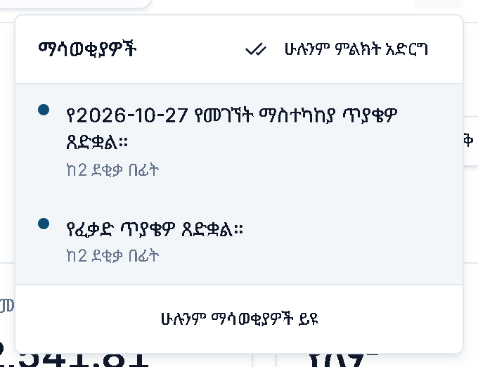{half}

የትኞቹን ማሳወቂያዎች እና በምን መንገድ (በመተግበሪያ ውስጥ፣ በኢሜይል፣ በSMS) እንደሚቀበሉ በ**ማሳወቂያዎች → ምርጫዎች** ይምረጡ፣ ከዚያ **ለውጦችን አስቀምጥ** ይጫኑ።

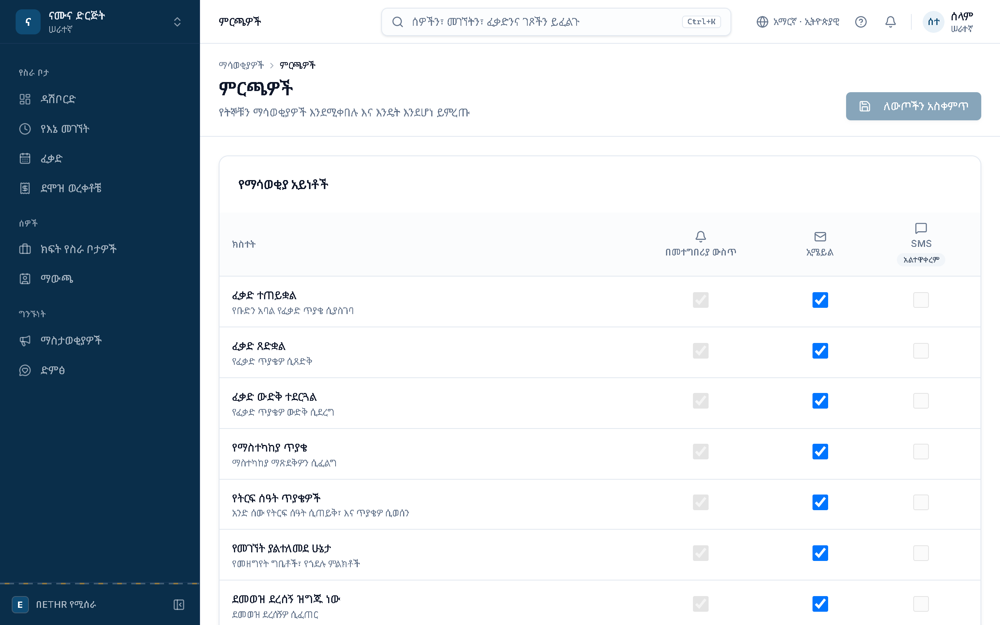

> [!note]
> በመተግበሪያ ውስጥ የሚመጡ ማሳወቂያዎችን ማጥፋት አይቻልም። SMS ድርጅትዎ ካዋቀረው ብቻ ይሠራል።

## እርዳታ ማግኘት

አንድ ነገር ካልሠራ ወይም ጥያቄ ካለዎት በላይኛው አሞሌ ያለውን የጥያቄ ምልክት (**እርዳታ ያግኙ**) ይጫኑ።

1. **ርዕስ** ይምረጡ።
2. **ምን ተፈጠረ** በሚለው ውስጥ ምን ለማድረግ እንደሞከሩ እና ምን እንደሆነ ይግለጹ።
3. **ቴክኒካዊ ዝርዝሮችን ያካትቱ** ሲበራ ያሉበት ገጽ እና የቅርብ ጊዜ ስሕተቶች አብረው ይላካሉ። የሚላከውን ለማየት **የሚካተተውን ይመልከቱ** ይጫኑ።
4. **ላክ** ይጫኑ።

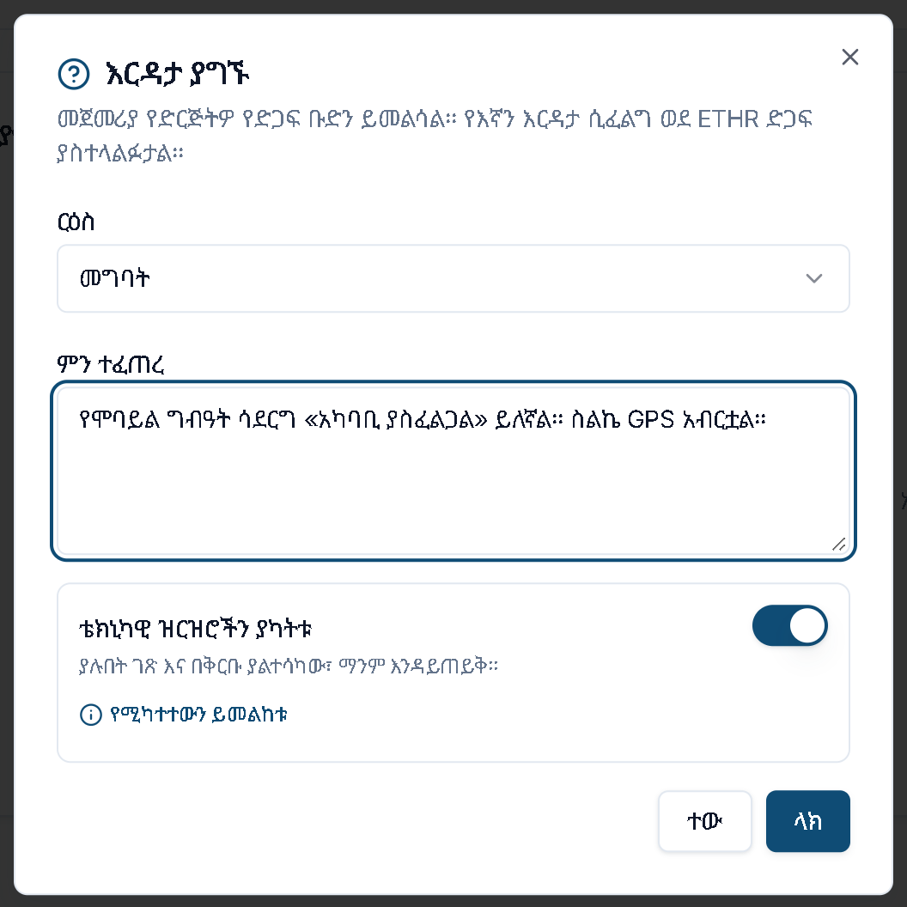{half}

ጥያቄዎ መጀመሪያ ወደ ድርጅትዎ የድጋፍ ቡድን (ብዙውን ጊዜ የሰው ሀብት ክፍል) ይሄዳል። እነሱ ካልፈቱት ወደ ETHR ድጋፍ ያስተላልፉታል። መልሱ በ**የመለያ ምናሌ → የእርዳታ ጥያቄዎች** ገጽ እና በኢሜይልዎ ይደርስዎታል።

| ጥያቄዎ ስለ | የሚጠየቀው |
|---|---|
| ፈቃድ፣ ደመወዝ፣ የግል መረጃ | የሰው ሀብት ክፍል |
| የመገኘት ማስተካከያ ማጽደቅ | ኃላፊዎ |
| መግባት ያለመቻል፣ የተበላሸ ገጽ | **እርዳታ ያግኙ** |

# ETHRን በስልክ መጫን

ETHR ከመተግበሪያ መደብር ሳይወርድ በስልክዎ ላይ እንደ መተግበሪያ ይጫናል።

:::cols
:::card አንድሮይድ (Chrome)
1. የድርጅትዎን አድራሻ በChrome ይክፈቱ እና ይግቡ።
2. ከላይ በቀኝ ያለውን የሦስት ነጥብ ምናሌ ይጫኑ።
3. **Add to Home screen** (ወደ መነሻ ማያ ገጽ አክል) ወይም **Install app** ይጫኑ።
:::
:::card አይፎን (Safari)
1. የድርጅትዎን አድራሻ በSafari ይክፈቱ እና ይግቡ።
2. የ**Share** (አጋራ) ምልክቱን ይጫኑ።
3. **Add to Home Screen** ይጫኑ። iOS 16.4 ወይም ከዚያ በኋላ ያስፈልጋል።
:::
:::

ETHR ራሱ **ETHRን ይጫኑ** የሚል መልእክት ሊያሳይዎ ይችላል፤ **ጫን** ይጫኑ።

## ኢንተርኔት ሳይኖር መመዝገብ

ኔትወርክ ቢጠፋም የተጫነው መተግበሪያ መገኘትዎን ይመዘግባል።

1. የተጫነውን ETHR ይክፈቱ።
2. እንደተለመደው **ግባ** ወይም **ውጣ** ይጫኑ። መዝገቡ በስልክዎ ላይ ይቀመጣል።
3. ኢንተርኔት ሲመለስ መዝገቡ በራሱ ይላካል። በመገኘት ገጹ ላይ **ተመሳስሏል** ሲል ደርሷል ማለት ነው። ቶሎ እንዲላክ **አሁን አመሳስል** መጫን ይችላሉ።

> [!note]
> ከመስመር ውጭ የሚደረግ መዝገብ በስልኩ ይፈረማል፤ በኋላ ሊስተካከል ወይም ከሌላ ስልክ ሊላክ አይችልም።

# የደህንነት ምክሮች እና የቃላት መፍቻ

## የደህንነት ምክሮች

- የይለፍ ቃልዎን ለማንም አይስጡ። የሰው ሀብት ክፍል ወይም ETHR የይለፍ ቃልዎን በጭራሽ አይጠይቁም።
- በጋራ ኮምፒውተር ሲጨርሱ ሁልጊዜ **ውጣ** ይጫኑ።
- ባለሁለት ደረጃ ማረጋገጫን ያብሩ (ክፍል 8.4)።
- የተመዘገበ ስልክዎን ለሌላ ሰው አያውሱ።
- መለያዎ ተጠልፏል ብለው ከጠረጠሩ ወዲያውኑ የይለፍ ቃልዎን ይቀይሩ እና የሰው ሀብት ክፍልን ያሳውቁ።

## የቃላት መፍቻ

| በማያ ገጹ ላይ | ትርጉሙ |
|---|---|
| **ግባ / ውጣ** | ሥራ መጀመርዎን / መጨረስዎን መመዝገብ |
| **ፈረቃ** | የሥራ ሰዓትዎ መርሐ ግብር፣ ለምሳሌ 08:30 እስከ 17:30 |
| **የእፎይታ ጊዜ** | ዘግይቷል ከመባሉ በፊት የሚፈቀደው ደቂቃ |
| **ማስተካከያ** | የተሳሳተ የመገኘት መዝገብን የማረሚያ ጥያቄ |
| **ማጽደቅ** | ኃላፊ ወይም የሰው ሀብት ጥያቄዎን መቀበሉ |
| **በመጠባበቅ ላይ** | ጥያቄው ገና አልተወሰነም |
| **ተጣራ ክፍያ** | ከተቀናሾች በኋላ የሚከፈልዎ ገንዘብ |
| **ባለሁለት ደረጃ ማረጋገጫ (MFA)** | ከይለፍ ቃሉ በተጨማሪ ከስልክ የሚመጣ ኮድ |
| **ማመሳሰል** | በስልኩ የተቀመጠ መዝገብ ወደ ETHR መላክ |
