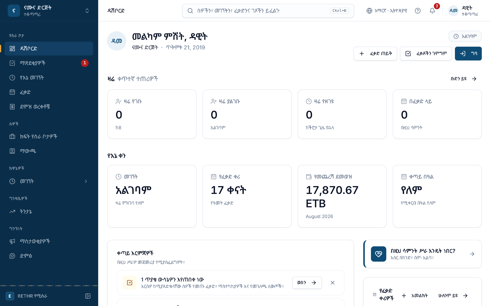
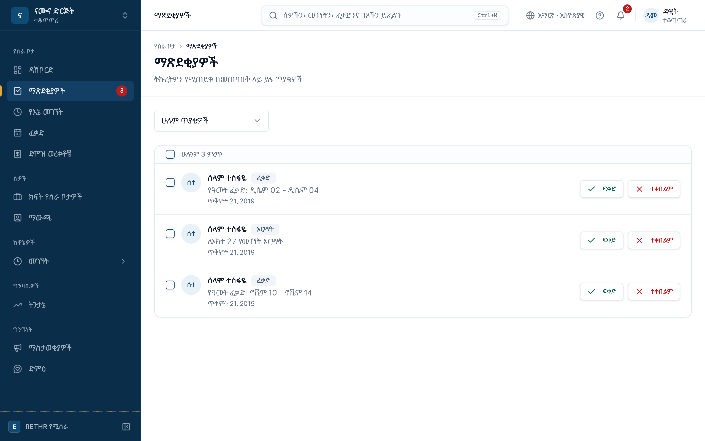
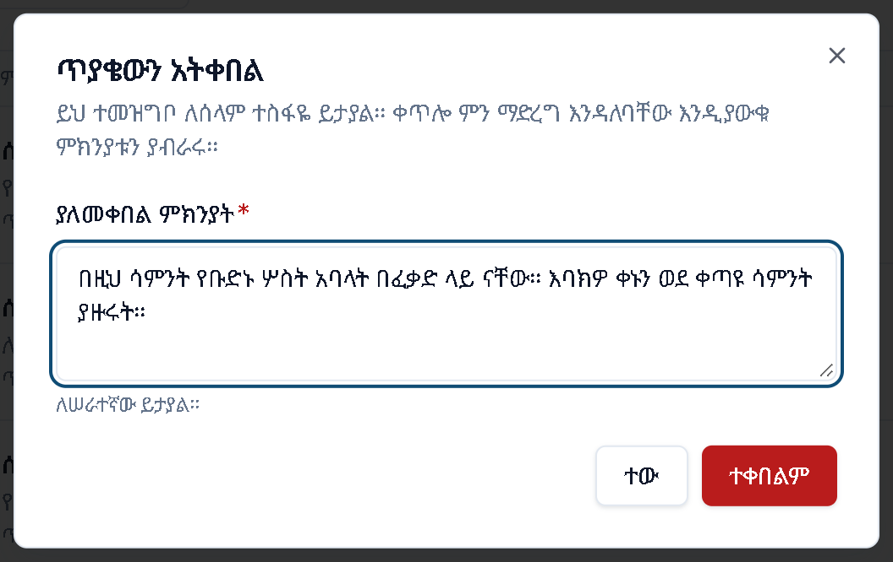
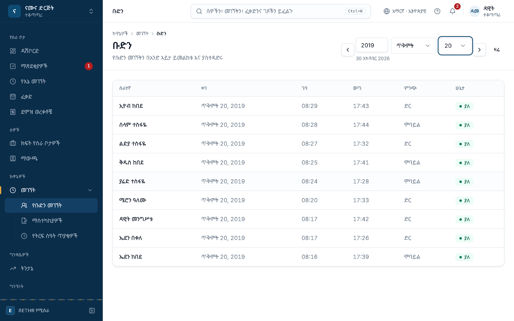
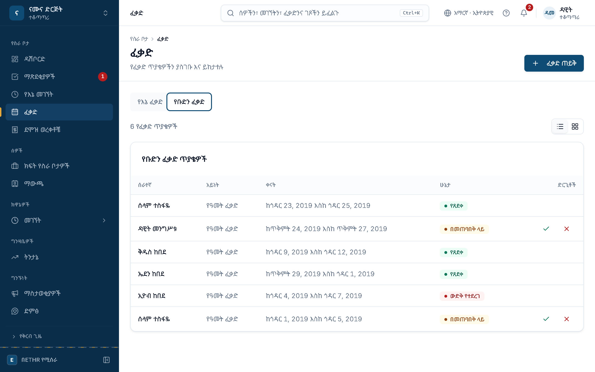
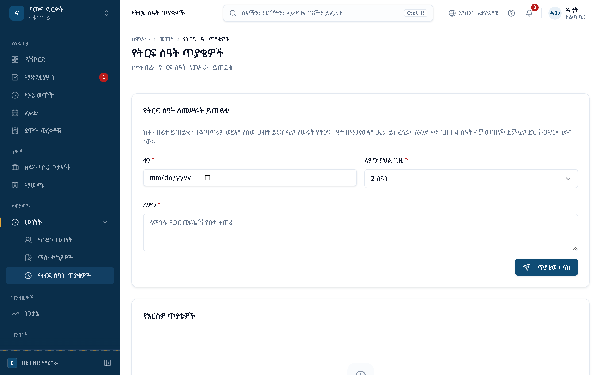
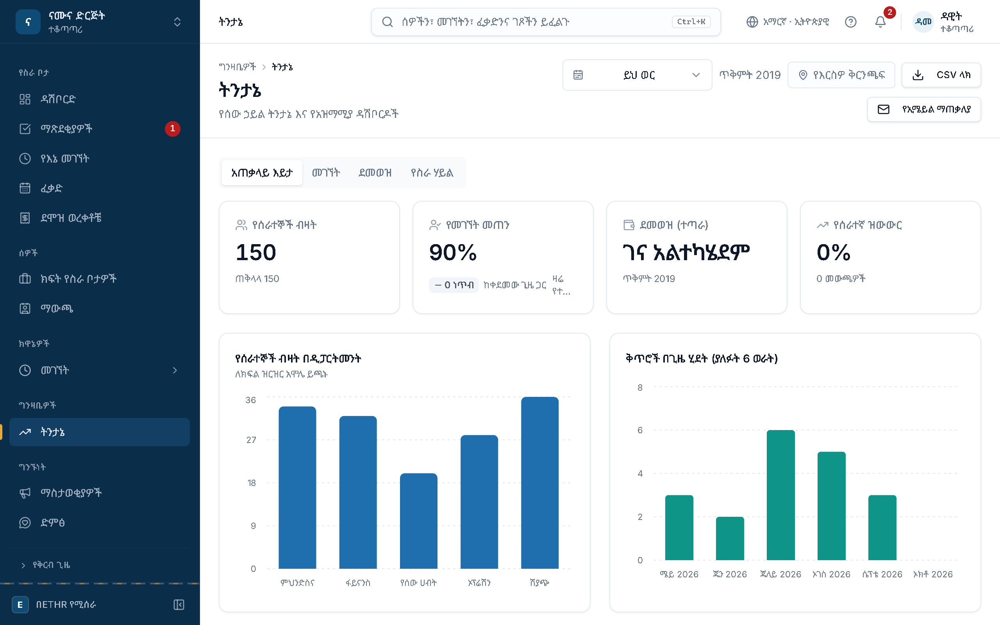

# ይህ መመሪያ ለማን ነው

ይህ መመሪያ ቡድን ለሚመሩ ሰዎች ነው፦ ለ**ተቆጣጣሪዎች**፣ ለክፍል እና ለቅርንጫፍ ኃላፊዎች፣ እና እንደ ኃላፊ ለሚያጸድቁ የሰው ሀብት ባለሙያዎች። የኃላፊ መሣሪያዎቹ መለያዎ የኃላፊነት ሚና ሲኖረው በራሳቸው ይታያሉ፤ ምንም መቀየር አያስፈልግዎትም።

እርስዎም ሠራተኛ ነዎት፦ የራስዎን መገኘት፣ ፈቃድ እና የደመወዝ ወረቀት በ**የሠራተኛ መመሪያ** እንደተገለጸው ይጠቀማሉ። ይህ መመሪያ በኃላፊነትዎ የሚጨመሩትን ብቻ ያሳያል።

## የኃላፊ መሣሪያዎች የት ናቸው

| መሣሪያ | በጎን ምናሌው ውስጥ | ማን ያየዋል |
|---|---|---|
| ማጽደቂያዎች | **የስራ ቦታ → ማጽደቂያዎች** | ጥያቄ የሚያጸድቁ ሁሉ |
| የቡድን መገኘት | **ክዋኔዎች → መገኘት → የቡድን መገኘት** | ተቆጣጣሪዎች እና ከዚያ በላይ |
| ማስተካከያዎች | **ክዋኔዎች → መገኘት → ማስተካከያዎች** | ተቆጣጣሪዎች እና ከዚያ በላይ |
| የትርፍ ሰዓት ጥያቄዎች | **ክዋኔዎች → መገኘት → የትርፍ ሰዓት ጥያቄዎች** | ሁሉም |
| የቡድን ፈቃድ | **ፈቃድ → የቡድን ፈቃድ** ትር | ተቆጣጣሪዎች እና ከዚያ በላይ |
| ትንታኔ | **ግንዛቤዎች → ትንታኔ** | ተቆጣጣሪዎች እና ከዚያ በላይ |

ከዚህ ውስጥ የሆነ ገጽ በምናሌዎ ውስጥ ከሌለ መለያዎ ገና የሚያስፈልገው ሚና የለውም። የድርጅትዎን አስተዳዳሪ ሚናዎን እንዲያዩልዎ ይጠይቁ።

> [!note] ማን ማንን ያጸድቃል
> ተቆጣጣሪ ቀጥታ ሪፖርት የሚያደርጉለትን፣ የክፍል አስተዳዳሪ የክፍሉን ሰዎች፣ የሰው ሀብት፣ የፋይናንስ እና የድርጅት አስተዳዳሪ ደግሞ ሁሉንም ያጸድቃሉ። የራስዎን ጥያቄ ማጽደቅ አይችሉም። እነዚህ ሕጎች በአገልጋዩ ላይ ይፈጸማሉ፤ ቁልፉን በመደበቅ ብቻ የተጠበቁ አይደሉም።

# የኃላፊ ዳሽቦርድ

ኃላፊ ሲገቡ ዳሽቦርዱ ከራስዎ መረጃ በተጨማሪ ስለ ቡድንዎ ያሳያል።

1. **ማጽደቂያዎች** በጎን ምናሌው ውስጥ፣ የሚጠብቁዎትን ጥያቄዎች ቁጥር በቀይ ያሳያል።
2. **ዛሬ** ቀጥተኛ ተጠሪዎችዎ፦ **ዛሬ የገቡ**፣ **ዛሬ ያልገቡ**፣ **ዛሬ የዘገዩ** እና **በፈቃድ ላይ**። **ቡድን ይዩ** ሙሉውን ዝርዝር ይከፍታል።
3. **ፈቃዶችን ገምግም** በቀጥታ ወደ ማጽደቂያዎቹ ይወስዳል።
4. **ቀጣይ እርምጃዎች** ውሳኔዎን የሚጠብቁ ጥያቄዎችን ይቆጥራል፤ **ወስን** ይጫኑ።

ከታች ያለው **ቡድንዎ በዚህ ሳምንት** ገበታ ለእያንዳንዱ የሥራ ቀን የገቡትን፣ የዘገዩትን እና ያልገቡትን ያሳያል። ቁጥሮቹ ገጹ ክፍት እስካለ ድረስ በየደቂቃው፣ እና እርስዎ ጥያቄ እንደወሰኑ ወዲያውኑ ይታደሳሉ።

# ጥያቄዎችን ማጽደቅ

**ማጽደቂያዎች** ውሳኔዎን የሚፈልጉትን ሁሉ በአንድ ዝርዝር ይሰበስባል፦

- **ፈቃድ** ጥያቄዎች
- **የመገኘት ማስተካከያ** ጥያቄዎች
- **የትርፍ ሰዓት** ጥያቄዎች
- **የመገለጫ ለውጥ** ጥያቄዎች (ስም፣ TIN፣ የባንክ መረጃ)። እነዚህ የሚታዩት የሠራተኛ መዝገብ ማዘመን ለሚችሉ ብቻ ነው።

እያንዳንዱ ረድፍ የሠራተኛውን ስም፣ የጥያቄውን አይነት፣ አጭር ማጠቃለያ እና የቀረበበትን ቀን ያሳያል።

## አንድ ጥያቄ መወሰን

1. **ሁሉም ጥያቄዎች** ማጣሪያው አንድ አይነት ጥያቄ ብቻ እንዲታይ ያደርጋል።
2. **ሁሉንም ምረጥ** በገጹ ያሉትን ሁሉ ይመርጣል (ክፍል 3.3)።
3. አንድን ጥያቄ ለመምረጥ የረድፉን ሳጥን ይጫኑ።
4. ለመቀበል **ፍቀድ** ይጫኑ።
5. ላለመቀበል **ተቀበልም** ይጫኑ (ክፍል 3.2)።

ማያ ገጹ ውሳኔዎን የሚያሳየው አገልጋዩ መመዝገቡን ካረጋገጠ በኋላ ነው። ይህ ሆን ተብሎ ነው፦ ፈቃድ ማጽደቅ የሠራተኛውን የፈቃድ ቀሪ ይቀይራል፤ ማስተካከያ ማጽደቅ ይፋዊ የመገኘት መዝገብን ይቀይራል።

> [!tip] ከማጽደቅዎ በፊት
> ብዙ ሰዎች በአንድ ጊዜ እንዳይወጡ የፈቃድ ጥያቄን ከማጽደቅዎ በፊት **የቡድን ፈቃድ** ትሩን ይመልከቱ (ምዕራፍ 5)።

## ላለመቀበል ምክንያት መስጠት

**ተቀበልም** ሲጫኑ ምክንያት ይጠየቃሉ። ምክንያቱ ይመዘገባል እና ለሠራተኛው ይታያል፤ ቀጥሎ ምን ማድረግ እንዳለባቸው እንዲያውቁ በግልጽ ይጻፉ።

1. **ያለመቀበል ምክንያት** ውስጥ ምክንያቱን ይጻፉ፣ ከዚያ **ተቀበልም** ይጫኑ።

{half}

## ብዙ ጥያቄዎችን በአንድ ጊዜ

ብዙ ረድፎችን ሲመርጡ ከላይ **የተመረጡ ጥያቄዎች** አሞሌ ይታያል። **3 አጽድቅ** ወይም **3 ውድቅ አድርግ** (ቁጥሩ የመረጡት ብዛት ነው) ሁሉንም በአንድ ጊዜ ይወስናል። ውድቅ ሲያደርጉ አንድ ምክንያት ለሁሉም ይላካል። **ምርጫውን አጽዳ** ምርጫውን ይሰርዛል።

## በደረጃ የሚጸድቁ ጥያቄዎች

ድርጅትዎ **የማጽደቂያ ሰንሰለት** ካዘጋጀ፣ አንድ ጥያቄ በተራ ከአንድ በላይ ሰው ያልፋል (ለምሳሌ መጀመሪያ ተቆጣጣሪ፣ ከዚያ የሰው ሀብት)። በረድፉ ላይ **ደረጃ 1 ከ 2** የሚል ይታያል። እርስዎ ሲያጸድቁ ጥያቄው ወደሚቀጥለው ደረጃ ይሄዳል፤ ያለመቀበል ግን ጥያቄውን እዚያው ይዘጋዋል። ሰንሰለት ከሌለ የእርስዎ ውሳኔ የመጨረሻ ነው።

ሁሉንም ሲወስኑ **በመጠባበቅ ላይ ያለ ማጽደቅ የለም** የሚል መልእክት ይታያል።

# የቡድን መገኘት

**ክዋኔዎች → መገኘት → የቡድን መገኘት** የቡድንዎን የአንድ ቀን መገኘት ያሳያል።

1. ቀኑን በኢትዮጵያ ቀን መቁጠሪያ ይምረጡ፦ ዓመት፣ ወር፣ ቀን። ከሥሩ የግሪጎሪያን ቀኑ ይታያል።
2. **ቀዳሚ ቀን** እና **ቀጣይ ቀን** ቀስቶች ቀን በቀን ያንቀሳቅሳሉ።
3. እያንዳንዱ ረድፍ አንድ ሰው ነው፦ የገባበት እና የወጣበት ሰዓት፣ **ምንጭ** (ድር፣ ሞባይል፣ ኪዮስክ፣ ባዮሜትሪክ ወይም በእጅ) እና **ሁኔታ** (ያለ፣ ዘግይቷል፣ ቀርቷል፣ በፈቃድ ላይ)።

ሰዓቶቹ በኢትዮጵያ ሰዓት (EAT፣ UTC+3) ናቸው። ሁኔታው በቀለም እና በምልክት ስለሚታይ ቀለም መለየት ለሚቸገሩ ሰዎችም ይነበባል።

> [!note] ዛሬ ባዶ ከሆነ
> ገና ማንም ካልገባ ገጹ **ምንም የቡድን መገኘት መዝገቦች የሉም** ይላል። የትላንትናውን ለማየት **ቀዳሚ ቀን** ይጫኑ።

## ማስተካከያዎች

አንድ መዝገብ ከተሳሳተ ወይም ከጎደለ ሠራተኛው (ወይም ከተፈቀደልዎ እርስዎ) **ማስተካከያ** ይጠይቃል። ጥያቄው ወደ **ማጽደቂያዎች** ይመጣል። ሲያጸድቁ፦

- አዲሶቹ ሰዓቶች በመገኘት መዝገቡ ላይ ይገባሉ፤ መዝገቡ «የተስተካከለ» ተብሎ ይመዘገባል።
- የመጀመሪያዎቹ ሰዓቶች አይጠፉም፤ የኦዲት ምዝገባው ከማስተካከያው በፊት እና በኋላ ያሉትን ሰዓቶች፣ ጥያቄውን እና ውሳኔዎን ይይዛል።

> [!warning]
> የተስተካከለው ቀን አስቀድሞ በተሠራ የደመወዝ ጊዜ ውስጥ ከሆነ ደመወዙ በራሱ እንደገና አይሰላም። ይህን ለሰው ሀብት ወይም ለፋይናንስ ክፍል ያሳውቁ።

# የቡድን ፈቃድ

**ፈቃድ** ገጽ ላይ **የቡድን ፈቃድ** ትሩን ይጫኑ። የቡድንዎ የፈቃድ ጥያቄዎች ከቀናቸው እና ከሁኔታቸው (**የጸደቀ** ወይም **በመጠባበቅ ላይ**) ጋር ይዘረዘራሉ። በመጠባበቅ ላይ ያለውን ከዚሁ ረድፍ ላይ ማጽደቅ ወይም አለመቀበል ይችላሉ።

1. **የቡድን ፈቃድ** ትር። ከቀኝ በኩል ያሉት ሁለት ምልክቶች በዝርዝር እና በወር የቀን መቁጠሪያ እይታ መካከል ይቀያይራሉ።

የቀን መቁጠሪያው እይታ በእያንዳንዱ ቀን በፈቃድ ላይ ያሉትን ሰዎች ስም ያሳያል። በአንድ ቀን እስከ ሦስት ስሞች ይታያሉ፤ የቀሩት «+N» ተብለው ይቆጠራሉ። ስሙ ላይ ሲያቆሙ ሙሉ ስሙ እና የፈቃዱ አይነት ይታያሉ።

# የትርፍ ሰዓት

## የትርፍ ሰዓት ጥያቄዎች

ሠራተኞች የትርፍ ሰዓት ከመሥራታቸው በፊት ይጠይቃሉ፤ ጥያቄው ወደ እርስዎ **ማጽደቂያዎች** ይመጣል። እርስዎም ለራስዎ በዚሁ ገጽ ይጠይቃሉ፦

1. **ቀን** ይምረጡ። ዛሬን ወይም ከዚያ በኋላ ያለ ቀን ብቻ።
2. **ለምን ያህል ጊዜ** ይምረጡ፣ ከግማሽ ሰዓት እስከ 4 ሰዓት። 4 ሰዓት በቀን ሕጋዊው ገደብ ነው።
3. **ለምን** ይጻፉ፣ ለምሳሌ «የወር መጨረሻ የዕቃ ቆጠራ»።
4. **ጥያቄውን ላክ** ይጫኑ።

> [!note]
> የተሠራ የትርፍ ሰዓት በማንኛውም ሁኔታ ይከፈላል። ማጽደቅ ሥራውን አስቀድሞ ለማቀድ ነው፤ ክፍያውን አይወስንም።

## የትርፍ ሰዓት ክትትል

የሰው ሀብት አስተዳዳሪዎች **ክዋኔዎች → መገኘት → ትርፍ ሰዓት** ገጽ አላቸው። ለዚህ ሳምንት ወይም ለዚህ ወር፣ ትርፍ ሰዓት የሠሩትን ሰዎች፣ ጠቅላላ ሰዓቱን እና በወር ከ10 ሰዓት በላይ የሠሩትን ያሳያል። ገደቡን ያለፉት **ገደብ አልፏል** ተብለው ምልክት ይደረግባቸዋል። ይህ ገጽ ለተቆጣጣሪዎች አይታይም፤ ቁጥሮቹን ከሰው ሀብት ክፍል ይጠይቁ።

# ትንታኔ

**ግንዛቤዎች → ትንታኔ** ስለ ሰዎችዎ ቁጥሮችን ያሳያል፦ የሰራተኞች ብዛት፣ የመገኘት መጠን፣ ደመወዝ እና የሰራተኞች መልቀቅ። ከላይ ጊዜውን (ወር፣ ሩብ ዓመት ወይም ዓመት) ይምረጡ፤ **CSV ላክ** ሰንጠረዡን ያወርዳል።

ትሮቹ (**አጠቃላይ እይታ**፣ **መገኘት**፣ **ደመወዝ**፣ **የሰው ሃይል**) ዝርዝሩን ይከፍታሉ። ተቆጣጣሪዎች የሚያዩት የራሳቸውን ቅርንጫፍ ብቻ ነው።

## ሪፖርቶች

የሪፖርት ገንቢው (**ግንዛቤዎች → ሪፖርቶች**) ለሰው ሀብት፣ ለፋይናንስ እና ለድርጅት አስተዳዳሪዎች ብቻ ነው። ተቆጣጣሪዎች እና የክፍል አስተዳዳሪዎች አያዩትም። አጠቃቀሙ በ**የአስተዳዳሪ መመሪያ** ውስጥ ተገልጿል።

# ምክሮች

- **ማሳወቂያዎች።** አዲስ ጥያቄ ሲመጣልዎ እና የራስዎ ጥያቄ ሲወሰን ማሳወቂያ ይደርስዎታል። የደወሉን ምልክት እና በ**ማጽደቂያዎች** ላይ ያለውን ቀይ ቁጥር ይከታተሉ።
- **በየቀኑ አንድ ጊዜ።** ጠዋት ዳሽቦርዱን ይክፈቱ፤ የቡድኑን የዛሬ ሁኔታ እና የሚጠብቁ ጥያቄዎችን በአንድ እይታ ያያሉ።
- **ሰዓት።** ሁሉም ሰዓቶች በኢትዮጵያ ሰዓት (EAT፣ UTC+3) ናቸው። ኢትዮጵያ የቀን ብርሃን ቁጠባ ሰዓት ስለማትጠቀም ልዩነቱ አይለወጥም።
- **ስልክ።** የኃላፊ ገጾች በስልክም ይሠራሉ፤ ጥያቄዎችን ከስልክዎ መወሰን ይችላሉ።
- **ግልጽ ምክንያት።** ጥያቄን ሳይቀበሉ ሲቀሩ ሠራተኛው ቀጥሎ ምን ማድረግ እንዳለበት የሚያውቅበትን ምክንያት ይጻፉ።
